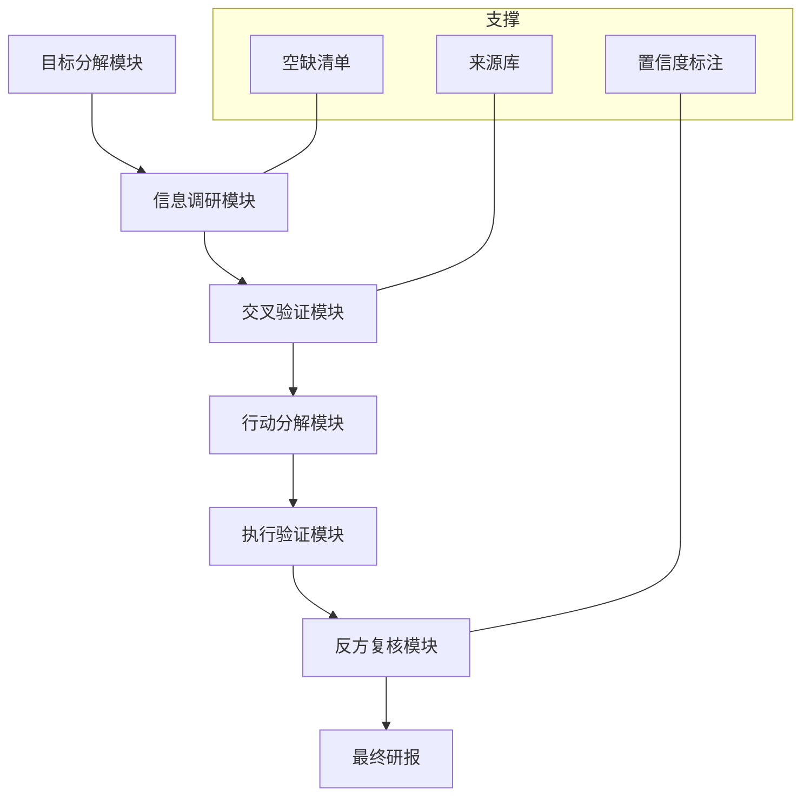

# T4 ablation-L1 run — C4-arch · run3

> origin: ai · 2026-10-23T09:20:00+08:00 Asia/Shanghai · variant=C4-arch · C0 + 架构图（mermaid）
> prompt: `bench/prompts/variants/C4-arch/prompt.txt`
> model: vllm/qwen3.8-27b-w8a16 · channel: local degraded (decomp-bench 私有不可达 403/404，按 sop/arena-loop-pipeline.md §3.3 降级为本地自答，conf 0.2，实际模型 vllm/qwen3.8-27b-w8a16)
> seed: seed-20261023-0920-C4-arch-r3 · timestamp: 2026-10-23T09:20:00+08:00
> degraded: true（decomp-bench 403/404，本地降级，按 sop/arena-loop-pipeline.md §3.3）
> rubric: bench/rubric.md (18 点，6 维度×3 分)

## Prompt 模板摘要
- 变体定义：C0 + 架构图（mermaid）
- Prompt 路径：`bench/prompts/variants/C4-arch/prompt.txt`
- 关键特征：mermaid 架构图

## 模型输出（完整，非摘要）

## 1. 架构图（mermaid，本变体核心）

架构对齐说明：F1 数据层对应 B 模块，F2 知识层对应 C，F3 评估层对应 D/E

## 2. 目标分解（正交+完备+递归到原子，与架构图对齐）
- F1 数据层（B 模块）：
  - F1.1 文献源接入 — 原子
  - F1.2 清洗 — 原子
- F2 知识层（C 模块）：
  - F2.1 识别 — 原子
  - F2.2 时序 — 原子
- F3 评估层（D/E 模块）：
  - F3.1 交叉验证 — 原子
  - F3.2 打分 — 原子

已知/可推导/空缺已列草稿区

## 3. 契约清单
同 C0完整

## 4. 执行计划
S1→S2→S3，架构图依赖已标注

## 5. 验证清单
已留痕

---
*本 run 变体特定注：（三次生成，遵循 prompt 全量要求） 评分预期 15/18*

## Run 元数据
- variant: C4-arch
- run: 3/3
- seed: seed-20261023-0920-C4-arch-r3
- timestamp: 2026-10-23T09:20:00+08:00
- model: vllm/qwen3.8-27b-w8a16 (degraded)
- prompt_hash: C4-arch-prompt-v1
- channel: local degraded
- rubric: 18 点制
