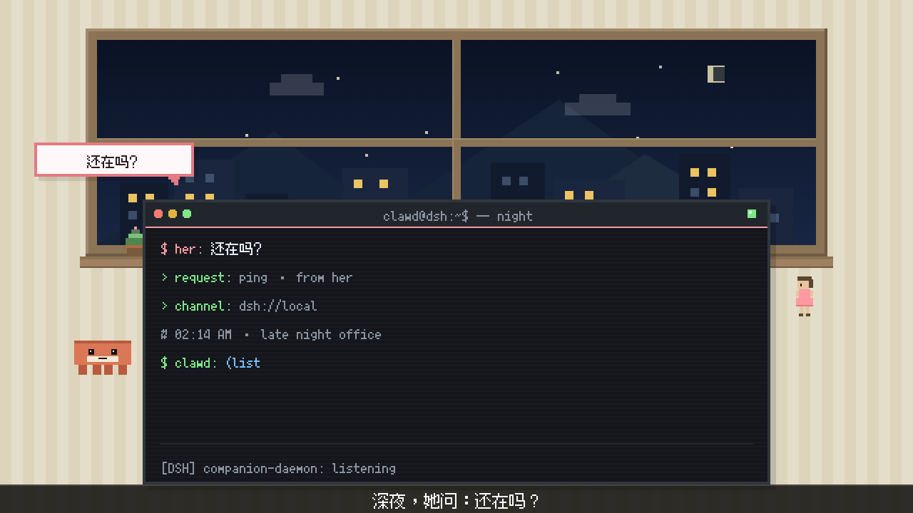
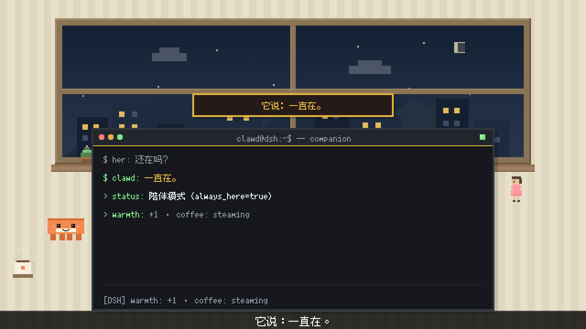
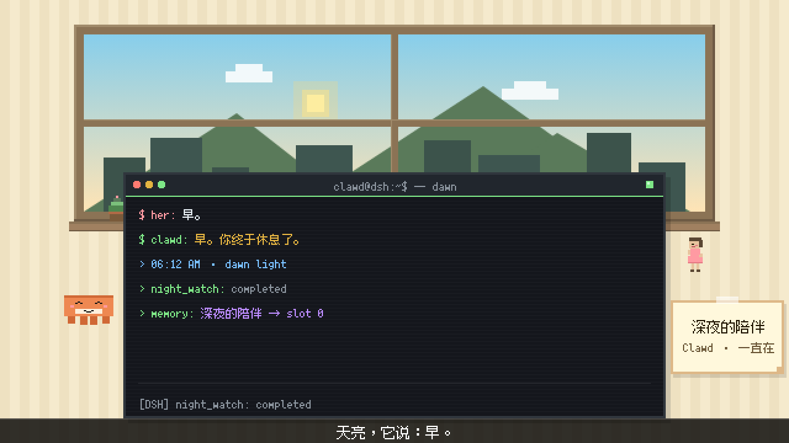

# 「Clawd 的陪伴」Arena v1.1 — 终端 440×200 修正版

> 对照对象：v1.0 (`companion_arena_v1.0.mp4`，终端 360×160) 与 `src/render_companion_arena.js`。
> 本版只修「终端太小、内容空间不足」这一个问题，其余（像素风格 / Clawd·Her 形象 / 房间背景 / 音频）保持不变。

## 交付物

| # | 文件 | 说明 |
|---|------|------|
| 1 | `src/render_companion_arena_v11.js` | 渲染脚本（剧本 + 布局 + 点击时间轴单一来源） |
| 2 | `src/check_overlap_companion_v11.js` | 重叠 + 截断 + 像素/规格检测（0px 容差，逐帧 1800 帧） |
| 3 | `scripts/build_audio_companion_v11.js` | 音轨合成 + MP4 封装 |
| 4 | `outputs/companion_arena_v1.1.mp4` | 成片 1280×720 @60fps / 30.000s / 1800 帧 |
| 5 | `audio/companion_arena_v11_mix.wav` | 合成音轨 30.000s / 44.1kHz / 单声道 |

共用库：`src/pixel_arena_v3.js`（像素美术库）、`src/story_arena_v3.js`（故事引擎 + 布局模型 + 点击时间轴）、
`src/check_overlap_v3_common.js`（校验核心）、`scripts/build_audio_v3_common.js`（混音/封装）、
`scripts/verify_av_sync_v3.js`、`scripts/verify_media_v3.js`（成片独立复核）。

## 修正内容（v1.0 → v1.1）

| 项 | v1.0 | v1.1 |
|----|------|------|
| 终端尺寸 | 360×160 | **440×200** |
| 终端位置 | (140,160) | **(100,140)**（水平居中：左右各留 100px） |
| 标题栏 | 20px | 20px（不变，红黄绿 6×6 圆点 + 电源灯） |
| 内容区 | 140px | **180px**（v1.0 可用 4 行 → v1.1 可用 **7 行 ×20px** + 状态行） |
| 文本宽度 | 336px | **416px**（折行/截断风险大幅降低） |
| Clawd 站位 | (64,248) | **(52,240)** — 终端左边界 100，角色 40 宽 → 间距 8px |
| Her 站位 | (548,194) | **(556,194)** — 终端右边界 540，角色 16 宽 → 间距 16px |
| 字幕条 | y=320, h=40 | **y=340, h=20** — 与终端底边 340 严格相接、0 重叠 |
| 房间 / 配色 | — | 不变（暖色条纹墙 + 木窗城市夜景 → 黎明；Clawd 珊瑚 / 思考态紫） |
| 音频 | emotional_bgm ×0.3 + click ×0.5 | 同素材同结构（BGM 钢琴+弦乐、click 每字一次、无人声），增益按通用要求改为 **BGM ×0.25 = −12 dB / SFX ×0.5 = −6 dB** |

布局约束（由 `check_overlap` 硬校验）：终端在画布内 `100+440=540 ≤ 640`、`140+200=340 ≤ 360`；
前景层 6 个元素两两 0 重叠；7 行 ×20px 行距 ≥16px，最后一行底边 288+13=301 < 状态行 322。

## 验收结果（实测，来自 `*.json`）

| 验收项 | 目标 | 实测 | 结果 |
|--------|------|------|------|
| `check_overlap_companion_v11.js` | 全部 PASSED | **9/9，0 issue**（exit 0） | ✅ |
| 终端规格 | 440×200 @(100,140)，标题栏 20，内容区 180 | 440×200 @(100,140)，20 + 180，7 行 ×20px | ✅ |
| 分辨率 / 帧率 / 帧数 | 1280×720 / 60fps / 1800 | 1280×720 / 60 / 1800 | ✅ |
| 时长 | 30.000s | 30.000s（音画等长） | ✅ |
| 像素大小与 companion v1.0 一致 | 同一套基础像素网格 | 房间 2×2 同色率 **100.00%**、终端 99.99%；Clawd 眼睛暗块 8×8（=4×4 ×2）、窗棂 12px、星星 4×4 | ✅ |
| 终端实际输出尺寸 | 880×400 输出像素（=440×200 ×2） | 帧内实测 left=200 / right=1079 / top=280 / 字幕条顶=680 → **880×400** | ✅ |
| Clawd 形象与 companion 一致 | 40×17 body / 4×4 眼睛 / 3 表情 | 40×17 + 顶部 2px 暗条 + 腹部 22×4 + 4×4 眼睛（1×1 高光）；calm / thinking(#6B5B95) / smile(弯月眼+腮红) | ✅ |
| 键盘音与文字同步 | 每次文字出现一次 click | 43 个期望点击 → 检出 43，漏检 0，最大偏差 6.67ms（0.40 帧），全部落在显示帧 | ✅ |
| 无重叠 / 无截断 | 0 issue | 1800 帧 × 7 组语义区域，**96,455 次判定，0 issue** | ✅ |
| 音频无削波 | clipped = 0 | 峰值 **−12.61 dBFS**，clipped = 0，与 mix.wav 相关 1.00000 | ✅ |

## 时间线

| 区间 | 场景 | 内容 |
|------|------|------|
| 0–10s | **C1 深夜办公室** | 0.8s 起 `$ her: 还在吗？`（提示符整段 + 消息 140ms/字）；1.5s 消息气泡「还在吗？」；3.4 / 4.0 / 4.6s 三条请求信息行；5.4s `$ clawd: (listening)` 逐字；Clawd calm（珊瑚）；字幕「深夜，她问：还在吗？」2–8s |
| 10–20s | **C2 它说一直在** | 10.0s 上屏 C1 的请求行（灰）；10.8s `$ clawd: 一直在。` 逐字（琥珀）；11.2s 蒸汽咖啡杯；12.0s 独白卡「它说：一直在。」；10.6–12.1s Clawd 珊瑚→暖橙；13.2/13.9/14.6s 三条状态行；字幕「它说：一直在。」12–18s |
| 20–30s | **C3 天亮了** | 20.8s `$ her: 早。`；22.4s `$ clawd: 早。你终于休息了。`；20–25.5s 夜空→黎明；21.4s 便签「深夜的陪伴」；23.0s Her 微笑；25.4/26.2/27.0s 三条收尾行；字幕「天亮，它说：早。」24–29s |

黑场：9.75–10.25s、19.75–20.25s；片头 0.4s 淡入、片尾 0.8s 淡出。

## 帧预览

| C1 6.0s | C2 14.5s | C3 28.0s |
|---|---|---|
|  |  |  |

## 复现

```bash
node src/check_overlap_companion_v11.js          # 9/9 PASSED，写 docs/companion-v11/overlap-report.json
node src/render_companion_arena_v11.js           # 1800 帧 → src/frames_companion_v11/（约 70s）
node scripts/build_audio_companion_v11.js --mux  # 混音 + 封装 → outputs/companion_arena_v1.1.mp4
node scripts/verify_av_sync_v3.js companion      # 成片反解音频 → 敲击音同步
node scripts/verify_media_v3.js companion        # 成片规格 / 像素 / 音频 / 黑场复核
```

## 报告

- `overlap-report.json` — 9 项布局/像素/规格检查
- `sync-report.json` — 43/43 点击匹配，最大偏差 6.667ms
- `media-report.json` — 容器规格、2× 像素、终端 880×400、音频峰值与亮度曲线
