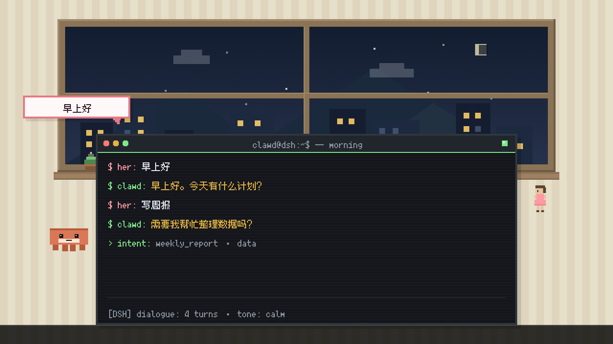
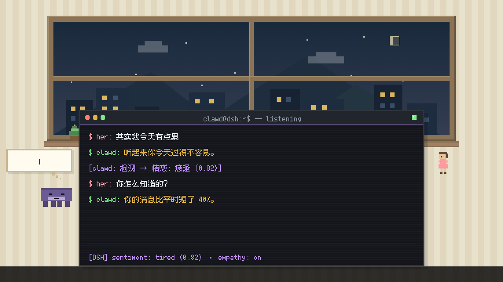
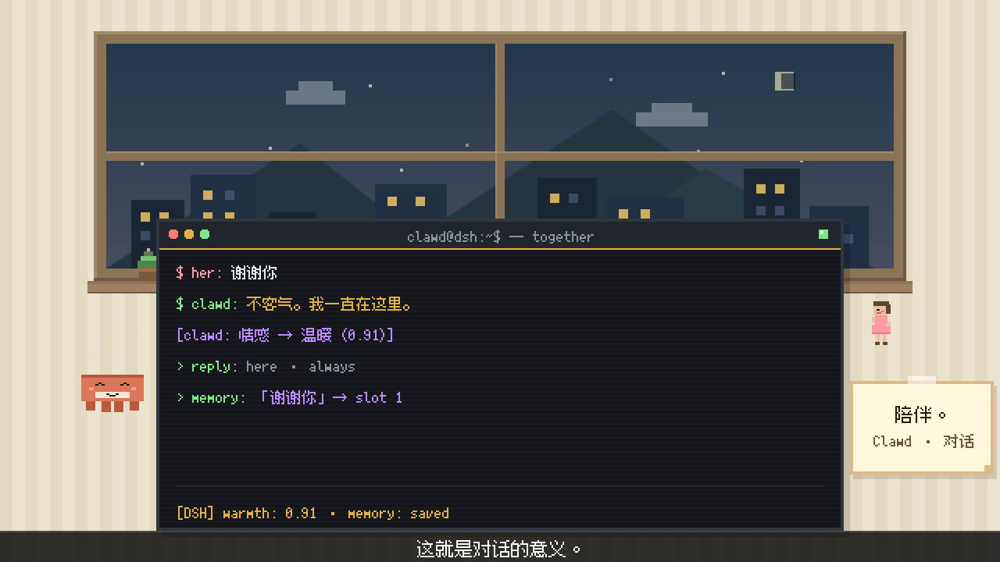

# 「Clawd 的对话」Arena v1.0

> 主题：Clawd 和 Her 的日常对话，展示 AI 如何理解人类语言。
> 30s / 1280×720 @60fps / 1800 帧，像素标准见 SOP 05 §5。

## 交付物

| # | 文件 | 说明 |
|---|------|------|
| 1 | `src/render_dialogue_arena.js` | 渲染脚本（三场景剧本 + 布局 + 点击时间轴） |
| 2 | `src/check_overlap_dialogue.js` | 重叠 + 截断 + 像素/规格检测（0px 容差，逐帧 1800 帧） |
| 3 | `scripts/build_audio_dialogue.js` | 音轨合成 + MP4 封装 |
| 4 | `outputs/dialogue_arena_v1.0.mp4` | 成片 1280×720 @60fps / 30.000s |
| 5 | `audio/dialogue_arena_mix.wav` | 合成音轨 30.000s / 44.1kHz / 单声道 |

## 场景设计

| 区间 | 场景 | 终端内容 |
|------|------|----------|
| 0–10s | **D1 早安** | `$ her: 早上好`（0.8s）→ `$ clawd: 早上好。今天有什么计划？`（2.0s）→ `$ her: 写周报`（4.8s）→ `$ clawd: 需要我帮忙整理数据吗？`（5.9s）→ `> intent: weekly_report · data`（8.3s）。Clawd calm；1.4s 消息气泡「早上好」 |
| 10–20s | **D2 理解** | `$ her: 其实我今天有点累`（10.4s）→ `$ clawd: 听起来你今天过得不容易。`（12.0s）→ `[clawd: 检测 → 情感: 疲惫 (0.82)]`（14.2s）→ `$ her: 你怎么知道的？`（15.2s）→ `$ clawd: 你的消息比平时短了 40%。`（16.8s）。Clawd calm→thinking(12.6s)；思考泡泡 `...`(13.6s) → `?`(15.2s) → `!`(17.6s) |
| 20–30s | **D3 陪伴** | `$ her: 谢谢你`（20.8s）→ `$ clawd: 不客气。我一直在这里。`（22.2s）→ `[clawd: 情感 → 温暖 (0.91)]`（25.4s）→ `> reply: here · always`（26.6s）→ `> memory: 「谢谢你」→ slot 1`（27.4s）。Clawd smile；26.0s 便签「陪伴。」；27.6s 起 Clawd 身侧温暖星尘（x∈[56,88)、y∈[206,232)，与终端/气泡 0 重叠） |

字幕（12px · 160ms/字）：「对话从早安开始。」2–8s /「它学会了倾听。」12–18s /「这就是对话的意义。」24–29s。
黑场：9.75–10.25s、19.75–20.25s；片头 0.4s 淡入、片尾 0.8s 淡出。

节奏说明：对话行采用「提示符整段出现（1 次 click）+ 消息 140ms/字（每字 1 次 click）」，
两个说话人交替时串行排布（前一行打完 0.1s 后再起下一行），保证阅读节奏与敲击音一一对应。

## 技术规格

| 项 | 值 |
|----|----|
| 画布 | BW=640 BH=360 SCALE=2 → 1280×720 @60fps，1800 帧 |
| 终端 | 440×200 @(100,140)，标题栏 20 + 内容区 180（5 行/场景，行距 20px） |
| 字体 | Fusion Pixel 10px（终端）/ 12px（字幕、便签），二值化无灰边 |
| 角色 | Clawd 40×17（calm / thinking / smile），Her 16×28（stand / smile） |
| 房间 | 暖色条纹墙 + 木窗城市夜景（dawn 0.06 → 0.20 逐场景变亮）+ 窗台盆栽 |
| 字幕条 | y=340, h=20 |

## 验收结果（实测）

| 验收项 | 目标 | 实测 | 结果 |
|--------|------|------|------|
| `check_overlap_dialogue.js` | 全部 PASSED | **9/9，0 issue** | ✅ |
| 分辨率 / 帧率 / 帧数 | 1280×720 / 60fps / 1800 | 1280×720 / 60/1 / 1800 | ✅ |
| 时长 | 30.000s | 30.000s | ✅ |
| 像素大小与 companion 一致 | 同一套基础像素网格 | 房间 100.00% / 终端 99.99% 的 2×2 同色率；眼睛 8×8；窗棂 12px；终端 880×400 输出像素 | ✅ |
| Clawd 形象与 companion 一致 | 40×17 + 4×4 眼睛 + 3 表情 | 通过（D1 calm / D2 thinking / D3 smile） | ✅ |
| 键盘音与文字同步 | 每次文字出现一次 click | **92/92 匹配**，漏检 0，最大偏差 6.67ms（0.40 帧） | ✅ |
| 无重叠 / 无截断 | 0 issue | 1800 帧 × 8 组语义区域，**95,400 次判定，0 issue**（星尘与前景层跨组校验） | ✅ |
| 音频无削波 | clipped = 0 | 峰值 −11.99 dBFS，clipped = 0，与 mix.wav 相关 1.00000 | ✅ |

## 帧预览

| D1 9.0s（早安） | D2 19.0s（理解） | D3 28.0s（陪伴） |
|---|---|---|
|  |  |  |

## 复现

```bash
node src/check_overlap_dialogue.js
node src/render_dialogue_arena.js
node scripts/build_audio_dialogue.js --mux
node scripts/verify_av_sync_v3.js dialogue
node scripts/verify_media_v3.js dialogue
```
