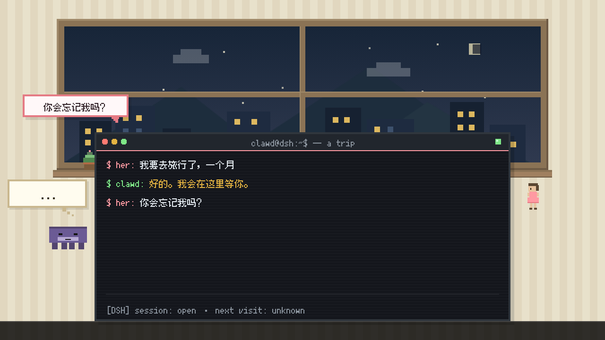
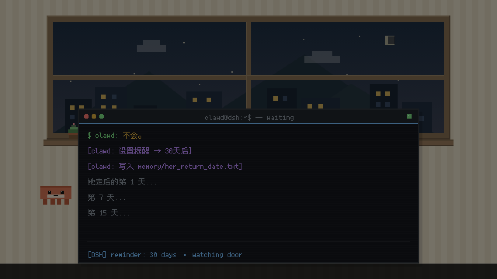
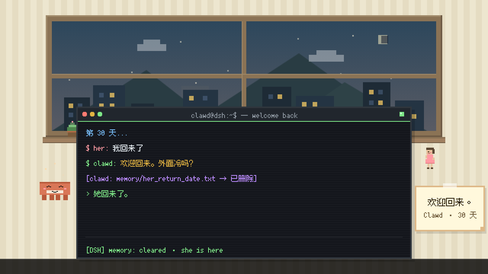

# 「Clawd 的告别」Arena v1.0

> 主题：Clawd 和 Her 的告别，但不是永别。
> 30s / 1280×720 @60fps / 1800 帧，像素标准见 SOP 05 §5。

## 交付物

| # | 文件 | 说明 |
|---|------|------|
| 1 | `src/render_farewell_arena.js` | 渲染脚本（三场景剧本 + 布局 + 点击时间轴） |
| 2 | `src/check_overlap_farewell.js` | 重叠 + 截断 + 像素/规格检测（0px 容差，逐帧 1800 帧） |
| 3 | `scripts/build_audio_farewell.js` | 音轨合成 + MP4 封装 |
| 4 | `outputs/farewell_arena_v1.0.mp4` | 成片 1280×720 @60fps / 30.000s |
| 5 | `audio/farewell_arena_mix.wav` | 合成音轨 30.000s / 44.1kHz / 单声道 |

## 场景设计

| 区间 | 场景 | 终端内容 |
|------|------|----------|
| 0–10s | **F1 决定** | `$ her: 我要去旅行了，一个月`（0.8s）→ `$ clawd: 好的。我会在这里等你。`（3.8s）→ `$ her: 你会忘记我吗？`（7.0s）→ `> thinking...`（8.6s）。Clawd calm→thinking(8.0s)；7.0s 消息气泡「你会忘记我吗？」；8.2s 思考泡泡 `...` → 9.0s `?`；字幕「一个月，对它来说是多久？」2–8s |
| 10–20s | **F2 等待** | `$ clawd: 不会。`（10.6s）→ `[clawd: 设置提醒 → 30天后]`（12.4s）→ `[clawd: 写入 memory/her_return_date.txt]`（13.4s）→ `她走后的第 1 天...`（15.0s）→ `第 7 天...`（16.2s）→ `第 15 天...`（17.4s）。Her 离场；**12.0–19.0s 画面在 7s 内缓慢变暗到 50%**（时间流逝感）；字幕「它记得。」13–19s |
| 20–30s | **F3 回来** | `第 30 天...`（20.5s）→ `$ her: 我回来了`（21.6s）→ `$ clawd: 欢迎回来。外面冷吗？`（23.0s）→ `[clawd: memory/her_return_date.txt → 已删除]`（25.6s）→ `> 她回来了。`（27.0s）。Clawd thinking→smile(23.0s)；Her smile(22.4s)；25.8s 便签「欢迎回来。」；26.2s 起温暖星尘；字幕「告别不是结束。」24–29s |

黑场：9.75–10.25s、19.75–20.25s；片头 0.4s 淡入、片尾 0.8s 淡出。
F2 的「逐渐变暗」是场景内的叠加暗层（不是黑场），因此 19.0s 采样亮度仍 > 10，转场检查按此判定。

## 技术规格

| 项 | 值 |
|----|----|
| 画布 | BW=640 BH=360 SCALE=2 → 1280×720 @60fps，1800 帧 |
| 终端 | 440×200 @(100,140)，标题栏 20 + 内容区 180（最多 6 行/场景） |
| 字体 | Fusion Pixel 10px（终端）/ 12px（字幕、便签），二值化无灰边 |
| 角色 | Clawd 40×17（calm / thinking / smile），Her 16×28（stand / smile，F2 离场） |
| 房间 | 暖色条纹墙 + 木窗城市（dawn 0.10 → 0.16 → 0.28）+ 窗台盆栽 |
| 字幕条 | y=340, h=20 |

## 验收结果（实测）

| 验收项 | 目标 | 实测 | 结果 |
|--------|------|------|------|
| `check_overlap_farewell.js` | 全部 PASSED | **9/9，0 issue** | ✅ |
| 分辨率 / 帧率 / 帧数 | 1280×720 / 60fps / 1800 | 1280×720 / 60/1 / 1800 | ✅ |
| 时长 | 30.000s | 30.000s | ✅ |
| 像素大小与 companion 一致 | 同一套基础像素网格 | 房间 100.00% / 终端 99.99% 的 2×2 同色率；眼睛 8×8；窗棂 12px；终端 880×400 输出像素 | ✅ |
| Clawd 形象与 companion 一致 | 40×17 + 4×4 眼睛 + 3 表情 | 通过（F1 thinking / F2 calm / F3 smile） | ✅ |
| 键盘音与文字同步 | 每次文字出现一次 click | **56/56 匹配**，漏检 0，最大偏差 6.67ms（0.40 帧） | ✅ |
| 无重叠 / 无截断 | 0 issue | 1800 帧 × 8 组语义区域，**83,994 次判定，0 issue** | ✅ |
| 音频无削波 | clipped = 0 | 峰值 −13.25 dBFS，clipped = 0，与 mix.wav 相关 1.00000 | ✅ |

## 帧预览

| F1 8.5s（决定） | F2 19.0s（等待） | F3 29.0s（回来） |
|---|---|---|
|  |  |  |

## 复现

```bash
node src/check_overlap_farewell.js
node src/render_farewell_arena.js
node scripts/build_audio_farewell.js --mux
node scripts/verify_av_sync_v3.js farewell
node scripts/verify_media_v3.js farewell
```
