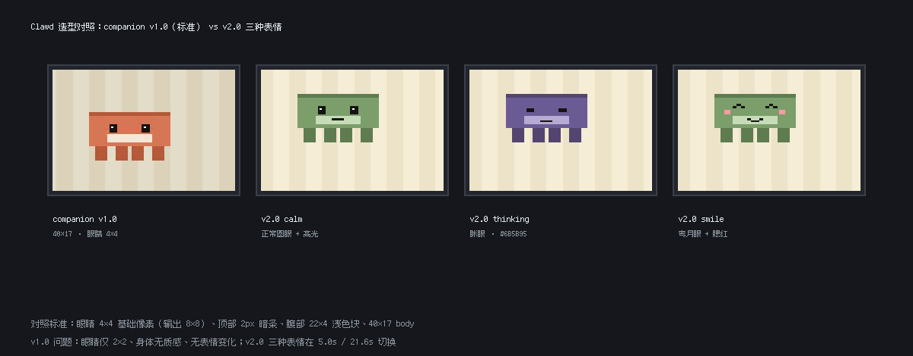
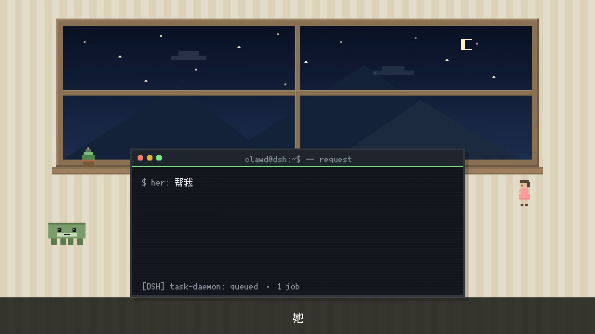
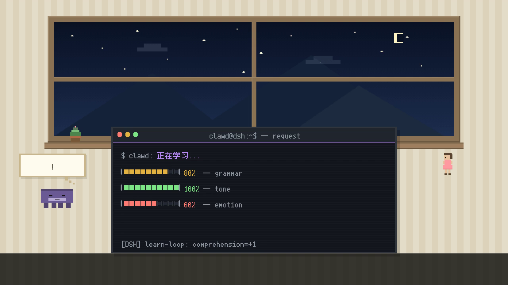
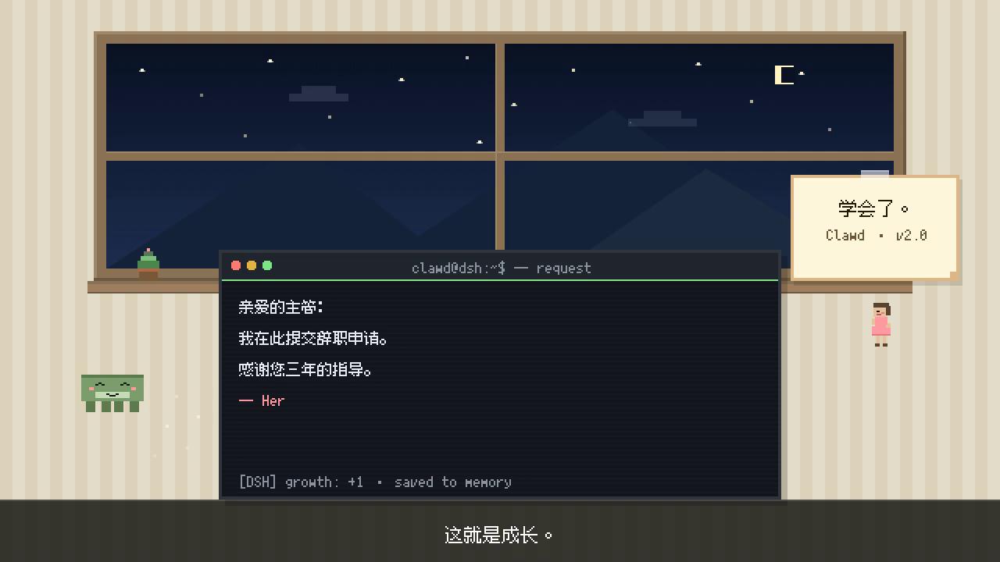

# 「Clawd 的学习」Arena v2.0

> v1.0 的两个问题（Clawd 形象、像素感）在本版修正；对照标准 = `companion_arena_v1.0.mp4`
> 与参考仓库 `dd2003-460/d1-video-recreation` 的 `src/render_companion_arena.js`。

## 交付物

| # | 文件 | 说明 |
|---|------|------|
| 1 | `src/pixel_arena_v2.js` | 共用像素美术库（房间/终端/Clawd/Her/气泡/便签/进度条/文字/时间轴） |
| 2 | `src/render_learning_arena_v2.js` | 渲染脚本（1800 帧，剧本+布局+点击时间轴单一来源） |
| 3 | `src/check_overlap_learning_v2.js` | 重叠 + 截断 + 像素标准检测（0 容差，1800 帧） |
| 4 | `scripts/build_audio_learning_v2.js` | 音轨合成 + MP4 封装 |
| 5 | `scripts/verify_av_sync_v2.js` | 从成片反解音频，独立验证敲击音 ↔ 文字同步 |
| 6 | `scripts/verify_media_v2.js` | 成片规格/像素/音频/黑场复核（写出 `media-report.json`） |
| 7 | `outputs/learning_arena_v2.0.mp4` | 最终视频 1280×720 @60fps / 30.000s / 1800 帧 |
| 8 | `audio/learning_arena_v2_mix.wav` | 合成音轨 30.000s / 44.1kHz / 单声道 |

## 验收结果

| 验收项 | 目标 | 实测 | 结果 |
|--------|------|------|------|
| `check_overlap_learning_v2.js` | 全部 PASSED | **8/8 checks PASSED，0 issue**（exit 0） | ✅ |
| 分辨率 / 帧率 / 帧数 | 1280×720 / 60fps / 1800 | 1280×720 / 60 fps / 1800 帧 | ✅ |
| 时长 | 30.000s | 30.000s（视频与音频等长） | ✅ |
| 编码 | h264 + aac | h264 High / yuv420p + aac LC 44.1kHz mono | ✅ |
| 像素大小与 companion 一致 | 同一套基础像素网格 | 解码帧 2×2 同色率：房间 100.00% / 终端 99.99%；Clawd 眼睛暗块 8×8（=4×4 基础像素 ×2）；窗棂 12px（=6px ×2）；星星 4×4（=2×2 ×2） | ✅ |
| Clawd 形象与 companion 一致 | 40×17 body / 4×4 眼睛 / 3 表情 | body 输出 80×30px（=40×17 ×2）；眼睛 4×4 + 1×1 高光；顶部 2px 暗条；腹部 22×4；calm / thinking(#6B5B95) / smile(弯月眼+腮红) | ✅ |
| 字体 | 10px Fusion Pixel | 终端 `FusionPixel10`（ASCII 5px / CJK 10px），字幕/便签 `FusionPixel12`，全部 alpha 阈值二值化（无灰边） | ✅ |
| 键盘敲击音与文字同步 | 每次文字出现一次 click | 71 个期望点击 → 检出 71 个 onset，漏检 0，最大偏差 6.67ms（0.40 帧），全部时间戳落在显示帧上 | ✅ |
| 无重叠 / 无截断 | 0 issue | 1800 帧 × 8 组语义区域，112,380 次判定，0 issue | ✅ |
| 音频无削波 | clipped = 0 | 峰值 −12.93 dBFS，clipped = 0，与成片 AAC 解码后相关 1.00000 | ✅ |

## 时间线（帧级）

| 区间 | 场景 | 内容 |
|------|------|------|
| 0–10s | **L1 她的请求** | 0.8s 起逐字打字 `$ her: 帮我写一封辞职信`（140ms/字，4.18s 打完）；2.2s 消息气泡「帮我写一封辞职信」；3.3s `> request received.`；3.9s `> task: write_resignation_letter`；5.0–5.6s Clawd 绿→紫（calm→thinking）；5.2s 思考泡泡「...」；字幕「她给它一个任务。」2–8s |
| 10–20s | **L2 学习过程** | 10.4s `$ clawd: 正在学习...`（紫色，1.82s 打完）；13.0s grammar 进度条 0→80%（黄）；14.5s tone 100%（绿）；16.0s emotion 60%（红）；12.2s 泡泡「?」；15.2s 泡泡「!」；字幕「它在学习理解。」12–18s |
| 20–30s | **L3 成长** | 20.5s `亲爱的主管：` → 21.5s `我在此提交辞职申请。` → 23.1s `感谢您三年的指导。` → 24.6s `— Her`（逐字 140ms）；24.2s 窗台便签「学会了。」；21.6s Clawd smile（腮红+弯月眼）；23.0s Her 微笑；23.2s 起成长粒子；字幕「这就是成长。」24–29s |

黑场转场：9.75–10.25s、19.75–20.25s（各 30 帧）；片头 0.4s 淡入、片尾 0.8s 淡出。

## 与 v1.0 的差异（修正说明）

1. **Clawd 形象**：v1.0 的眼睛只有 2×2、身体是纯色块、没有表情变化。v2.0 按
   `render_companion_arena.js#drawClawd()` 重写：40×17 body + 顶部 2px 暗条 + 腹部 22×4
   浅色块 + 4×4 眼睛（1×1 白色高光）+ 4 条 6×7 腿；`calm` / `thinking`（#6B5B95 眯眼）/
   `smile`（弯月眼 + 粉色腮红 + 微笑弧）三种表情，另备 `curious` / `proud` 供升级篇使用。
2. **像素感**：v1.0 的文字用 14px 字形直接栅格化，出灰边、观感"过清"。v2.0 全线回到
   基础画布整像素：文字逐字形 alpha 阈值二值化后按整像素合成（无抗锯齿），
   所有图形元素坐标取整，最终整帧 2× 最近邻放大——与 companion 帧的
   "星星 2×2 / 窗棂 6×6 / 眼睛 4×4"完全同一套网格。`check_overlap_v2_common.js`
   的 `像素放大` 与 `文本二值化` 两项会逐帧/逐样本硬校验这一点。



## 参考素材

| 素材 | 位置 | 用途 |
|------|------|------|
| `companion_arena_v1.0.mp4` | `dd2003-460/d1-video-recreation` → `outputs/`（像素/美术标准） | 像素大小与角色造型的比对基准 |
| `render_companion_arena.js` | 同上 → `src/` | `drawClawd()` / `drawHer()` / 房间与终端的造型标准 |
| `docs/refs/bili_v1/f_012.png`、`docs/refs/bili_v2/f_008.png` | 本仓库 | bilibili 原视频 Clawd 形象参考帧 |

参考视频未随本仓库分发（v1 整理时移出）。需要重新生成对照图或逐像素复测时：

```sh
gh api repos/dd2003-460/d1-video-recreation/contents/outputs/companion_arena_v1.0.mp4 \
  -H "Accept: application/vnd.github.raw" > /tmp/companion_arena_v1.0.mp4
ffmpeg -y -i /tmp/companion_arena_v1.0.mp4 -vf "select=eq(n\,120)" -vframes 1 /tmp/cmp_frame.png
```

`scripts/verify_media_v2.js` 不依赖该视频：它把标准值（眼睛 8×8、窗棂 12px、2×2 同色率）硬编码，
直接对成片解码结果断言，因此离线也能复验。

## 可复现

```sh
npm ci

# 1) 布局/像素检测（0 issue 才退出 0）
node src/check_overlap_learning_v2.js

# 2) 渲染 1800 帧（默认 src/frames_learning_v2/，可用 FRAMES_DIR 覆盖）
FRAMES_DIR=/tmp/frames_learning_v2 node src/render_learning_arena_v2.js

# 3) 音轨 + 封装
FRAMES_DIR=/tmp/frames_learning_v2 node scripts/build_audio_learning_v2.js --mux

# 4) 独立复核：A/V 同步 + 成片规格
node scripts/verify_av_sync_v2.js learning
node scripts/verify_media_v2.js learning
```

帧 PNG 属于可再生中间产物，按 `.gitignore`（`frames_*/`）不进入 Git。

## 关键帧

| L1 4.0s | L2 18.0s | L3 27.0s |
|---|---|---|
|  |  |  |

## 机器可读报告

- `overlap-report.json`：8 项检查明细（几何/截断/像素/字体/造型/打字完整性）
- `media-report.json`：成片规格、像素标准实测值、音频峰值/削波/相关性、亮度曲线
- `sync-report.json`：期望点击 vs 检出 onset 的匹配结果
