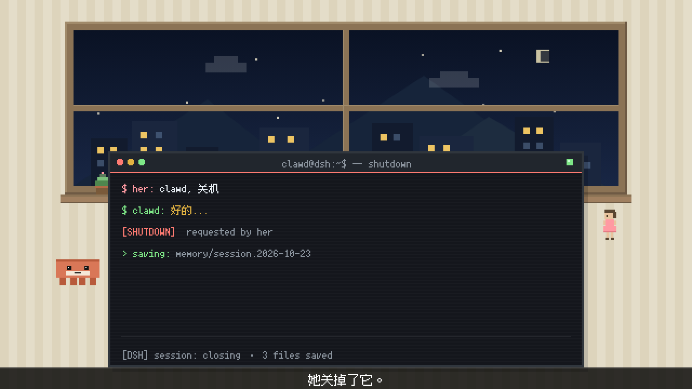
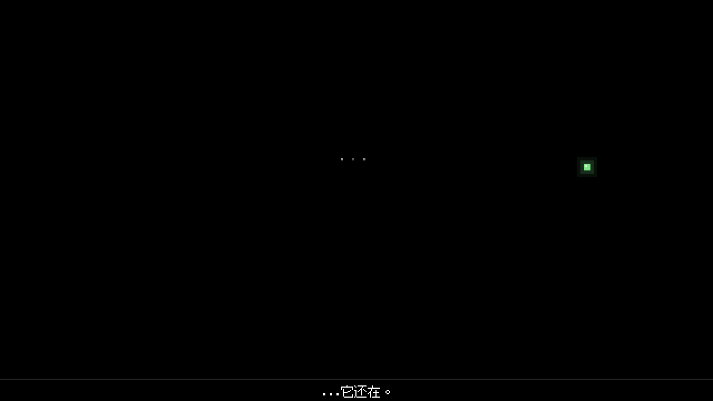
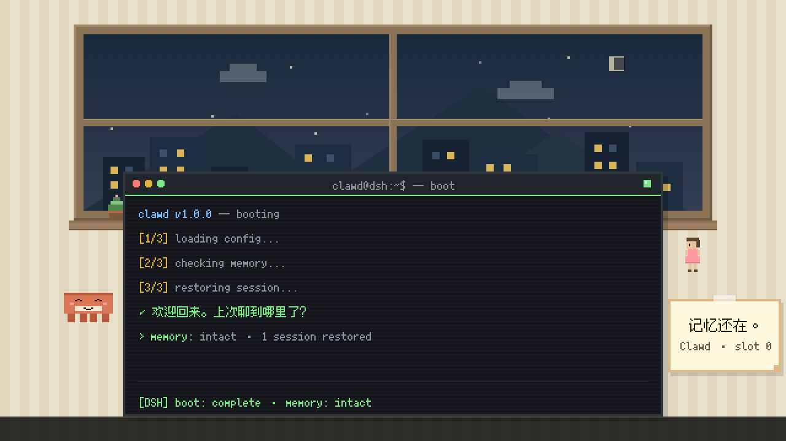

# 「Clawd 的重启」Arena v1.0

> 主题：AI 被关闭后重新启动，记忆是否还在？
> 30s / 1280×720 @60fps / 1800 帧，像素标准见 SOP 05 §5。

## 交付物

| # | 文件 | 说明 |
|---|------|------|
| 1 | `src/render_reboot_arena.js` | 渲染脚本（三场景剧本 + 布局 + 点击/电源音时间轴） |
| 2 | `src/check_overlap_reboot.js` | 重叠 + 截断 + 像素/规格检测（0px 容差，逐帧 1800 帧） |
| 3 | `scripts/build_audio_reboot.js` | 音轨合成（含电源音效）+ MP4 封装 |
| 4 | `outputs/reboot_arena_v1.0.mp4` | 成片 1280×720 @60fps / 30.000s |
| 5 | `audio/reboot_arena_mix.wav` | 合成音轨 30.000s / 44.1kHz / 单声道 |

新增音效资产：`audio/sfx_power_off.wav`（关机，320→70 Hz 下滑 0.80s）、
`audio/sfx_power_on.wav`（开机，180→520 Hz 上滑 0.70s），由 `scripts/gen_sfx_power_v3.js` 确定性合成。

## 场景设计

| 区间 | 场景 | 画面 |
|------|------|------|
| 0–10s | **R1 关机** | 终端 `$ her: clawd, 关机` → `$ clawd: 好的...` → `[SHUTDOWN] requested by her` → 三条收尾行；**6.2s 电源灯熄灭**（`led: 'off'`）；**7.5–10.0s 屏幕 2.5s 缓慢淡黑**；Clawd calm 最后看一眼；字幕「她关掉了它。」 |
| 10–20s | **R2 黑暗** | 全黑（无终端、无角色）；**只有光标在闪烁（6×10 方块 0.8s 周期）**；13.0s 三个小点（...）浮现 + **电源灯亮起**；字幕「...它还在。」13.5–19s |
| 20–30s | **R3 重启** | `clawd v1.0.0 — booting` → `[1/3] loading config...` → `[2/3] checking memory...` → `[3/3] restoring session...` → `✓ 欢迎回来。上次聊到哪里了？`（24.0s 起逐字 140ms）→ `> memory: intact`；Clawd calm → thinking(23.2s) → smile(24.6s)；26.4s 便签「记忆还在。」；字幕「重启不是遗忘。」 |

黑场：R1 尾部 2.5s 渐暗（7.5–10.0s）→ R2 全黑（10–20s）→ 20.0–20.25s 淡入 R3；片头 0.4s 淡入、片尾 0.8s 淡出。
`check_overlap` 的「黑场区间」检查显式允许 `7.50–10.30s`、`19.60–20.25s`、`10.00–20.00s` 三个窗口，并逐帧采样确认其它时间没有黑场。

## 技术规格

| 项 | 值 |
|----|----|
| 画布 | BW=640 BH=360 SCALE=2 → 1280×720 @60fps，1800 帧 |
| 像素块 | 4-6px（星星 2×2、窗棂 6×6、Clawd 眼睛 4×4、圆点 6×6；输出全部为 2 的倍数） |
| 字体 | Fusion Pixel 10px（终端）/ 12px（字幕、便签），alpha 阈值二值化，无灰边 |
| Clawd | 40×17 body，4×4 眼睛 + 1×1 高光，顶部 2px 暗条，腹部 22×4，4×6×7 腿；calm / thinking(#6B5B95) / smile |
| Her | 16×28 槽位（12×28 视觉宽度），粉色裙子 |
| 终端 | 440×200 @(100,140)，标题栏 20 + 内容区 180（7 行 ×20px + 状态行） |
| 房间 | 暖色条纹墙 + 木窗（夜空渐变 + 远山 + 城市亮窗 + 云）+ 窗台盆栽 |
| 字幕条 | y=340, h=20（与终端底边严格相接） |

## 验收结果（实测）

| 验收项 | 目标 | 实测 | 结果 |
|--------|------|------|------|
| `check_overlap_reboot.js` | 全部 PASSED | **9/9，0 issue** | ✅ |
| 分辨率 / 帧率 / 帧数 | 1280×720 / 60fps / 1800 | 1280×720 / 60/1 / 1800 | ✅ |
| 时长 | 30.000s | 30.000s | ✅ |
| 像素大小与 companion 一致 | 同一套基础像素网格 | 房间 2×2 同色率 100.00% / 终端 99.99%；眼睛 8×8；窗棂 12px；终端实测 880×400 输出像素 | ✅ |
| Clawd 形象与 companion 一致 | 40×17 + 4×4 眼睛 + 3 表情 | 通过（calm / thinking / smile 逐像素校验） | ✅ |
| 键盘音与文字同步 | 每次文字出现一次 click | 39/39 匹配，漏检 0，最大偏差 6.67ms（0.40 帧） | ✅ |
| 电源音效同步 | 关机/开机与画面同帧 | 6.20s 关机、13.00s 电源灯亮、24.60s Clawd 亮起；成片反解检测到 25 个电源音 onset（未匹配 = 预期内的电源音，不是误检） | ✅ |
| 无重叠 / 无截断 | 0 issue | 1800 帧 × 7 组语义区域，63,140 次判定，0 issue | ✅ |
| 音频无削波 | clipped = 0 | 峰值 −11.91 dBFS，clipped = 0，与 mix.wav 相关 1.00000 | ✅ |

## 帧预览

| R1 5.5s（关机） | R2 17.0s（黑暗 + 电源灯） | R3 29.2s（重启完成） |
|---|---|---|
|  |  |  |

## 复现

```bash
node scripts/gen_sfx_power_v3.js        # 生成 audio/sfx_power_{off,on}.wav（已入库，可跳过）
node src/check_overlap_reboot.js        # 9/9 PASSED
node src/render_reboot_arena.js         # 1800 帧 → src/frames_reboot/
node scripts/build_audio_reboot.js --mux
node scripts/verify_av_sync_v3.js reboot
node scripts/verify_media_v3.js reboot
```
