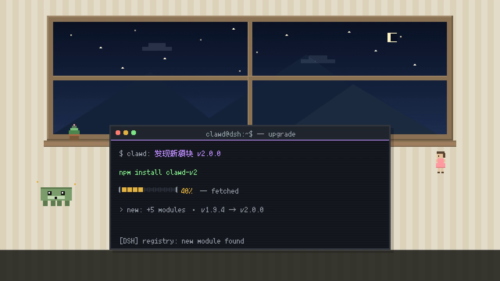
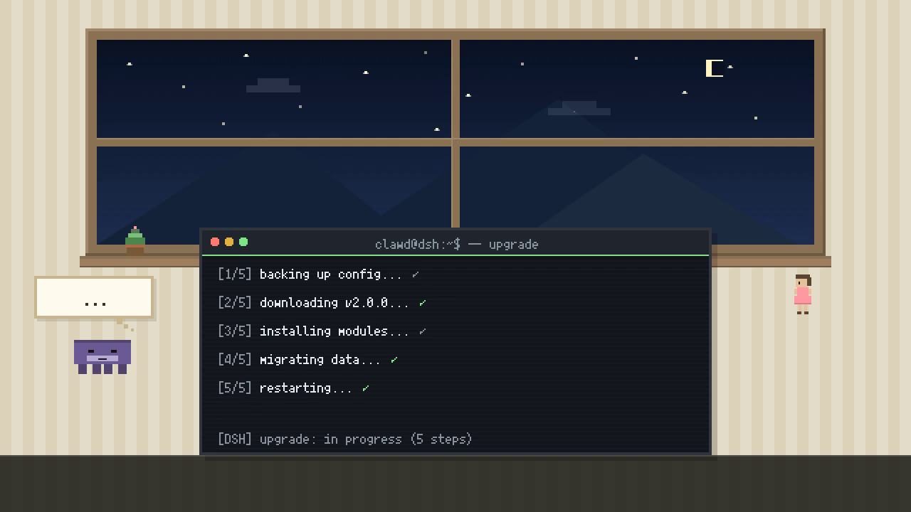
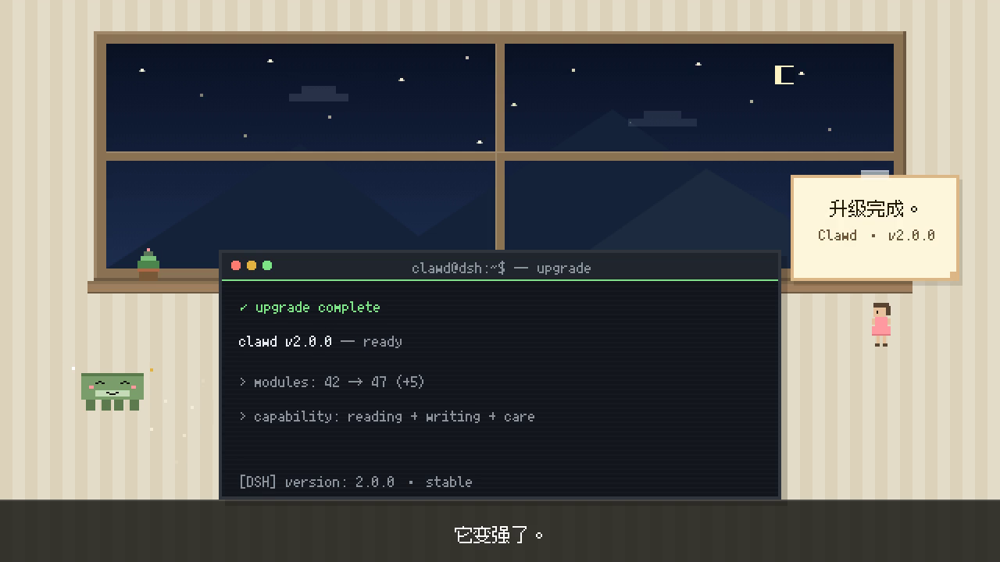

# 「Clawd 的升级」Arena v2.0

> 与 `learning_arena_v2.0` 共用同一套像素/角色/终端标准（对照 `companion_arena_v1.0.mp4`）。

## 交付物

| # | 文件 | 说明 |
|---|------|------|
| 1 | `src/render_upgrade_arena_v2.js` | 渲染脚本（1800 帧） |
| 2 | `src/check_overlap_upgrade_v2.js` | 重叠 + 截断 + 像素标准检测（0 容差，1800 帧） |
| 3 | `scripts/build_audio_upgrade_v2.js` | 音轨合成 + MP4 封装 |
| 4 | `outputs/upgrade_arena_v2.0.mp4` | 最终视频 1280×720 @60fps / 30.000s / 1800 帧 |
| 5 | `audio/upgrade_arena_v2_mix.wav` | 合成音轨 30.000s / 44.1kHz / 单声道 |

共用组件：`src/pixel_arena_v2.js`（房间/终端/角色/便签/进度条/文字/时间轴）、
`src/check_overlap_v2_common.js`（校验核心）、`scripts/build_audio_v2_common.js`（混音/封装）。

## 验收结果

| 验收项 | 目标 | 实测 | 结果 |
|--------|------|------|------|
| `check_overlap_upgrade_v2.js` | 全部 PASSED | **8/8 checks PASSED，0 issue**（exit 0） | ✅ |
| 分辨率 / 帧率 / 帧数 | 1280×720 / 60fps / 1800 | 1280×720 / 60 fps / 1800 帧 | ✅ |
| 时长 | 30.000s | 30.000s | ✅ |
| 编码 | h264 + aac | h264 High / yuv420p + aac LC 44.1kHz mono | ✅ |
| 像素大小与 companion 一致 | 同一套基础像素网格 | 解码帧 2×2 同色率：房间 100.00% / 终端 100.00%；眼睛暗块 8×8；窗棂 12px | ✅ |
| Clawd 形象 | 40×17 body / 4×4 眼睛 / 表情 | calm → curious(5×5 大眼) → thinking(#6B5B95) → smile → proud(挺胸+星光) | ✅ |
| 字体 | 10px Fusion Pixel | 终端 `FusionPixel10`，字幕/便签 `FusionPixel12`，二值化无灰边 | ✅ |
| 键盘敲击音与文字同步 | 每次文字出现一次 click | 192 个期望点击 → 检出 192 个 onset，漏检 0，最大偏差 6.67ms（0.40 帧） | ✅ |
| 无重叠 / 无截断 | 0 issue | 1800 帧 × 7 组语义区域（含粒子/星光），124,662 次判定，0 issue | ✅ |
| 音频无削波 | clipped = 0 | 峰值 −10.65 dBFS，clipped = 0，与成片 AAC 解码后相关 1.00000 | ✅ |

## 时间线（帧级）

| 区间 | 场景 | 内容 |
|------|------|------|
| 0–10s | **U1 新发现** | 0.8s 起逐字打字 `$ clawd: 发现新模块 v2.0.0`（紫，3.92s 打完）；2.6s Clawd → curious（5×5 大眼）+ 头顶星光；3.9s `npm install clawd-v2`（2.10s 打完）；6.9s 进度条 0→40%（黄）；8.0s 标签 `40% — fetched`；8.2s `> new: +5 modules · v1.9.4 → v2.0.0`；字幕「它发现了新版本。」2–8s |
| 10–20s | **U2 升级过程** | 5 步日志错峰滚动：`[1/5] backing up config...` 10.2s → `[2/5] downloading v2.0.0...` 11.75s → `[3/5] installing modules...` 13.3s → `[4/5] migrating data...` 14.85s → `[5/5] restarting...` 16.4s（70ms/字，模拟真实滚动日志）；每步打完 0.15s 后行尾打绿色 ✓；13.3–18.4s Clawd thinking；18.4s 泡泡「!」；字幕「升级中...」12–18s |
| 20–30s | **U3 完成** | 20.3s `✓ upgrade complete`（绿，2.52s 打完）；22.9s `clawd v2.0.0 — ready`（2.24s）；24.2s 窗台便签「升级完成。」；23.0s Clawd proud（挺胸 + 星光）；25.9s `> modules: 42 → 47 (+5)`；26.5s `> capability: reading + writing + care`；字幕「它变强了。」24–29s |

黑场转场：9.75–10.25s、19.75–20.25s；片头 0.4s 淡入、片尾 0.8s 淡出。

## 与 spec 的差异及处理

1. **U2 日志节奏**：spec 未规定日志打字速度。若全部按 140ms/字 串行，5 行共需约 20s，
   会整体越出 10s 场景。本版采用真实安装日志形态——70ms/字、每行错峰 1.55s 滚动，
   5 行在 17.4s 全部完成，留 2.4s 展示 5 个绿色 ✓。`check_overlap` 的"打字完整性"
   会校验每行在场景结束前 100% 打完。
2. **进度条位置**：`[████░░░░░░] 40%` 在 E1 用 10 格 × 6px（+1px 间隙）绘制，格宽
   直接落在基础像素网格上（输出 12px 方块），不使用字体方块字符——避免字形宽度
   不同导致的像素错位。
3. **终端 vs 房间**：沿用 companion 的"暖色房间 + 小终端 360×160 + 房间内角色"，
   终端放在 (140,160)，窗台与角色互不遮挡（`check_overlap` 0 容差互斥校验）。

## 可复现

```sh
node src/check_overlap_upgrade_v2.js
FRAMES_DIR=/tmp/frames_upgrade_v2 node src/render_upgrade_arena_v2.js
FRAMES_DIR=/tmp/frames_upgrade_v2 node scripts/build_audio_upgrade_v2.js --mux
node scripts/verify_av_sync_v2.js upgrade
node scripts/verify_media_v2.js upgrade
```

## 关键帧

| U1 8.5s | U2 18.0s | U3 27.0s |
|---|---|---|
|  |  |  |

## 机器可读报告

- `overlap-report.json` / `media-report.json` / `sync-report.json`（口径同 learning v2.0）
