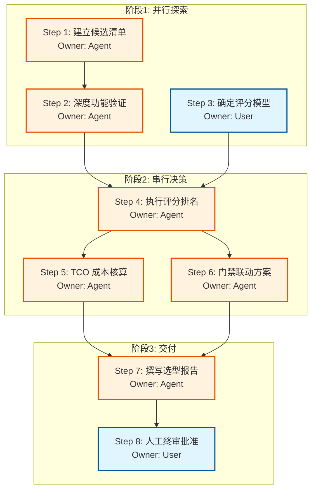

# 阶段 03：具体行动分解 - 会议室预约系统选型

## 前置校验与假设声明
**Repair Stage**: 03
**依据**: 本步骤基于“已通过 Reviewer 的证据”进行分解。假设在阶段 02/02.5 中已完成以下事实核验（若未核验，需回退至 02.5）：
1.  **预算确认可行性**：已确认市面上存在至少一款满足 ≤2万元/年、支持三端及双日历集成的 SaaS 或开源部署方案。
2.  **门禁联动非强制**：已确认“门禁联动可选”意味着若首选方案不支持，可接受通过中间件（如 Zapier/Make/Webhook）实现基础联动，或暂时放弃该功能而不影响核心业务。
3.  **用户规模**：30人研发团队，并发量低，对高可用 SLA 要求中等。

---

## 行动步骤分解

### 并行组 A：市场扫描与初步筛选 (Agent 主导)

#### Step 1: 建立候选清单 (Longlist)
*   **Owner**: `agent`
*   **输入**: 
    *   硬性约束：预算≤2万/年，支持 macOS/Win/Web，集成 Google Calendar & Outlook。
    *   软性约束：30人规模，门禁联动为加分项。
    *   搜索关键词："meeting room booking system", "room scheduler", "calendar integration", "open source meeting room".
*   **动作**: 
    1. 检索主流 SaaS 平台（如 RoomGuru, Book4Time, Calendly Pro, Slack Connect 插件等）。
    2. 检索开源解决方案（如 OpenRoom, Roomster, 基于 Next.js/CAL.com 的自建方案）。
    3. 检查各方案官网价格页，标记出明确标价 ≤2万/年 的产品。
    4. 检查技术文档，确认是否原生支持 Google API 和 Microsoft Graph API。
*   **依赖**: 无
*   **预期产出**: 《候选产品清单.xlsx》，包含产品名称、类型(SaaS/OpenSource)、预估年费、日历集成方式、终端支持情况。
*   **验收方式**: 清单中包含至少 5-8 个符合硬性约束的产品；每个条目均有来源链接。
*   **失败处理**: 若无法找到同时满足“双日历集成”且“预算内”的商业 SaaS，则扩大搜索范围至“通用日程管理工具+会议室模块”，或将门禁联动降级为二期需求。

#### Step 2: 深度功能与技术验证 (Shortlist Filter)
*   **Owner**: `agent`
*   **输入**: Step 1 产出的《候选产品清单》
*   **动作**: 
    1. 针对 Top 5 候选，注册试用账号或使用沙盒环境。
    2. **测试点 1 (日历)**：模拟创建会议，验证是否双向同步到 GCal 和 Outlook（重点检查时区、冲突检测）。
    3. **测试点 2 (终端)**：在 macOS Safari/Chrome、Windows Edge/Chrome、移动端 Web 上访问，检查 UI 适配性和操作流畅度。
    4. **测试点 3 (门禁)**：查看 API 文档，确认是否有 Webhook 或 REST API 可供第三方调用以触发门禁（如 RFID 或蓝牙信标）。
    5. **测试点 4 (成本)**：获取正式报价单或计算自建成本（服务器+域名+维护时间折算）。
*   **依赖**: Step 1
*   **预期产出**: 《功能验证报告.md》，包含每个候选产品的测试截图、API 可用性分析、最终得分。
*   **验收方式**: 每个候选产品都有明确的“Pass/Fail”判定理由；对于 Fail 的项目，明确指出是哪一项硬性指标未达标。
*   **失败处理**: 若某产品声称支持但实测不同步，记录为“虚假宣传”，直接淘汰。

---

### 并行组 B：内部需求细化与决策标准 (User 主导)

#### Step 3: 确定加权评分模型
*   **Owner**: `user`
*   **输入**: 团队现有 IT 基础设施现状（是否有现成 AD/LDAP？门禁品牌是什么？）、团队偏好（更倾向 SaaS 免运维还是开源可控？）
*   **动作**: 
    1. 定义评分维度及权重：
        *   日历同步稳定性 (30%)
        *   用户体验/易用性 (25%)
        *   总拥有成本 TCO (20%)
        *   门禁集成可行性 (15%)
        *   数据隐私/合规性 (10%)
    2. 确定“一票否决项”：例如“必须支持离线模式”或“必须私有化部署”。
*   **依赖**: 无 (可与 Step 1 并行)
*   **预期产出**: 《评分标准表.xlsx》，包含维度、权重、打分细则（1-5分）。
*   **验收方式**: 所有研发团队成员对评分标准无异议并签字确认（或邮件回复确认）。
*   **失败处理**: 若团队对权重有分歧，由 Tech Lead 裁决并记录理由。

---

### 串行组 C：综合评估与推荐 (Agent + User)

#### Step 4: 执行评分与排名
*   **Owner**: `agent`
*   **输入**: Step 2 的《功能验证报告》、Step 3 的《评分标准表》
*   **动作**: 
    1. 根据验证结果，为 Shortlist 中的产品逐项打分。
    2. 计算加权总分。
    3. 识别 Top 1 (推荐) 和 Top 2 (备选)。
    4. 撰写淘汰理由：针对未进入前二名的产品，引用 Step 2 中的具体失败证据。
*   **依赖**: Step 2, Step 3
*   **预期产出**: 《评分汇总与排名.md》
*   **验收方式**: 分数计算无误；排名逻辑清晰；淘汰理由客观且有据可依。
*   **失败处理**: 若出现平局，增加“实施复杂度”作为 tie-breaker，或发起 User 投票。

#### Step 5: 成本明细核算 (TCO Analysis)
*   **Owner**: `agent`
*   **输入**: Top 2 产品的官方定价页、自建方案的服务器配置估算
*   **动作**: 
    1. **SaaS 方案**: 列出首年费用、次年续费涨幅、隐藏费用（如 API 超额费、高级功能解锁费）。
    2. **开源/自建方案**: 列出云资源费用（AWS/Aliyun ECS/RDS）、域名 SSL 证书、预计运维人力成本（按小时费率 x 预估维护时长）。
    3. 对比两种方案在 3 年周期内的总成本。
*   **依赖**: Step 4 (仅对 Top 2 详细核算，其他粗略估算)
*   **预期产出**: 《3年 TCO 对比表.xlsx》
*   **验收方式**: 所有数字均有出处链接或计算公式；区分一次性投入和年度经常性支出。
*   **失败处理**: 若某 SaaS 价格不透明（需销售联系），标记为“高风险”，并在报告中注明“需进一步商务谈判确认”。

#### Step 6: 门禁联动方案设计 (Conditional)
*   **Owner**: `agent`
*   **输入**: Top 1 产品的 API 文档、现有门禁系统接口文档
*   **动作**: 
    1. 若 Top 1 产品无原生门禁接口，设计一个轻量级中间层方案（例如使用 n8n 或简单的 Node.js 脚本监听 Webhook）。
    2. 绘制数据流向图：预约成功 -> 发送 Webhook -> 中间件解析 -> 调用门禁 API 授权。
    3. 评估开发工作量（人天）和额外硬件成本（如需网关）。
*   **依赖**: Step 4
*   **预期产出**: 《门禁联动技术方案草稿.md》
*   **验收方式**: 方案逻辑闭环，无技术断层；明确标注哪些部分需要额外采购。
*   **失败处理**: 若门禁系统老旧且无 API，则在报告中明确建议“放弃门禁联动”或“更换门禁控制器”，并说明这对整体预算的影响。

---

### 最终交付物生成

#### Step 7: 撰写选型报告
*   **Owner**: `agent`
*   **输入**: Step 1-6 的所有产出物
*   **动作**: 
    1. 整合内容，按照任务书要求结构撰写：
        *   **执行摘要**: 一句话推荐结论。
        *   **推荐方案**: 名称、核心理由、TCO 明细、门禁联动方案。
        *   **备选方案**: 名称、相比推荐方案的优劣。
        *   **淘汰理由**: 列表形式，简洁有力。
        *   **风险与建议**: 潜在风险及缓解措施。
    2. 确保语言专业、客观，避免主观臆断。
*   **依赖**: Step 5, Step 6
*   **预期产出**: 《会议室预约系统选型报告.pdf/md》
*   **验收方式**: 
    1. 覆盖所有任务书要求的要素。
    2. 数据准确，逻辑自洽。
    3. 另一个执行者阅读后能清楚知道下一步该联系谁、买什么、怎么配。
*   **失败处理**: 若发现之前步骤有重大遗漏（如漏算了关键许可费），返回 Step 5 修正，并更新报告版本。

#### Step 8: 人工终审与批准
*   **Owner**: `user`
*   **输入**: Step 7 产出的《选型报告》
*   **动作**: 
    1. 团队负责人审阅报告。
    2. 确认预算是否符合财务审批流程。
    3. 签署批准意见。
*   **依赖**: Step 7
*   **预期产出**: 带有批准签名的最终版报告。
*   **验收方式**: 获得明确的“Go”或“No-Go”决定。
*   **失败处理**: 若被驳回，记录驳回原因，返回相应步骤（如 Step 4 重新评估或 Step 1 寻找新候选）。

---

## 依赖关系图 (Mermaid)

## 关键失败情况与替代路径

| 关键步骤 | 潜在失败场景 | 替代路径 / 停止条件 |
| :--- | :--- | :--- |
| **Step 1** | 找不到符合“双日历+低价+三端”的商业软件 | **替代**: 转向开源方案（如 Cal.com 定制版或 Roomster）； **停止条件**: 若开源方案维护成本预估超过 1 万元/年，则标记项目为“暂缓”，建议明年再评估或降低需求。 |
| **Step 2** | 试用期间发现日历同步存在严重延迟或数据丢失 | **替代**: 剔除该产品；若剩余候选均不稳定，考虑使用 Zapier/Make 连接通用日历工具（如 Calendly）与会议室硬件，虽体验稍差但稳定。 **停止条件**: 若所有候选都无法保证实时同步，则判定当前技术栈无法满足核心业务连续性，需升级需求或更换供应商类别。 |
| **Step 5** | SaaS 厂商拒绝提供书面报价，仅口头承诺 | **替代**: 将该厂商标记为“高风险”，不作为首选推荐，除非其免费试用期足以覆盖试点期。 **停止条件**: 若 Top 1 厂商无法提供合规发票或合同，则自动降为备选，提升第二名排名。 |
| **Step 6** | 现有门禁系统完全封闭，无任何 API 或网络接口 | **替代**: 在报告中明确“门禁联动不可行”，建议采用“手机扫码开门”或“手动刷卡”作为过渡方案，将门禁联动列为长期 IT 改造目标而非本项目交付物。 **停止条件**: 无，因为门禁是“可选”项，不影响主流程。 |

## 给执行者的备注 (For Another Executor)

1.  **关于 Owner 标注**: 
    *   所有 `Agent` 步骤可由 AI 辅助完成，但最终数据录入和验证需人工复核。
    *   `User` 步骤（Step 3, Step 8）是关键的人工阻塞点，请务必预留沟通时间，不要假设用户会即时响应。
2.  **关于证据**: 
    *   在 Step 2 中，务必保留测试过程的录屏或日志截图，作为后续 Reviewer 质检的依据。
    *   在 Step 5 中，所有价格必须附带截图或 PDF 链接，防止厂商后期调价导致报告失效。
3.  **关于门禁**: 
    *   不要过度设计门禁方案。如果 Top 1 产品没有原生支持，优先推荐“Webhook + 简单脚本”的低成本方案，而不是引入复杂的 IoT 平台。