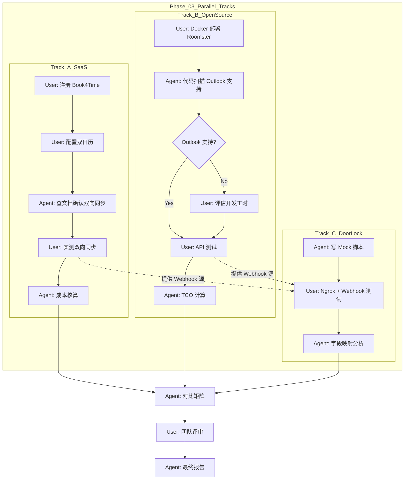

# 阶段 03：具体行动分解

## 1. 前置条件与假设声明
基于阶段 02 的证据清单，本行动计划严格遵循以下前提：
1.  **预算约束**：年度总成本（现金+人力折算）≤ 20,000 RMB。
2.  **核心功能硬指标**：必须支持 macOS/Windows/Web 三端访问；必须实现 Google Calendar 和 Outlook 的**双向同步**（特别是反向释放房间）。
3.  **门禁联动**：作为可选加分项，若实现成本低则保留，否则降级为手动管理，不阻塞主流程。
4.  **执行者角色定义**：
    *   `agent`：AI 助手或自动化脚本，负责信息检索、代码生成、文档撰写、初步逻辑校验。
    *   `user`：人类研发负责人/IT 管理员，负责账号注册、密钥配置、实际点击测试、最终决策、服务器权限操作。

## 2. 行动步骤分解

### 模块 A：商业 SaaS 深度验证 (Book4Time)
*目标：验证 Book4Time 是否满足“双日历双向同步”及预算要求。*

| ID | Owner | 输入 (Input) | 动作 (Action) | 依赖 (Dependencies) | 预期产出 (Output) | 验收方式 (Acceptance Criteria) |
| :--- | :---: | :--- | :--- | :--- | :--- | :--- |
| A1 | user | Book4Time 官网链接 | 注册免费试用账号，添加 3 个虚拟会议室，完成基础设置。 | 无 | 可用的 Book4Time 测试实例 URL | 能成功登录并看到会议室列表。 |
| A2 | user | Google Workspace 测试邮箱, Microsoft 365 测试邮箱 | 在 Book4Time 后台配置 Google Calendar 集成；配置 Outlook/Microsoft Graph 集成（需 Azure App Registration）。 | A1 | 两个日历集成状态显示为 "Connected" | 后台无报错，授权流程顺利完成。 |
| A3 | agent | A2 的配置截图/日志 | 检查 Book4Time 文档中关于 "Two-way sync" 的说明，确认是否支持从日历端删除事件后自动释放房间。 | A2 | 技术可行性报告片段（引用官方文档链接） | 明确标注“支持”或“不支持”，若有歧义标记为“待实测”。 |
| A4 | user | A2 的连接好的系统 | **关键测试**： 1. 在 Book4Time 创建会议 -> 检查 GCal/Outlook。 2. 直接在 Outlook 删除该会议 -> 检查 Book4Time 房间状态。 3. 直接在 GCal 修改时间 -> 检查 Book4Time 更新情况。 | A3 | 《Book4Time 双向同步测试记录表》 | **Pass**: 所有反向操作均正确反映到预约系统。 **Fail**: 任何反向操作未同步或延迟超过 5 分钟。 |
| A5 | agent | A4 测试结果, Book4Time 定价页 | 计算 3-5 间会议室的年费总额，对比 20,000 RMB 预算。评估汇率风险。 | A4 | Book4Time 成本核算单 | 年费 < 20,000 RMB 且包含所需功能许可。 |

### 模块 B：开源方案部署验证 (Roomster)
*目标：验证 Roomster 私有化部署的可行性及 Outlook 集成工作量。*

| ID | Owner | 输入 (Input) | 动作 (Action) | 依赖 (Dependencies) | 预期产出 (Output) | 验收方式 (Acceptance Criteria) |
| :--- | :---: | :--- | :--- | :--- | :--- | :--- |
| B1 | user | Docker 环境, GitHub Roomster Repo | 拉取 Roomster 最新代码，使用 Docker Compose 启动服务。 | 无 | 本地运行的 Roomster 实例 (localhost:3000) | 浏览器可访问首页，API `/health` 返回 200。 |
| B2 | agent | Roomster 源代码 (`config`, `api` 目录) | 扫描代码库，搜索 `microsoft`, `graph`, `outlook` 关键词。确认是否存在原生 Outlook 适配器或仅支持 Google。 | B1 | 《Roomster 日历集成能力分析》 | 列出支持的日历提供商列表。若仅支持 Google，标记需二次开发。 |
| B3 | user | B2 的分析结果 | 若 B2 显示缺乏 Outlook 支持： 1. 查阅 Microsoft Graph API 文档。 2. 评估接入工作量（人天估算）。 若 B2 显示支持：直接进行配置测试。 | B2 | Outlook 集成方案草案（含工时估算） | 若需开发，预估工时 ≤ 5 人天；若无需开发，完成配置。 |
| B4 | user | B3 的方案 | 在 Roomster 中创建一个会议室，尝试通过 API 模拟预约，观察生成的 Calendar Event JSON 结构。 | B3 | API 响应示例 & 数据结构分析 | JSON 中包含正确的 `start`, `end`, `resource_id` 字段。 |
| B5 | agent | B1-B4 数据 | 计算 TCO： 1. 云服务器费用 (阿里云 ECS + RDS 最低配)。 2. 域名 SSL 费用。 3. 首年运维人力成本 (按 5 人天 x 人均日薪估算，保守估计)。 | B4 | Roomster TCO 明细表 | 总 TCO ≤ 20,000 RMB。若人力成本过高导致超标，标记为“高风险”。 |

### 模块 C：门禁联动可行性 POC (并行执行)
*目标：验证 Webhook 触发门禁 API 的技术路径。*

| ID | Owner | 输入 (Input) | 动作 (Action) | 依赖 (Dependencies) | 预期产出 (Output) | 验收方式 (Acceptance Criteria) |
| :--- | :---: | :--- | :--- | :--- | :--- | :--- |
| C1 | agent | 海康威视/HID 通用 REST API 文档 | 编写一个伪代码 Python 脚本，模拟接收 Webhook 并调用门禁 API 下发临时权限的逻辑。 | 无 | `mock_access_control.py` 脚本 | 脚本语法正确，逻辑闭环（接收->解析->调用->撤销）。 |
| C2 | user | C1 脚本, ngrok/内网穿透工具 | 在本地运行 C1 脚本，使用 ngrok 暴露端口。在 A4 或 B4 的系统中配置 Webhook 指向该 ngrok 地址。 | C1, A4/B4 (任选其一完成即可) | Webhook 接收日志截图 | 当创建会议时，本地终端打印出收到的 JSON 载荷。 |
| C3 | agent | C2 日志 | 分析 Webhook 载荷，确认是否包含足够的字段（开始时间、结束时间、房间ID）来映射到门禁系统的 Zone/Door ID。 | C2 | 字段映射表 | 能够建立预约系统字段与门禁 API 参数的映射关系。 |

### 模块 D：综合评估与报告生成

| ID | Owner | 输入 (Input) | 动作 (Action) | 依赖 (Dependencies) | 预期产出 (Output) | 验收方式 (Acceptance Criteria) |
| :--- | :---: | :--- | :--- | :--- | :--- | :--- |
| D1 | agent | A5, B5, C3 的所有输出 | 构建对比矩阵： - 功能完整性 (双日历双向同步) - 成本 (TCO) - 实施难度 - 维护风险 根据评分推荐 Top 1 和 Top 2。 | A5, B5, C3 | 《选型对比矩阵》 | 每个维度有明确分值或定性描述，结论逻辑自洽。 |
| D2 | user | D1 矩阵, 团队内部反馈 | 召集 IT 负责人和产品经理，评审对比矩阵。确认对“人力隐性成本”的接受度。 | D1 | 评审会议纪要 & 最终倾向 | 确定首选方案和备选方案。 |
| D3 | agent | D2 结论, 阶段 02 证据, 阶段 03 所有测试记录 | 撰写《会议室预约系统选型报告》。 结构： 1. 执行摘要 2. 需求回顾 3. 候选方案详细分析 (含测试数据) 4. 成本明细 (现金+人力) 5. 风险评估与缓解措施 6. 最终推荐 | D2 | 完整选型报告 PDF/Markdown | 覆盖所有约束条件，数据准确，无未解决的“待核验”项（除非已标记为低风险）。 |

## 3. 依赖关系图与并行策略

**并行说明**：
- **Track A** 和 **Track B** 完全独立，可由不同人员或同一人交替执行，互不阻塞。
- **Track C** 依赖 A 或 B 中至少有一个系统跑通并能发出 Webhook。通常建议在 A4 或 B4 完成后立即插入 C2/C3，以节省等待时间。
- **D1** 必须等待 A5, B5, C3 全部完成。

## 4. 失败处理与替代路径

### 场景 1：Book4Time 双向同步测试失败 (A4 Fail)
- **现象**：在 Outlook 删除事件后，Book4Time 房间仍显示占用。
- **影响**：SaaS 方案体验不佳，可能导致用户困惑。
- **替代路径**：
    1. 检查 Book4Time 是否有 "Sync Interval" 设置，调整为最短间隔（如 1 分钟）。
    2. 若仍失败，查看其帮助中心是否有 "Zapier Integration" 用于弥补单向同步缺陷。
    3. 若无法解决，将 Book4Time 降级为“备选”，权重降低，重点转向 Roomster。

### 场景 2：Roomster 缺乏 Outlook 原生支持且开发工时超标 (B3 Fail)
- **现象**：评估发现需要 > 10 人天才能完美对接 Microsoft Graph API 的双向同步。
- **影响**：TCO 可能超过 20,000 RMB（假设人均日薪 1500 RMB，10 人天 = 15,000 RMB，加上服务器和维护，极易超标）。
- **替代路径**：
    1. **混合方案**：继续使用 Roomster 作为前端和管理面板，但放弃其内置日历同步。改用 **n8n** 或 **Node-RED** 搭建中间件，专门处理 Roomster API 与 Microsoft Graph/Google API 之间的双向同步。
    2. **重新评估开源项目**：快速调研 **Roo** (Go 语言版) 或 **CleverRooms**，看是否有更好的 Outlook 支持。
    3. **妥协方案**：如果团队主要使用 Google Calendar，强制规定“会议室预约必须在 Roomster 操作，日历仅作只读提醒”，从而规避双向同步的开发成本。（需在报告中注明此限制）。

### 场景 3：门禁 Webhook 字段缺失 (C3 Fail)
- **现象**：Webhook 载荷中没有明确的“房间物理 ID”，只有“资源名称字符串”。
- **影响**：无法自动化匹配门禁门点。
- **替代路径**：
    1. 在预约系统中给每个会议室命名时，采用固定编码规范（如 `ROOM-A101`）。
    2. 在中间件脚本中建立静态映射表（Map），将 `ROOM-A101` 映射到门禁系统的 `DoorID_123`。
    3. 若门禁系统不支持动态临时权限，仅支持白名单，则改为“会议开始前批量导入参会人 ID 到门禁白名单”，会后移除。

### 场景 4：预算超限 (D1 发现 TCO > 20k)
- **现象**：即使选择最便宜的 SaaS，加上必要的插件或升级包，年费接近或超过 20,000 RMB。
- **替代路径**：
    1. **谈判**：联系 SaaS 销售，争取初创企业优惠或多付一年锁价。
    2. **缩减范围**：暂时不启用门禁联动（将其列为 Phase 2 需求），以降低潜在的技术集成复杂度带来的隐性人力成本。
    3. **更换供应商**：回到阶段 02 证据中的其他低价 SaaS（如 SimplyBook 的低配版，如果其入门价低于 Book4Time 且功能够用）。

## 5. Reviewer 自检清单

- [ ] **Owner 标注**：所有步骤均已明确标注 `user` 或 `agent`。
- [ ] **原子性**：A4 包含了三个子测试动作，但在操作上是连续的验证过程，视为一个原子验证任务。B3 包含了分支判断，逻辑清晰。
- [ ] **依赖完整性**：C2 依赖 A4 或 B4，已在图中用虚线表示。D1 依赖所有上游产出。
- [ ] **未知处理**：对于 Roomster 是否支持 Outlook，未假设为“是”，而是设计了 B2 扫描和 B3 分支处理。
- [ ] **可执行性**：另一个开发者拿到此文档，知道第一步做什么（注册/Docker），第二步做什么（配置/扫描），以及失败了怎么办。

**Repair Stage**: 03
*(理由：所有行动均基于阶段 02 已核验或明确标记为待测的事实，没有引入新的未经验证的前提。)*