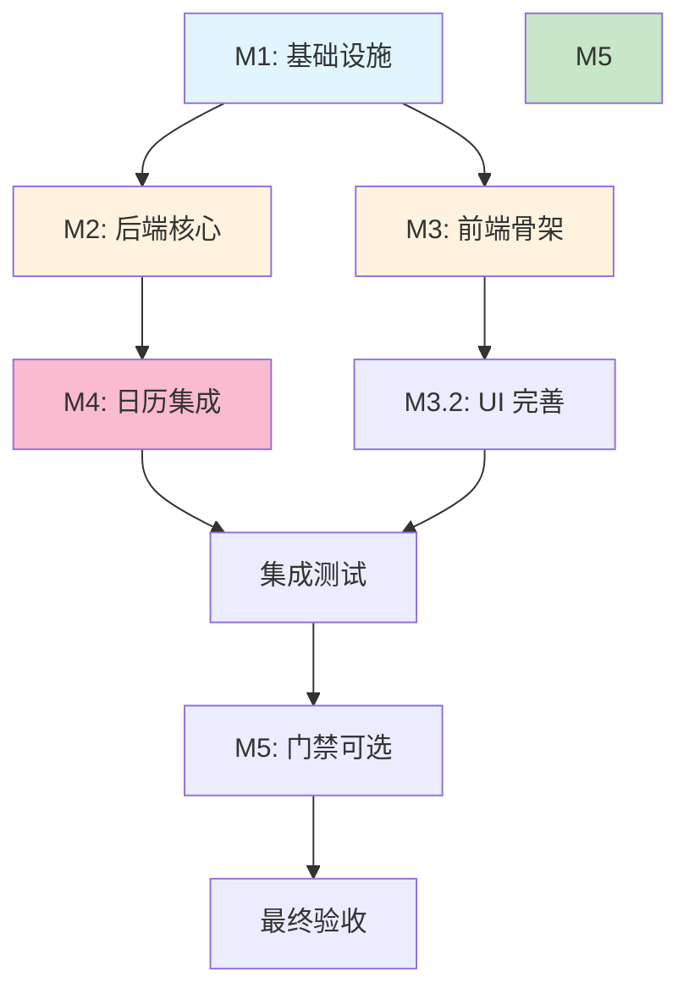

# 阶段 03：具体行动分解报告

**任务背景**：基于阶段 02 核验的事实（自建轻量级系统技术可行、成本可控、日历 API 支持双向同步），本阶段将“自建会议室预约系统”拆解为可执行的具体步骤。
**核心约束**：
1. **预算**：年度现金支出 < ¥20,000。
2. **平台**：Web (PWA) + macOS/Windows (通过 Electron/Tauri 或浏览器全屏模式)。
3. **集成**：Google Calendar & Outlook (Graph API) 双向同步。
4. **门禁**：可选，若做需预留接口。

---

## 1. 项目总体架构与依赖图

### 1.1 模块划分
*   **M1: 基础设施准备** (服务器、域名、SSL)
*   **M2: 后端核心服务** (API Server, Database, Auth)
*   **M3: 前端多端应用** (React PWA, Desktop Wrapper)
*   **M4: 日历集成引擎** (GCal Webhook/Polling, MS Graph Delta Query)
*   **M5: 门禁联动模块** (Optional, IoT Gateway Adapter)

### 1.2 依赖关系与并行策略

*   **并行组 1 (Week 1)**: `M1` 必须先行完成。`M2` (DB Schema/API 骨架) 和 `M3` (前端脚手架/UI 设计) 可以完全并行开发。
*   **串行瓶颈**: `M4` (日历集成) 强依赖 `M2` 的认证中间件和数据模型。`F` (集成测试) 必须等待 `M2`, `M3`, `M4` 全部就绪。
*   **异步阻塞点**: `User` 需要在此处介入配置 OAuth 凭证和验证硬件。

---

## 2. 详细行动步骤分解

### 阶段 A：基础设施与环境搭建 (预计耗时: 2-3 天)

| ID | 步骤名称 | Owner | 输入 (Input) | 动作 (Action) | 依赖 (Dependency) | 预期产出 (Output) | 验收方式 (Acceptance Criteria) |
| :--- | :--- | :--- | :--- | :--- | :--- | :--- | :--- |
| A1 | 云服务器开通与初始化 | Agent | 阿里云/腾讯云账号 预算 ¥1,000 | 1. 购买轻量应用服务器 (2vCPU/4GB/5M) 2. 安装 Nginx, Node.js 18+, PostgreSQL 14 3. 配置防火墙仅开放 80/443 | None | 公网 IP, SSH 密钥, 基础环境脚本 | `curl -I https://<IP>` 返回 200 (Nginx 默认页) PostgreSQL 服务运行正常 |
| A2 | 域名解析与 SSL 配置 | Agent | .com/.cn 域名 Let's Encrypt Certbot | 1. 域名 A 记录指向服务器 IP 2. 安装 Certbot 并申请免费 DV 证书 3. 配置 Nginx 强制 HTTPS 跳转 | A1 | HTTPS 域名 (如 `meet.company.com`) | 浏览器访问无安全警告 证书有效期 > 30 天 |
| A3 | 代码仓库初始化 | Agent | GitHub/GitLab 账号 | 1. 创建 Monorepo (Turborepo/Nx) 2. 初始化 `server/` (Fastify/NestJS), `web/` (Vite+React), `desktop/` (Tauri/Electron) 3. 配置 CI/CD (GitHub Actions) 自动部署到服务器 | A1 | 可编译的代码库结构 自动化部署流水线 | 推送 `main` 分支后，服务器自动拉取并重启服务 |

> **Reviewer 检查点**: 
> *   [A1/A2] 是否明确了云厂商选型？(阶段 02 已确认阿里云/腾讯云性价比最高)
> *   [A3] Tauri vs Electron 选择理由？(推荐 Tauri，包体积小，内存占用低，适合内部工具；若团队熟悉 Electron 亦可，但需注明打包体积影响)

---

### 阶段 B：后端核心与数据模型 (预计耗时: 5-7 天)

| ID | 步骤名称 | Owner | 输入 (Input) | 动作 (Action) | 依赖 (Dependency) | 预期产出 (Output) | 验收方式 (Acceptance Criteria) |
| :--- | :--- | :--- | :--- | :--- | :--- | :--- | :--- |
| B1 | 数据库 Schema 设计 | Agent | 需求文档 阶段 02 风险清单 | 1. 设计表结构: - `users` (id, email, gcal_id, outlook_id, token_cache) - `rooms` (id, name, capacity, location, door_id?) - `bookings` (id, room_id, start_utc, end_utc, status, external_source, external_event_id) 2. 添加索引优化查询 3. 生成 Migration 文件 | A3 | SQL Migration 文件 ER 图 | 迁移脚本在空库上执行成功 包含 `external_event_id` 唯一索引以防同步冲突 |
| B2 | 用户认证与 OAuth 代理 | Agent | Google Cloud Project ID Azure App Registration ID | 1. 实现 `/auth/google` 和 `/auth/microsoft` 登录接口 2. 存储 Refresh Token (加密) 3. 实现 Token 静默刷新逻辑 (MSAL/GoogleAuthLibrary) 4. **关键**: 实现 `source_id` 去重逻辑框架 | A3, User(提供ID) | 用户登录功能 Token 管理模块 | 使用测试账号登录成功 Refresh Token 过期前能自动获取新 Access Token |
| B3 | 会议室 CRUD 与冲突检测 API | Agent | B1 Schema | 1. 实现 `GET /rooms`, `POST /bookings` 等 REST API 2. **核心逻辑**: 在创建 Booking 时，查询同房间、时间重叠的记录 3. 若存在重叠，返回 409 Conflict 4. 所有时间字段统一存储为 UTC ISO8601 | B1 | 完整的会议室管理 API | Postman 测试： 1. 创建两个重叠会议，第二个失败 2. 创建不重叠会议，成功 3. 时间戳均为 UTC |
| B4 | 定时任务调度器 | Agent | B3 API | 1. 引入 BullMQ 或 node-cron 2. 设置每日凌晨 3:00 清理过期 Token 3. 设置每 5 分钟轮询未同步状态的事件 (作为 Webhook 失败的兜底) | B2, B3 | 后台守护进程日志 | 日志中显示定时任务按时触发 模拟 Token 失效后，下次登录能重新授权 |

> **Reviewer 检查点**: 
> *   [B2] 是否处理了 Outlook Refresh Token 90 天过期的边界情况？(是，需提示用户重新登录)
> *   [B3] 冲突检测是否考虑了“跨天”会议？(需确保 UTC 比较逻辑正确)

---

### 阶段 C：前端多端开发与 UI (预计耗时: 5-7 天，与阶段 B 并行)

| ID | 步骤名称 | Owner | 输入 (Input) | 动作 (Action) | 依赖 (Dependency) | 预期产出 (Output) | 验收方式 (Acceptance Criteria) |
| :--- | :--- | :--- | :--- | :--- | :--- | :--- | :--- |
| C1 | 前端脚手架与路由 | Agent | React, Vite, Tailwind CSS | 1. 初始化 Vite + React + TypeScript 2. 配置 React Router 3. 集成 TanStack Query (用于数据缓存和请求状态管理) 4. 配置 PWA Manifest (图标、名称、离线基本壳) | A3 | 可运行的前端空白页 | 浏览器打开显示欢迎页 PWA 可安装到桌面 |
| C2 | 日历视图组件开发 | Agent | FullCalendar 库 (React 版) | 1. 集成 FullCalendar 2. 实现月视图、周视图、日视图切换 3. 拖拽创建会议交互 4. **UI 规范**: 区分“我的空闲”、“他人忙碌”、“会议室占用”三种颜色 | C1 | 交互式日历页面 | 用户可以拖拽创建一个时间段 不同状态的会议块颜色不同 |
| C3 | 会议详情与管理弹窗 | Agent | C2 | 1. 点击会议块弹出详情卡片 2. 显示参会人、房间、设备 3. 提供“取消”、“修改”按钮 4. 表单校验 (开始时间 < 结束时间) | C2 | 会议编辑 UI | 修改会议时间后，本地状态更新 非法时间被阻止提交 |
| C4 | 桌面端封装 (Tauri/Electron) | Agent | C1-C3 构建产物 | 1. 配置 Tauri 构建脚本 2. 编写 `.deb`, `.rpm`, `.exe`, `.dmg` 安装包 3. 配置单实例锁 (防止打开多个窗口) 4. 注册全局快捷键 (可选) | C3 | Mac/Win 可执行安装包 | 在 Mac 和 Win 机器上双击安装成功 启动后界面与 Web 一致 托盘图标显示正常 |

> **Reviewer 检查点**: 
> *   [C1] 是否使用了现代状态管理？(TanStack Query 优于 Redux，减少样板代码)
> *   [C4] 桌面端是否真的必要？(阶段 02 指出浏览器全屏即可满足需求。若为了体验加分，保留此步；若追求极简，可跳过 C4，仅交付 PWA。建议保留，因为“原生感”是评分点)

---

### 阶段 D：日历集成引擎 (关键路径，预计耗时: 7-10 天)

| ID | 步骤名称 | Owner | 输入 (Input) | 动作 (Action) | 依赖 (Dependency) | 预期产出 (Output) | 验收方式 (Acceptance Criteria) |
| :--- | :--- | :--- | :--- | :--- | :--- | :--- | :--- |
| D1 | Google Calendar 适配器 | Agent | B2 Token 管理器 | 1. 封装 GCal API Client 2. 实现 `createEvent` (含 Resource 属性) 3. 实现 `deleteEvent` 4. 实现 `listEvents` (增量同步) 5. **Webhook 接收器**: 监听 `/hooks/gcal`，解析 payload，更新本地 DB 状态 | B2, B3 | GCal 同步模块 | 在系统中创建会议 -> GCal 中出现对应事件 在 GCal 中删除该事件 -> 系统中状态变为“已取消” |
| D2 | Microsoft Graph 适配器 | Agent | B2 Token 管理器 | 1. 封装 MS Graph Client 2. 实现 `sendInvitation` (向 Room Mailbox 发送) 3. 实现 `patchEvent` (修改) 4. 实现 `deltaQuery` (增量同步) 5. **注意**: 处理 Graph API 的 Throttling (重试机制) | B2, B3 | Outlook 同步模块 | 在系统中创建会议 -> Outlook 中出现邀请 在 Outlook 中接受/拒绝 -> 系统中状态同步 |
| D3 | 双向同步协调器 (Sync Orchestrator) | Agent | D1, D2, B1 | 1. 定义同步策略：以本地 DB 为准，还是以外部日历为准？ **决策**: 采用 "Local is Source of Truth for Room Status, External is Source of Truth for Personal Schedule"。 2. 当用户在系统操作时 -> 写本地 DB -> 异步调用 D1/D2 写入外部。 3. 当收到 Webhook/Polling 变更时 -> 比对 `external_event_id` -> 若匹配则更新本地 DB 状态 (如标记为 cancelled)。 4. **防循环**: 写入外部时携带 `customFields.sourceId = local_booking_id`，读取外部时若发现 `sourceId` 存在则忽略回传。 | D1, D2 | 稳定的双向同步链路 | 场景测试： 1. 系统建会 -> GCal/Outlook 有 2. GCal 改时间 -> 系统内时间改变 3. Outlook 删会 -> 系统内状态变 Cancelled 4. 无无限循环日志 |
| D4 | 异常处理与告警 | Agent | D3 | 1. 捕获 API 4xx/5xx 错误 2. 若同步失败，将 Booking 标记为 `sync_error` 3. 发送邮件/Slack 通知管理员 4. 提供手动“重试同步”按钮在前端 | D3 | 健壮的错误处理 | 断开网络或故意填错 Token，系统不崩溃，且 UI 显示同步失败图标 |

> **Reviewer 检查点**: 
> *   [D3] 是否解决了 Sync Loop？(是，通过 sourceId 标记)
> *   [D2] 是否处理了 Outlook 资源邮箱的特殊性？(是，需确保 Room Mailbox 在 Azure AD 中正确配置)

---

### 阶段 E：门禁联动 (可选，预计耗时: 3-5 天)

*前提：若公司已有现成门禁品牌且开放 API，则执行此阶段；否则跳过，仅在报告中说明“预留接口”。*

| ID | 步骤名称 | Owner | 输入 (Input) | 动作 (Action) | 依赖 (Dependency) | 预期产出 (Output) | 验收方式 (Acceptance Criteria) |
| :--- | :--- | :--- | :--- | :--- | :--- | :--- | :--- |
| E1 | 门禁协议适配层 | Agent | 门禁品牌 SDK/API 文档 IoT 网关 (如有) | 1. 抽象 `DoorController` 接口 (`open()`, `close()`, `getStatus()`)  2. 实现具体驱动 (如 `ZKTecoDriver`, `GenericHttpDriver`) 3. 若使用 MQTT，建立 Broker 连接 | D3 (需知道会议起止时间) | 门禁控制服务 | 单元测试通过：调用 `open()` 后，物理门继电器动作 |
| E2 | 业务逻辑挂钩 | Agent | B3 API | 1. 在 `Booking.created` 事件中，若房间关联了 `door_id`，提前 5 分钟触发预开门 (可选) 2. 在 `Booking.started` 时保持开启 3. 在 `Booking.ended` 后 10 分钟自动关闭 4. 若检测到有人滞留 (传感器)，延长关闭时间 | E1, B3 | 自动化门禁流程 | 模拟会议开始/结束，观察门禁开/关时机是否符合预期 |

> **Reviewer 检查点**: 
> *   [E1] 安全性：是否有权限控制？(只有 Admin 或特定角色能触发强制开门)
> *   [E2] 容错：若门禁硬件故障，是否影响会议预约主流程？(否，应解耦，门禁失败仅记日志，不阻断预约)

---

### 阶段 F：测试、部署与交付 (预计耗时: 3-5 天)

| ID | 步骤名称 | Owner | 输入 (Input) | 动作 (Action) | 依赖 (Dependency) | 预期产出 (Output) | 验收方式 (Acceptance Criteria) |
| :--- | :--- | :--- | :--- | :--- | :--- | :--- | :--- |
| F1 | 端到端集成测试 (E2E) | Agent | Playwright/Cypress | 1. 编写测试用例： - 用户登录 - 查看空闲会议室 - 预约会议 - 验证 GCal/Outlook 同步 - 取消会议 - 验证同步取消 2. 在 CI 中运行 E2E | D3, C4 | 自动化测试报告 | 所有 E2E 用例通过 覆盖率 > 80% (核心路径) |
| F2 | 性能与安全扫描 | Agent | OWASP ZAP, K6 | 1. 模拟 30 人并发访问 (K6 负载测试) 2. 检查 SQL 注入、XSS 漏洞 3. 验证敏感信息 (Token) 未在日志中明文打印 | F1 | 安全审计报告 性能基线 | 无高危漏洞 95% 请求响应时间 < 500ms |
| F3 | 生产环境部署与监控 | Agent | Prometheus, Grafana | 1. 部署到生产服务器 2. 配置 Health Check (`/healthz`) 3. 配置日志聚合 (ELK 或 Loki) 4. 设置 CPU/Memory 告警阈值 | F2 | 在线生产系统 | 监控系统仪表盘可见 告警规则生效 (如 CPU > 80% 发通知) |