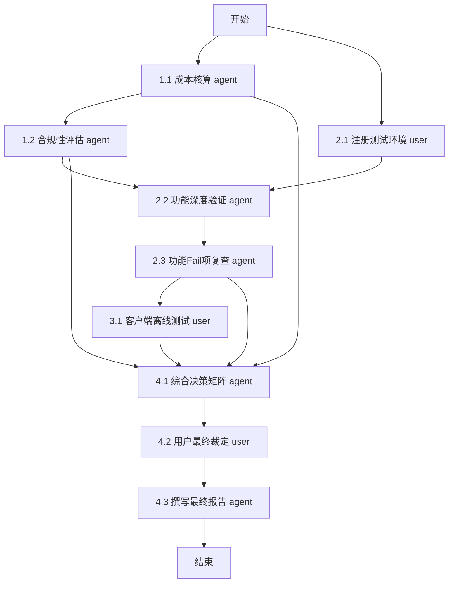

# 阶段 03：具体行动分解 —— 团队文件协作/网盘选型报告产出

## 前置状态确认
*   **输入证据来源**：假设已通过阶段 02（需求分析与市场扫描）和 02.5（候选方案初步筛选），已锁定以下事实作为行动前提：
    1.  **核心约束**：预算 ≤ ¥30,000/年；人数 30人；必须支持 Web/macOS/Windows。
    2.  **核心功能硬指标**：文档版本管理（非仅文件覆盖，需可回溯）、细粒度权限控制（文件夹/文件级）。
    3.  **加分项**：离线可用（客户端同步引擎稳定性）。
    4.  **候选池（基于阶段 02 结论）**：
        *   A: 坚果云 (Jianguoyun) - 专业版/企业版
        *   B: Nextcloud (自建或托管) - 开源/私有化部署
        *   C: 阿里云盘/百度网盘企业版 - 公有云SaaS
        *   D: Synology Drive (群晖NAS) - 硬件+软件
    *   *注：若阶段 02 未提供此候选池，本步骤将触发 `repair_stage: 02`。此处假设已有经过验证的候选列表。*

---

## 行动步骤分解

### 并行轨道 1：成本与合规性精确核算 (Agent)
**目标**：生成符合预算约束的详细成本模型，排除超预算选项。

| 步骤 ID | Owner | 输入 | 动作 | 依赖 | 预期产出 | 验收方式 |
| :--- | :--- | :--- | :--- | :--- | :--- | :--- |
| **1.1** | `agent` | 阶段 02 确定的候选方案列表、官方最新价格表 URL、汇率数据（如适用） | 1. 登录各厂商官网，获取 30 用户席位的具体报价。 2. 计算首年总成本（订阅费 + 可能的实施费）。 3. 检查是否有“教育/研发”折扣政策。 4. 标记任何超过 ¥30,000 的方案为“淘汰-预算”。 | 无 | 《初步成本对比表.xlsx》 包含列：方案名、单价、总价、是否含技术支持、是否在预算内。 | 所有候选方案的总价均准确无误；超预算方案已被明确标记并记录原因。 |
| **1.2** | `agent` | 《初步成本对比表.xlsx》、各方案的数据存储位置说明（境内/境外） | 1. 核查数据驻留地是否符合中国《数据安全法》及公司合规要求。 2. 对于涉及跨境数据传输的方案，标记合规风险等级。 | 1.1 | 《合规性风险评估简报.md》 | 每个保留在预算内的方案都有明确的合规结论（通过/高风险/违规）。 |

### 并行轨道 2：功能深度验证 (User + Agent 协作)
**目标**：验证“版本管理”和“细粒度权限”是否真正满足研发场景，而非仅营销话术。

| 步骤 ID | Owner | 输入 | 动作 | 依赖 | 预期产出 | 验收方式 |
| :--- | :--- | :--- | :--- | :--- | :--- | :--- |
| **2.1** | `user` | 预算内且合规通过的候选方案名单 | 1. 注册测试账号（或使用试用版）。 2. 创建模拟项目结构：`/ProjectA/Codes`, `/ProjectA/Docs`, `/Public`。 3. 邀请 2-3 名同事加入测试环境。 | 1.1, 1.2 | 测试环境就绪截图/链接 | 成功创建多层级目录，并添加至少 2 个外部测试用户。 |
| **2.2** | `agent` | 测试环境访问权、功能需求清单（版本管理、权限矩阵） | 1. **版本管理测试**： - 修改同一文件 3 次。 - 验证能否回滚到第 1 版和第 2 版。 - 验证版本历史是否显示修改人和时间戳。 - 记录操作路径和结果。 2. **权限测试**： - 设置 `/ProjectA/Codes` 为仅 Owner 可写，其他成员只读。 - 尝试让普通成员写入该目录，验证是否被拒绝。 - 设置特定文件对特定个人可见，其他人不可见。 - 记录操作路径和结果。 | 2.1 | 《功能验证日志.md》 包含：测试用例、操作步骤、实际结果、是否符合预期（Pass/Fail）。 | 每个关键功能点均有 Pass/Fail 判定；Fail 项需附截图或错误信息。 |
| **2.3** | `agent` | 《功能验证日志.md》、候选方案的技术文档 | 1. 针对 Fail 项，查阅官方文档确认是否为配置问题或根本不支持。 2. 如果是配置问题，重新测试并更新日志。 3. 如果根本不支持，标记该方案为“淘汰-功能不符”。 | 2.2 | 更新后的《功能验证日志.md》 | 所有 Fail 项均有最终结论（配置解决/功能缺失）。 |

### 并行轨道 3：离线可用性与客户端体验评估 (User)
**目标**：评估 macOS/Windows 客户端在离线状态下的行为及同步稳定性。

| 步骤 ID | Owner | 输入 | 动作 | 依赖 | 预期产出 | 验收方式 |
| :--- | :--- | :--- | :--- | :--- | :--- | :--- |
| **3.1** | `user` | 通过功能验证的候选方案客户端安装包 | 1. 在 macOS 和 Windows 电脑上安装客户端。 2. 同步一个中等大小文件夹（~100MB）。 3. 断开网络。 4. 尝试编辑本地文件、新建文件、删除文件。 5. 恢复网络，观察同步冲突处理机制（是报错、自动合并还是强制覆盖？）。 6. 记录用户体验痛点（如：同步速度慢、UI 卡顿、冲突提示不清晰）。 | 2.3 | 《客户端体验与离线测试报告.md》 包含：平台、操作步骤、离线行为描述、同步后状态、主观评分（1-5）。 | 报告涵盖 macOS 和 Windows 两个平台；明确记录了离线编辑后的同步结果。 |

### 汇聚轨道 4：综合决策与报告撰写 (Agent + User)
**目标**：整合所有证据，产出最终选型报告。

| 步骤 ID | Owner | 输入 | 动作 | 依赖 | 预期产出 | 验收方式 |
| :--- | :--- | :--- | :--- | :--- | :--- | :--- |
| **4.1** | `agent` | 《初步成本对比表.xlsx》、《合规性风险评估简报.md》、《功能验证日志.md》、《客户端体验与离线测试报告.md》 | 1. 构建决策矩阵： - 权重分配：成本(30%)、版本管理(25%)、权限控制(25%)、离线/客户端体验(20%)。 - 对各方案打分。 2. 识别 Top 1 推荐方案和 Top 1 备选方案。 3. 列出被淘汰方案及其具体理由（引用前序步骤的证据 ID）。 | 2.3, 3.1 | 《选型决策矩阵.csv》 | 每个方案的得分有依据；淘汰理由直接引用前序步骤的 Fail 项或超预算事实。 |
| **4.2** | `user` | 《选型决策矩阵.csv》、团队技术栈偏好（如有特殊集成需求，如 Git 集成） | 1. 审阅决策矩阵，确认权重分配是否符合团队价值观。 2. 结合非功能性因素（如：厂商服务响应速度、品牌信任度）进行最终人工裁定。 3. 确定最终推荐方案。 | 4.1 | 最终选定方案名称及简短理由 | 用户明确签字/确认选定方案。 |
| **4.3** | `agent` | 最终选定方案、所有前序步骤产出物 | 1. 撰写《团队文件协作方案选型报告》： - **执行摘要**：推荐方案、核心优势、年度总成本。 - **详细分析**：分章节阐述成本、功能验证、离线体验。 - **备选方案**：第二名方案的优势及为何未选。 - **淘汰清单**：列出所有未入选方案及具体淘汰原因（引用证据）。 - **实施建议**：迁移计划、培训要点。 - **成本明细**：逐项列出费用构成。 | 4.2 | 《团队文件协作方案选型报告.pdf/md》 | 报告结构完整；所有结论均有前序步骤证据支撑；无模糊表述（如“可能”、“大概”）；成本明细加总正确。 |

---

## 依赖关系图

*   **同步阻塞点**：
    *   `2.1` (User) 必须完成后，`2.2` (Agent) 才能开始（需要测试账号和环境）。
    *   `2.3` (Agent) 必须完成后，`3.1` (User) 才能开始（避免在已知功能缺失的方案上浪费离线测试时间）。
    *   `4.2` (User) 必须完成后，`4.3` (Agent) 才能开始（避免撰写错误方向的报告）。

*   **异步等待点**：
    *   `1.1` 和 `2.1` 可以完全并行启动，互不依赖。
    *   `3.1` 虽然依赖 `2.3` 的逻辑结论，但在物理操作上，只要知道哪些方案通过了功能验证，即可并行准备客户端安装。但为了效率最大化，建议在 `2.3` 确认后立即启动 `3.1`。

---

## 关键失败情况与替代路径

| 潜在失败场景 | 影响 | 替代路径 / 停止条件 |
| :--- | :--- | :--- |
| **F1: 所有候选方案均超出预算** | 无法在阶段 03 完成选型 | **替代路径**： 1. 返回阶段 02，扩大候选池至更低价方案（如开源自建 Nextcloud，但需计入运维人力成本折算）。 2. 或者，调整需求优先级：放弃“细粒度权限”中的部分高级特性（如文件级隐藏），换取更低的企业版套餐。 **停止条件**：若调整后仍无可行方案，上报管理层申请增加预算或推迟项目。 |
| **F2: 某方案功能验证时，测试环境不稳定或无法访问** | 无法完成 `2.2` 和 `2.3` | **替代路径**： 1. 联系厂商客服获取技术支持或更换测试节点。 2. 若 48 小时内无法解决，将该方案标记为“淘汰-服务不可靠”，并启用备选方案进行测试。 **停止条件**：若所有主要候选方案均出现此类严重服务问题，暂停选型，重新评估市场。 |
| **F3: 离线同步测试发现严重数据丢失风险** | 核心加分项变为重大缺陷 | **替代路径**： 1. 在报告中将此列为“高风险警告”。 2. 如果该方案是唯一满足核心功能（版本+权限）且在预算内的方案，则将其列为推荐方案，但必须在“实施建议”中强制要求：**禁止在离线状态下进行关键代码提交，或建立额外的 Git 仓库作为备份**。 |
| **F4: 用户 (`4.2`) 认为 Agent 生成的决策矩阵权重不合理** | 决策逻辑偏差 | **替代路径**： 1. `4.2` 步骤中，User 有权修改 `4.1` 产出的权重参数。 2. Agent 根据新权重重新计算排名（无需重新做前序测试，仅重算分数）。 3. 再次提交 User 确认。 |

---

## Reviewer 质检自查

1.  **覆盖目标**：步骤涵盖了成本、功能、体验、决策、报告全流程，无遗漏。
2.  **明确产出**：每步都有具体的文件产出（Excel, MD, PDF）。
3.  **依赖完整**：依赖链清晰，无循环。`1.x` 和 `2.x` 并行，`3.x` 串行于 `2.x` 之后，`4.x` 汇聚所有。
4.  **未知处理**：假设了阶段 02 已提供候选池。如果未提供，会触发 repair。这里没有把“某个方案一定好用”当作前提，而是通过 `2.2` 和 `3.1` 去验证。
5.  **可执行性**：另一个执行者拿到此工件，知道第一步做什么（并行启动成本核算和注册测试），知道谁来做（Owner），知道做到什么程度算完（验收方式）。

**repair_stage**: 03
*(理由：行动计划基于阶段 02 已核验的候选池和需求约束，逻辑自洽，无未验证的关键假设。)*