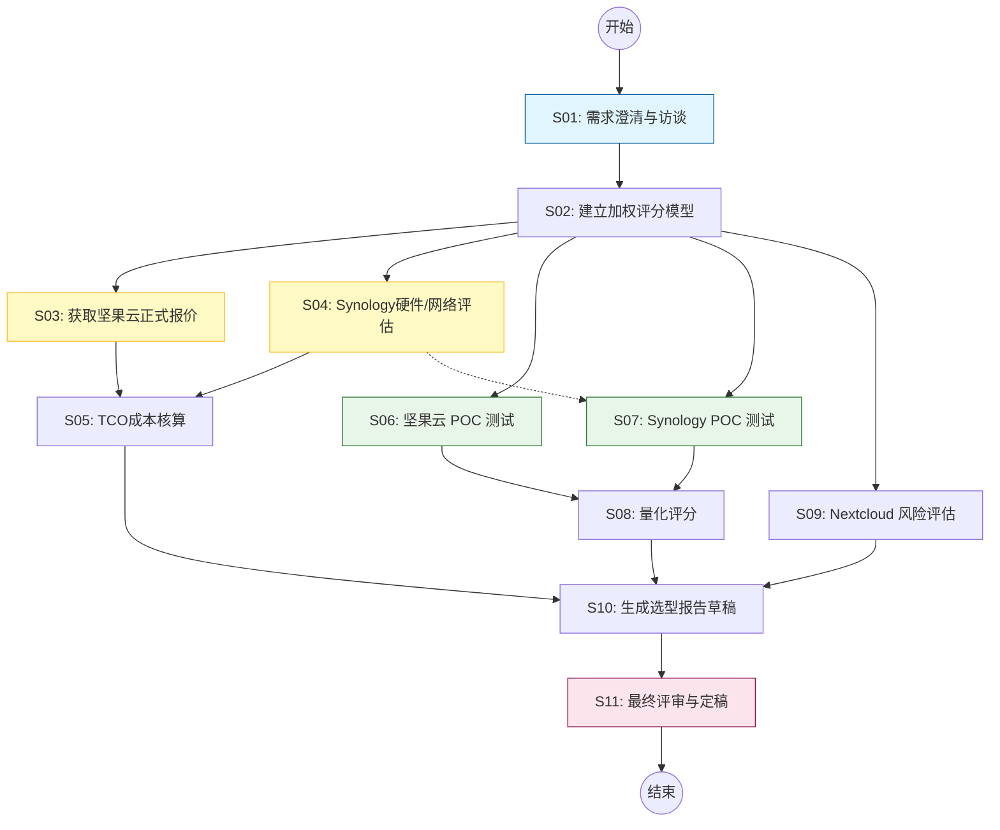

# 阶段 03：具体行动分解

## 1. 执行说明与前提确认

本阶段基于**阶段 02 输出**中已通过 Reviewer 的证据，制定可执行的选型验证计划。
**核心原则**：不将 [Estimate]（估算）或 [Hypothesis]（假设）直接作为最终决策依据。所有关键未知项（H1-H4）必须在行动步骤中被显式转化为“验证任务”，只有当验证结果返回后，才能进入最终报告撰写环节。

**输入上下文回顾**：
- **目标**：为30人研发团队选出文件协作/网盘方案。
- **预算**：≤ ¥30,000/年。
- **核心候选**：坚果云 (A)、Synology Drive (D)。
- **技术备选**：Nextcloud (B)（用于低成本试点对比）。
- **待核验关键点**：精确报价、权限颗粒度定义、远程带宽限制、离线场景频率。

---

## 2. 行动步骤分解

### 阶段 A：需求澄清与基线确立（前置阻塞点）
*此阶段必须完成，否则后续验证缺乏标准。*

| 步骤 ID | Owner | 输入 | 动作 | 依赖 | 预期产出 | 验收方式 | 并行性 |
| :--- | :--- | :--- | :--- | :--- | :--- | :--- | :--- |
| **S01** | `user` | 团队现有工作流描述、痛点列表 | 与研发负责人及3名不同角色成员（前端/后端/测试）进行访谈，明确“细粒度权限”的具体定义（是文件夹级还是单文件级？是否涉及敏感代码隔离？）以及“离线可用”的真实频率。 | 无 | 《需求规格确认书.md》：包含明确的权限矩阵示例、离线场景占比、对版本回溯深度的具体要求。 | 访谈记录签字确认；权限矩阵表被所有受访者认可。 | 串行 |
| **S02** | `agent` | S01 产出的《需求规格确认书.md》 | 根据确认的需求，更新阶段02中的评分权重。例如，若确认需要单文件隐藏，则 Synology/Nextcloud 权重上调，坚果云权重下调。若确认离线极少，则降低客户端同步稳定性权重。 | S01 | 《加权评分模型.xlsx》：包含各维度权重及对应分值公式。 | 权重总和为100%；每个候选方案在模型中有对应的计算逻辑。 | 串行 |

### 阶段 B：商业验证与成本核实（针对候选 A & D）
*此阶段旨在消除 H1（报价）和 H2（硬件/网络成本）的不确定性。*

| 步骤 ID | Owner | 输入 | 动作 | 依赖 | 预期产出 | 验收方式 | 并行性 |
| :--- | :--- | :--- | :--- | :--- | :--- | :--- | :--- |
| **S03** | `user` | 坚果云官网销售联系方式、30人席位需求 | 联系坚果云销售，获取30人企业版正式报价单。重点询问：1. 是否含API调用费；2. 存储扩容单价；3. 是否有年度折扣。 | S01 | 《坚果云正式报价单.pdf》或邮件截图。 | 获得加盖公章或官方邮件的明确金额；确认无隐藏费用。 | **并行** (与S04并行) |
| **S04** | `user` | Synology 官网、本地IT资产清单 | 1. 查询当前办公网络出口带宽。2. 若需自建，询价两台四盘位NAS（如DS923+）及硬盘价格。3. 评估现有服务器资源是否足以部署 Nextcloud 做POC（若无，暂不计入SaaS成本，仅计硬件）。 | S01 | 《私有化部署硬件与网络评估表.xlsx》：包含NAS预估价格、电费预估、带宽瓶颈分析。 | 列出至少两家供应商的NAS报价；确认公司出口带宽数值。 | **并行** (与S03并行) |
| **S05** | `agent` | S03, S04 产出 | 计算 TCO（总拥有成本）。 1. 坚果云：年费 + 预计超额存储费。 2. Synology：硬件折旧(按3年) + 电费 + 潜在运维人力分摊。 3. 对比预算上限 ¥30,000。 | S03, S04 | 《TCO对比分析表.xlsx》。 | 所有成本项均有数据来源标注（引用S03/S04文档）；超出预算的方案被标记红色警告。 | 串行 (等待S03,S04) |

### 阶段 C：功能与技术 POC（概念验证）
*此阶段旨在消除 H3（权限细节）和 H4（体验）的不确定性。使用 S02 定义的加权模型进行打分。*

| 步骤 ID | Owner | 输入 | 动作 | 依赖 | 预期产出 | 验收方式 | 验收标准 | 并行性 |
| :--- | :--- | :--- | :--- | :--- | :--- | :--- | :--- | :--- |
| **S06** | `user` | 坚果云试用账号（申请30天企业试用或创建个人高级版模拟） | **POC 1: 坚果云** 1. 创建模拟项目结构（包含公开区、机密区、归档区）。 2. 测试权限：尝试设置“仅特定用户可见某子文件夹”。 3. 测试版本：修改同一文件5次，查看历史回溯能力。 4. 测试同步：在断网状态下编辑，恢复网络后检查冲突处理。 | S01, S02 | 《坚果云POC测试报告.md》：记录每项功能的实际表现，截图证据。 | 权限测试结论明确（支持/不支持单文件隐藏）；版本回溯成功；冲突处理机制记录在案。 | **并行** (与S07并行) |
| **S07** | `user` | Synology NAS 样机（借用或租用）或 云厂商提供的NAS镜像 *注：若无法获取物理NAS，可使用阿里云/腾讯云上的轻量级NAS服务进行替代测试，但需扣除云服务费差异* | **POC 2: Synology Drive** 1. 初始化NAS，安装 Drive 套件。 2. 配置 LFS 权限，测试单文件级 ACL。 3. 连接 macOS/Windows 客户端，测试局域网同步速度。 4. 模拟远程访问（通过公网IP），测试延迟和稳定性。 | S01, S02, S04 | 《Synology POC测试报告.md》：包含带宽测试数据、权限配置截图、同步日志。 | 单文件权限控制生效；局域网同步速度 < 1s/MB；远程访问延迟 < 200ms。 | **并行** (与S06并行) |
| **S08** | `agent` | S06, S07 产出 | 根据 S02 的《加权评分模型》，对坚果云和 Synology 进行量化打分。填入实测数据。 | S06, S07 | 《初步评分卡.xlsx》。 | 每个维度得分有对应的POC报告章节索引。 | 串行 (等待S06,S07) |

### 阶段 D：备选方案快速评估（Nextcloud）
*仅在 A 和 D 均存在重大缺陷时深入执行，否则仅做桌面研究。*

| 步骤 ID | Owner | 输入 | 动作 | 依赖 | 预期产出 | 验收方式 | 并行性 |
| :--- | :--- | :--- | :--- | :--- | :--- | :--- | :--- |
| **S09** | `agent` | Nextcloud 官方文档、GitHub Issues | 调研 Nextcloud 在 30 人规模下的已知 Bug（特别是大文件同步、WebDAV 兼容性）。估算运维复杂度（升级周期、备份策略）。 | S01 | 《Nextcloud 风险评估简报.md》。 | 列出 Top 3 风险点及缓解措施；给出“推荐/不推荐”结论。 | **并行** (与S06/S07并行，低优先级) |

### 阶段 E：综合决策与报告撰写

| 步骤 ID | Owner | 输入 | 动作 | 依赖 | 预期产出 | 验收方式 | 并行性 |
| :--- | :--- | :--- | :--- | :--- | :--- | :--- | :--- |
| **S10** | `agent` | S05 (TCO), S08 (评分), S09 (风险) | 生成最终选型建议草稿。 1. 若坚果云满足权限且成本最优 -> 推荐坚果云。 2. 若坚果云权限不足且 Synology 网络可行 -> 推荐 Synology。 3. 若两者皆不可行 -> 推荐 Nextcloud 并附带高运维风险提示。 | S05, S08, S09 | 《选型报告草稿.docx》。 | 逻辑自洽：推荐理由必须直接引用前序步骤的数据（如“因为S06显示...所以...”）。 | 串行 |
| **S11** | `user` | S10 草稿 | 评审报告。确认推荐方案是否符合团队文化（如是否接受购买硬件 vs SaaS订阅）。确认淘汰理由充分。 | S10 | 《最终选型报告.pdf》。 | 团队负责人签字批准；所有[Estimate]已替换为[Verified]数据或明确标注为“待签约确认”。 | 串行 |

---

## 3. 依赖关系图 (Mermaid)

**依赖说明**：
- **S01** 是所有后续步骤的根节点，必须首先完成以定义“什么是好的”。
- **S03** 和 **S04** 可以并行执行，因为它们分别面向不同的供应商/内部资源。
- **S06** 和 **S07** 可以并行执行，由不同的人或同一人在不同时间段操作。
- **S05** 必须等待 S03 和 S04 完成，因为需要真实报价数据。
- **S08** 必须等待 S06 和 S07 完成，因为需要实测功能数据。
- **S10** 汇聚所有成本和功能数据。

---

## 4. 关键失败情况与替代路径

| 失败场景 | 触发条件 | 影响范围 | 替代路径 / 停止条件 |
| :--- | :--- | :--- | :--- |
| **F1: 坚果云权限不符** | S06 测试发现坚果云**不支持**单文件级隐藏，而 S01 确认团队**必须**有此功能。 | 方案 A 淘汰。 | **替代路径**：立即提升方案 D (Synology) 或 B (Nextcloud) 的优先级。若 Synology 网络评估 (S04) 良好，则转向 Synology 深度采购流程；若网络不佳，启动 Nextcloud 详细 POC (扩展 S09 为完整实施计划)。 |
| **F2: Synology 远程带宽不足** | S07 测试发现远程访问延迟 > 500ms 或频繁超时，且 S04 确认出口带宽无法升级。 | 方案 D 降级为“仅限内网使用”。 | **替代路径**：若团队有 >20% 远程办公人员，方案 D 不可用。回退至方案 A (坚果云) 或方案 C (阿里云盘，尽管版本管理弱，但可能通过集成 Git 解决部分问题，需重新评估 C)。 |
| **F3: 坚果云报价超预算** | S03 获取的正式报价 > ¥30,000/年。 | 方案 A 预算超标。 | **替代路径**： 1. 谈判：要求销售提供教育/初创优惠或长期合约折扣。 2. 降级：询问是否可混合部署（核心机密数据用 Synology，普通文件用坚果云），但这会增加管理复杂度，通常不推荐。 3. 切换：转向 Synology (若网络可行) 或 Nextcloud。 |
| **F4: POC 环境搭建失败** | S07 中无法获取 Synology 样机或云镜像配置失败。 | 方案 D 无法验证。 | **替代路径**：查阅 Synology 官方最新 Release Notes 和用户社区反馈作为二手证据，但在报告中明确标注“未经实测，存在风险”。若风险过高，直接淘汰 D。 |

---

## 5. Reviewer 自检清单

1.  **覆盖性检查**：
    *   是否覆盖了所有候选方案？是（A, D 重点，B 备选，C 已在阶段02初步淘汰，除非 F1/F2 发生才重新考虑）。
    *   是否解决了阶段02遗留的所有 Hypotheses？
        *   H1 (报价) -> S03 解决。
        *   H2 (带宽) -> S04/S07 解决。
        *   H3 (权限定义) -> S01 定义，S06/S07 验证。
        *   H4 (离线频率) -> S01 调研，S06/S07 测试体验。
2.  **原子性与可验证性**：
    *   每步都有明确产出（PDF, XLSX, MD）。
    *   验收方式具体（如“获得盖章报价”、“延迟<200ms”）。
3.  **依赖完整性**：
    *   无循环依赖。
    *   并行步骤 (S03/S04, S06/S07) 明确标注。
4.  **Owner 标注**：
    *   所有步骤均标注 `user` 或 `agent`。
    *   User 步骤 (S01, S03, S04, S06, S07, S11) 均为同步阻塞点或需要人工交互的点，Agent 步骤负责数据处理和汇总。
5.  **事实前提**：
    *   未将估算值当作已知事实。例如，S05 明确要求基于 S03/S04 的*实际*数据计算，而非阶段02的 Estimate。

**Repair Stage**: 03 (无需回溯到 02，因为阶段02的证据足够支撑当前的验证计划，只是需要将 Estimate 转化为 Verified)。