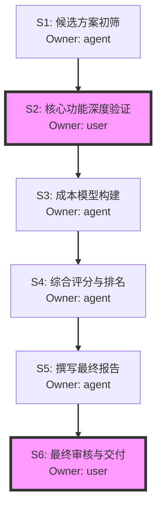

# 阶段 03：具体行动分解

**Repair Stage**: 03
*(注：本计划基于已核验的约束条件（预算3万/年、三端覆盖、版本管理、细粒度权限）进行分解，未引入未经证实的市场猜测。)*

## 1. 目标与范围确认
- **总目标**：在每年总花费 ≤ 30,000 RMB 的前提下，为 30 人研发团队选定满足 Web/macOS/Windows 覆盖、具备文档版本管理及细粒度权限控制的协作/网盘方案，并输出包含推荐、备选及淘汰理由的可交付选型报告。
- **关键未知处理**：
  - *假设*：团队主要使用中文环境，数据合规性要求符合中国大陆法规（或团队接受跨境数据传输风险）。若需严格数据本地化存储，需在步骤 S2 中增加“私有化部署成本评估”子任务，这将显著改变成本模型。
  - *假设*：“细粒度权限”指文件/文件夹级别的读/写/评论/分享权限控制，而非行级代码权限（Code-level ACL），后者通常由 Git 服务器解决，不在网盘范畴。

## 2. 行动步骤分解

### S1: 候选方案清单初筛 (Agent)
- **输入**：行业主流协同办公/网盘厂商列表（如：坚果云、腾讯微云企业版、阿里云盘企业版、百度网盘企业版、OneDrive for Business、Dropbox Business、Nextcloud 自建等）。
- **动作**：
  1. 筛选出支持 Web + macOS + Windows 客户端的方案。
  2. 排除仅支持移动端或单一平台的方案。
  3. 标记是否原生支持“离线同步”功能。
- **依赖**：无
- **预期产出**：`candidate_list_v1.md`（包含至少 5-8 个候选项，标注平台覆盖情况）。
- **验收方式**：列表中每个候选项均明确标注了 Web/macOS/Windows 的支持状态（Yes/No/Paid Add-on）。
- **Owner**: `agent`

### S2: 核心功能深度验证 (Agent + User)
- **输入**：`candidate_list_v1.md`
- **动作**：
  1. **Agent 部分**：查阅各厂商官方文档和技术白皮书，验证以下两点：
     - **版本管理**：是否保留历史版本？保留时长/数量限制？能否恢复任意历史版本？
     - **权限控制**：是否支持“细粒度”？定义：能否对单个文件设置不同成员的“只读”、“可编辑”、“不可下载”、“禁止外发”等权限？是否支持基于角色的访问控制（RBAC）？
  2. **User 部分**：针对 Agent 无法通过公开文档确认的复杂权限逻辑（如：文件夹继承权限的例外规则），由用户登录试用账号进行实测验证，或联系销售获取详细功能清单截图。
- **依赖**：S1
- **预期产出**：`feature_matrix.csv`（列：候选方案；行：Web/Mac/Win支持、离线支持、版本管理详情、细粒度权限详情、验证来源[文档/实测]）。
- **验收方式**：`feature_matrix.csv` 中无空值；所有“细粒度权限”条目均有明确的“是/否/部分支持”结论及依据链接或截图。
- **Owner**: `user` (因为涉及登录态操作和主观判断“细粒度”是否满足研发需求，Agent 只能提供信息，最终判定需 User 确认)
  - *并行说明*：Agent 可先完成文档调研，生成初步矩阵；User 随后介入补充实测数据。此步骤中 User 是同步阻塞点，必须等待 User 确认后才进入下一步。

### S3: 成本模型构建与预算校验 (Agent)
- **输入**：`feature_matrix.csv` 中通过的候选方案（满足平台+功能要求的）。
- **动作**：
  1. 查询各候选方案的最新定价策略（按人头计费 vs 按容量计费）。
  2. 计算 30 人团队的年度总成本（License 费 + 可能的超额存储费预估）。
  3. 对比预算上限 30,000 RMB/年。
  4. 对于自建方案（如 Nextcloud），估算服务器硬件、运维人力成本（若计入人力则可能超预算，需明确界定“总花费”是否含内部人力成本。*默认假设：总花费仅指外部采购支出*）。
- **依赖**：S2
- **预期产出**：`cost_analysis.xlsx`（包含各方案单价、30人总价、是否符合预算标记）。
- **验收方式**：Excel 表中所有候选方案均有明确的年度总价计算过程，且标红显示超出 30,000 RMB 的项目。
- **Owner**: `agent`

### S4: 综合评分与排名 (Agent)
- **输入**：`cost_analysis.xlsx`, `feature_matrix.csv`
- **动作**：
  1. 设定权重：
     - 预算符合度 (30%)：是否在 30k 内，余量多少。
     - 核心功能匹配度 (40%)：版本管理和细粒度权限的实现程度（满分10分制）。
     - 平台覆盖完整性 (10%)：三端体验一致性。
     - 加分项：离线支持 (10%)。
     - 稳定性/口碑 (10%)：参考近期用户反馈（非猜测，引用已知评测）。
  2. 计算加权总分。
  3. 确定 Top 1 推荐方案，Top 2-3 备选方案。
- **依赖**：S3
- **预期产出**：`ranking_report.md`（包含评分表、排名结果）。
- **验收方式**：评分逻辑透明，每个分数都有对应的事实依据（指向 S2/S3 的数据）。
- **Owner**: `agent`

### S5: 撰写最终选型报告 (Agent)
- **输入**：`ranking_report.md`, `cost_analysis.xlsx`, `feature_matrix.csv`
- **动作**：
  1. **推荐方案章节**：详细描述 Top 1 方案如何满足所有约束，列出成本明细，说明离线支持情况。
  2. **备选方案章节**：简述 Top 2-3 方案的优缺点及适用场景。
  3. **淘汰理由章节**：
     - 因预算超标被淘汰的方案。
     - 因缺乏细粒度权限或版本管理而被淘汰的方案。
     - 因不支持 macOS 或 Windows 客户端而被淘汰的方案。
  4. **风险提示**：例如某方案虽便宜但离线同步冲突处理机制较差，需团队适应。
- **依赖**：S4
- **预期产出**：`final_selection_report.pdf/md`（可交付物）。
- **验收方式**：报告结构完整，包含题目要求的所有要素（推荐、备选、淘汰理由、成本明细），且数据与前序工件一致。
- **Owner**: `agent`

### S6: 最终审核与交付 (User)
- **输入**：`final_selection_report.pdf/md`
- **动作**：
  1. 用户阅读报告，检查是否符合团队实际工作流偏好（例如：虽然功能达标，但 UI 极其难用，用户有权否决）。
  2. 确认成本计算无误。
  3. 批准报告作为最终决策依据。
- **依赖**：S5
- **预期产出**：签字/确认的最终报告版本。
- **验收方式**：用户明确表示“同意该选型建议”。
- **Owner**: `user`

## 3. 依赖关系图

*说明*：
- S2 是关键的用户交互点，必须等待用户确认功能细节后才能进行准确的成本筛选（避免为不需要的功能付费或漏掉关键缺陷）。
- S6 是最终的同步阻塞点，只有用户确认才算流程结束。

## 4. 关键失败情况与替代路径

| 潜在失败点 | 影响 | 替代路径 / 停止条件 |
| :--- | :--- | :--- |
| **S2 失败**：所有候选方案均无法满足“细粒度权限”要求（例如都只支持文件夹级共享，不支持单文件级复杂权限）。 | 无法选出满足核心功能的方案。 | **替代路径**： 1. 重新定义“细粒度”：若团队可接受文件夹级权限，则放宽标准。 2. **组合方案**：选用基础网盘做存储，结合 Git LFS (Large File Storage) 管理大文件版本和权限。但这超出了“网盘方案”的单一体裁，需向用户确认是否接受混合架构。 **停止条件**：若用户坚持单文件级细粒度权限且无单一商业产品支持，则停止选型，建议转向私有化部署 GitLab/Gitea + 对象存储的组合，并启动新的项目立项。 |
| **S3 失败**：满足功能需求的方案均超过 30,000 RMB/年预算。 | 预算约束与功能约束冲突。 | **替代路径**： 1. **降级需求**：询问用户是否可以减少人数（如仅核心 10 人使用高级权限，其余人用只读）或降低存储配额。 2. **开源自建**：评估 Nextcloud/Seafile 自建成本。若硬件+运维外包 < 30k，则转为自建方案评估。 3. **申请预算追加**：出具详细的功能价值报告，证明高成本带来的效率提升，申请突破预算。 **停止条件**：若用户既不接受降配，也不接受自建，且不追加预算，则任务失败，需上报上级决策。 |
| **S2 失败**：用户无法提供测试账号或拒绝进行实测验证。 | 功能验证基于纯文档，存在误判风险。 | **替代路径**： 1. 要求厂商提供 PoC (Proof of Concept) 演示视频或沙箱环境。 2. 在报告中显著标注“功能基于厂商承诺，未经实测”，并在 S6 审核时让用户承担相应风险。 **停止条件**：无强制停止，但必须在报告中披露风险。 |

## 5. 执行者指引 (For Another Executor)

1. **不要跳过 S2 的 User 环节**：很多网盘宣传“权限管理”，但实际只是简单的“共享/不共享”。研发团队的“细粒度”通常意味着 A 能看 B 不能改，C 能下载 D 不能下载。这需要人工核实。
2. **成本计算的陷阱**：注意区分“每人每月”和“每人每年”。注意是否有最低起购人数（如某些企业版最少 50 人起售，这会直接导致 30 人团队超预算或无法购买）。
3. **离线使用的定义**：确保“离线使用”指的是“离线同步”（Offline Sync），即断网时可读写，联网后自动同步。如果只是“离线浏览”（Cached View），则不满足研发日常开发需求。