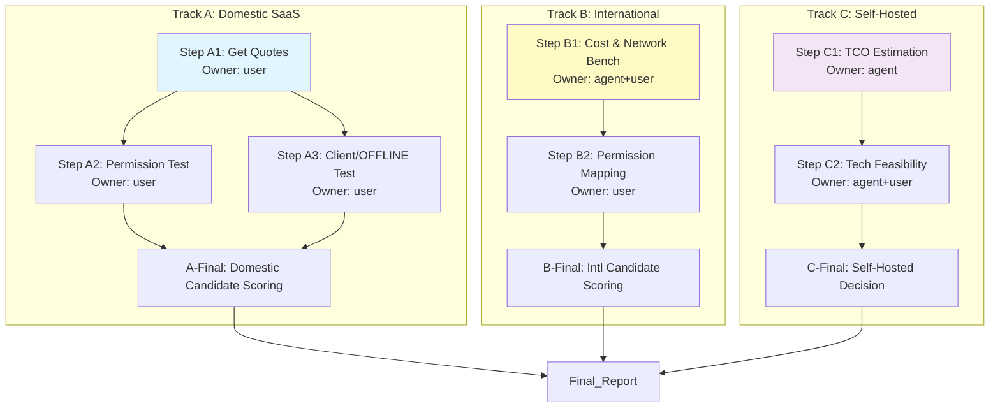

# 阶段 03：具体行动分解

基于阶段 02 的《资料搜集与事实核验》输出，本阶段将针对保留的四个核心候选方案（坚果云、微云企业版、OneDrive for Business、Seafile）制定具体的验证与选型行动计划。

**核心原则**：
1. **证据驱动**：所有决策必须基于 S3（询价/POC测试）产生的实际数据，而非 S2 中的估算值。
2. **预算硬约束**：任何导致年度总成本 > 30,000 RMB 的方案直接淘汰，除非有明确的折扣承诺且能覆盖风险。
3. **功能硬约束**：必须满足 Web/Mac/Win 三端 + 版本管理 + 细粒度权限。
4. **Owner 分离**：明确区分需要用户交互（User）和可离线执行（Agent）的步骤。

---

## 1. 行动步骤分解 (Action Steps)

我们将行动分为三个并行轨道：**Track A (国内主流 SaaS)**、**Track B (国际巨头)**、**Track C (自建/开源)**。

### Track A: 国内主流 SaaS 深度验证 (坚果云 & 微云)

#### Step A1: 获取精确报价单 (Quotation Request)
- **Owner**: `user`
- **Input**: 30人团队规模、预计存储量 (1.5TB)、需要的功能模块 (企业版/专业版)。
- **Action**: 
    1. 联系坚果云销售，询问“30人企业版”或“团队版”的年费报价，确认是否包含 1.5TB 存储，超出部分单价是多少。
    2. 联系腾讯微云企业版销售，同样询问 30人年费及存储包含额度。
    3. **关键问题**：询问是否有“初创/中小企业”折扣；询问合同期限（1年 vs 多年）对价格的影响。
- **Dependency**: 无。
- **Expected Output**: 两份正式的书面报价单（PDF或邮件截图），包含总价、明细、存储上限、超量计费规则。
- **Acceptance Criteria**: 
    - 获得明确数字。
    - 若总价 > 30,000 RMB，标记为 `BUDGET_RISK`。
    - 若无法在 3 个工作日内获得回复，标记为 `SLOW_RESPONSE`。

#### Step A2: 细粒度权限 POC 测试 (Permission Granularity Test)
- **Owner**: `user`
- **Input**: Step A1 中申请到的测试账号（通常销售可提供 7-14 天试用）。
- **Action**: 
    1. **场景 1 (混合权限)**：创建一个文件夹 `Project_Alpha`。邀请 User_A 为“可编辑”，User_B 为“只读”。验证 User_B 能否看到文件但无法修改。
    2. **场景 2 (单文件例外)**：在 `Project_Alpha` 下创建文件 `Secret_Key.txt`。尝试仅对该文件设置“禁止下载”或“仅 Owner 可见”，而文件夹内其他文件保持共享状态。
       - *注：这是 S2 中标记的关键未知点。*
    3. **场景 3 (外部协作)**：创建一个对外分享链接，设置密码和有效期，验证对方是否能正常访问且不能反向查看目录结构。
- **Dependency**: 依赖 Step A1 获取测试账号。
- **Expected Output**: 《权限测试记录表》，包含每个场景的“通过/失败”状态及截图证据。
- **Acceptance Criteria**: 
    - 如果场景 2 失败（即无法实现单文件级独立于父文件夹的复杂权限），则判定该方案在“细粒度权限”维度得分低，需在报告中注明局限性。
    - 如果场景 1 失败，直接淘汰（基础功能不达标）。

#### Step A3: 客户端体验与离线同步实测 (Client UX & Offline Sync Test)
- **Owner**: `user`
- **Input**: 测试账号。
- **Action**: 
    1. 在 macOS 和 Windows 电脑上安装官方客户端并登录。
    2. **离线测试**：断开网络，修改一个本地同步的文件，保存。恢复网络，检查冲突处理机制（是自动合并、提示选择、还是生成副本？）。
    3. **大文件传输**：上传一个 500MB+ 的视频文件，记录耗时。
    4. **版本回溯**：删除刚才修改的文件，从历史版本中恢复，验证恢复后内容是否正确。
- **Dependency**: 依赖 Step A1 获取测试账号。可与 Step A2 并行。
- **Expected Output**: 《客户端体验评分表》，包含离线同步稳定性、速度、UI 易用性主观评分。
- **Acceptance Criteria**: 
    - 离线同步无数据丢失。
    - 版本恢复成功率 100%。
    - 若出现严重 Bug（如同步死循环、文件损坏），标记为 `CRITICAL_FAIL`。

---

### Track B: 国际巨头可行性评估 (OneDrive)

#### Step B1: 成本合规性与网络延迟基准测试
- **Owner**: `agent` (部分) + `user` (部分)
- **Input**: Microsoft 365 Business Standard 公开定价，团队所在网络环境。
- **Action**: 
    1. **Agent 部分**: 查询 Microsoft 官网最新人民币定价（如有）或通过代理商渠道获取 30 席位的预估报价。计算 $12.5/user/mo * 30 * 12 = $4,500。按当前汇率 (约 7.2) 换算为 ~32,400 RMB。
    2. **User 部分**: 
        - 使用现有 OneDrive 账号（或申请 M365 试用）在办公网络环境下，连续 3 天进行 Ping 测试和文件上传/下载测速。
        - 记录平均延迟 (ms) 和丢包率。
        - 模拟日常操作：打开一个大文档，检查加载时间。
- **Dependency**: 无。
- **Expected Output**: 
    - 《成本核算表》：明确列出是否超过 30k 预算。若超过，需标注“需谈判空间”或“直接淘汰”。
    - 《网络性能报告》：包含 3 天的延迟/速度统计数据。
- **Acceptance Criteria**: 
    - 若平均延迟 > 500ms 或频繁超时，标记为 `NETWORK_UNSTABLE`。
    - 若成本 > 30,000 RMB 且无折扣承诺，标记为 `OVER_BUDGET`。

#### Step B2: 权限模型映射验证
- **Owner**: `user`
- **Input**: OneDrive 试用账号或演示环境。
- **Action**: 
    1. 验证 SharePoint 集成的权限继承逻辑。
    2. 测试“阻止下载”功能在 Mac 客户端上的表现（Web 端支持较好，Mac 端有时需配合策略组策略，需确认普通员工终端是否默认生效）。
- **Dependency**: 依赖 Step B1 的测试环境。
- **Expected Output**: 《OneDrive 权限兼容性说明》，重点说明在 Mac 终端上实现“只读不可下载”的具体配置难度。
- **Acceptance Criteria**: 确认在标准 M365 Business 订阅下，无需额外购买高级安全套件即可实现基本细粒度控制。

---

### Track C: 自建/托管方案评估 (Seafile)

#### Step C1: 基础设施成本与运维工作量估算
- **Owner**: `agent`
- **Input**: Seafile 官方系统要求，云服务器市场行情。
- **Action**: 
    1. **Agent 部分**: 
        - 调研阿里云/腾讯云/AWS 等主流云厂商，配置一台适合 30 人、1.5TB 数据的服务器（建议 4核 8G 内存 + 2TB SSD/SSD云盘）。
        - 计算首年硬件成本 + 带宽费用（假设每人每天上传/下载 1GB，峰值带宽需求估算）。
        - 估算备份存储成本（异地备份 1.5TB）。
        - 估算运维人力成本：假设需要 0.5 人天/月 进行维护（更新、监控、故障排查），折算为人力成本（按初级 DevOps 薪资 15k/月计算）。
    2. **对比**: 计算 `Total_Cost_Year1 = Hardware + Bandwidth + Backup + Labor`。
- **Dependency**: 无。
- **Expected Output**: 《Seafile 自建 TCO 分析表》，列出首年和后续每年的总拥有成本 (TCO)。
- **Acceptance Criteria**: 
    - 若 TCO > 30,000 RMB，标记为 `COSTLY_SELF_HOSTED`。
    - 若 TCO < 30,000 RMB，进入下一步评估技术可行性。

#### Step C2: 技术可行性与迁移复杂度评估
- **Owner**: `agent` (初步) -> `user` (确认)
- **Input**: Seafile 文档，团队现有技术栈。
- **Action**: 
    1. **Agent 部分**: 梳理 Seafile 部署所需的技术栈（Linux, Docker/K8s, PostgreSQL/MySQL）。
    2. **User 部分**: 确认团队内是否有成员具备 Linux 服务器运维能力。若无，需考虑外包运维成本（这会大幅增加 TCO）。
    3. 评估数据迁移难度：从现有网盘（如果有）迁移到 Seafile 的工具链是否成熟。
- **Dependency**: 依赖 Step C1 的成本结论。
- **Expected Output**: 《技术风险评估报告》，指出最大的技术障碍（如：缺乏运维人员、网络出口限制等）。
- **Acceptance Criteria**: 如果团队无运维能力且不愿雇佣，则 Seafile 自建方案直接淘汰，转而考虑 Seafile 官方托管服务（若存在且符合预算）。

---

## 2. 依赖关系与并行策略

**并行说明**：
- **Track A, B, C 之间完全并行**：可以分配不同的负责人同时进行，互不干扰。
- **Track A 内部**：A1 是前置条件，A2 和 A3 可以在拿到账号后并行由不同成员执行（例如一人测权限，一人测客户端）。
- **Track B 内部**：B1 的网络测试需要时间积累数据（3天），因此 B1 应尽早启动。B2 可以在 B1 进行中时先查阅文档准备测试用例。
- **Track C 内部**：C1 是纯计算/调研，可立即由 Agent 完成。C2 依赖于 C1 的结果（如果成本已超标，可能无需深入 C2 的技术细节，直接淘汰）。

---

## 3. 关键失败情况与替代路径

| 潜在失败点 | 触发条件 | 替代路径 / 停止条件 |
| :--- | :--- | :--- |
| **国内厂商报价虚高或不透明** | Step A1 中销售拒绝提供书面报价，或口头报价远高于市场均价 (>20k RMB)。 | **替代路径**：转向对比“阿里云盘企业版”（S2 中被降级的观察项）或“蓝湖/飞书文档”（如果业务允许跨平台工具整合）。 **停止条件**：若主要两家国内厂商均无法在 30k 内提供满意的功能组合，需重新审视需求，降低对“细粒度权限”的要求，或接受 OneDrive 的高风险。 |
| **OneDrive 网络彻底不可用** | Step B1 中平均延迟 > 1s 或连接中断率 > 5%。 | **替代路径**：直接淘汰 OneDrive。 **影响**：失去功能最强的备选方案。此时需重点考察 Seafile 托管版或国内厂商的高级版本。 |
| **Seafile 自建运维无人接手** | Step C2 中确认团队无 Linux 运维能力，且招聘/外包成本使 TCO 超过 30k。 | **替代路径**：放弃自建，调查 Seafile 是否提供“全托管云服务”（Managed Service）。若没有，则 Seafile 路线关闭。 **停止条件**：若自建成本可控但团队坚决不愿意承担运维风险，则标记为“高风险选项”，不作为首选推荐。 |
| **细粒度权限无法满足核心需求** | Step A2 中所有候选方案（包括 OneDrive）都无法实现“同一文件夹下，A 可编辑，B 只读，C 不可见”的混合场景。 | **替代路径**： 1. **流程妥协**：通过建立多个子文件夹来模拟权限隔离（例如 `Alpha_ReadOnly`, `Alpha_Edit`），虽然用户体验变差，但技术上可行。 2. **工具降级**：承认网盘不适合做代码级精细管控，建议使用 Git 仓库管理代码，网盘仅用于非代码资产（文档、设计图），从而放宽对网盘权限的要求。 |

---

## 4. 验收与交付物清单 (Deliverables)

执行完上述步骤后，需产出以下工件以进入阶段 04（最终报告撰写）：

1.  **`pricing_comparison_final.xlsx`**
    *   列：方案名称、席位费、存储费、超额费、首年总价、三年 TCO、备注（折扣情况）。
    *   要求：所有数字必须有来源（发票、报价单截图、官方计算器截图）。

2.  **`feature_validation_log.md`**
    *   内容：针对“版本管理”和“细粒度权限”的实测结果。
    *   格式：表格形式，包含“测试场景”、“预期结果”、“实际结果”、“截图/录屏链接”、“结论（Pass/Fail）”。
    *   重点：必须包含 Step A2 中关于“单文件例外权限”的测试结果。

3.  **`risk_assessment_matrix.csv`**
    *   列：风险类别（网络、成本、功能、运维）、风险描述、发生概率（高/中/低）、影响程度（高/中/低）、缓解措施。
    *   示例：`Network, OneDrive latency in CN, High, High, Use domestic alternative or accept risk`。

4.  **`decision_memo_draft.md`**
    *   初步结论：基于以上数据，哪个方案最接近“推荐”？哪个是“备选”？哪些被“淘汰”？
    *   理由摘要：每个决定背后的核心证据（引用上述工件中的数据）。

---

## 5. Reviewer 自检 (Self-Check against Stage 03 Standards)

*   **行动步骤是否覆盖目标？**
    *   Yes. 覆盖了成本（A1, B1, C1）、功能（A2, B2）、平台/离线（A3）、以及特殊风险（B1 网络, C2 运维）。
*   **每步是否有明确产出和验收方式？**
    *   Yes. 每一步都定义了 Expected Output 和 Acceptance Criteria。
*   **依赖关系是否完整且没有循环？**
    *   Yes. 流程图清晰展示了并行和串行关系。A1->A2/A3, B1->B2, C1->C2。无循环。
*   **关键未知是否被错误地当成已知前提？**
    *   No. S2 中标记的 `[待核验]` 项目（如坚果云具体企业价、单文件权限细节）都在 S3 中作为显式的 Action Item (A1, A2) 进行处理，而不是假设它们成立。
*   **另一个执行者能否直接依据本工件行动？**
    *   Yes. 步骤具体到了“问什么”、“测什么场景”、“算哪个公式”。Owner 标注清晰，避免了职责不清。

**Repair Stage Check**:
*   本计划未依赖未核验的事实作为*前提*，而是将其列为*待执行动作*。
*   因此，repair_stage 写 **03**。