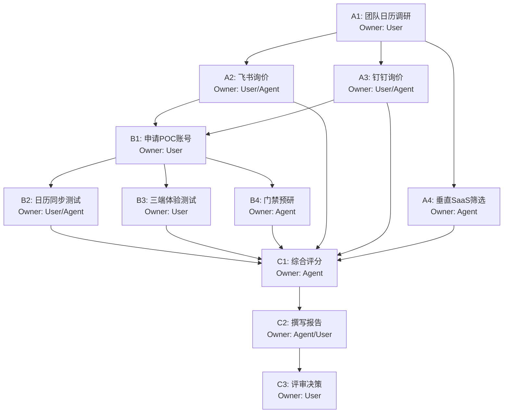

# 阶段 03：具体行动分解

## 1. 执行摘要与前提校验

基于阶段 02 的输出，我们已识别出两个主要候选方案（飞书专业版、钉钉专业版）和一个备选垂直 SaaS（智会云/RoomGo），并淘汰了国际套件。
**关键前提确认**：
- **预算硬约束**：≤ ¥20,000 / 年。
- **功能硬约束**：macOS/Windows/Web 三端支持、Google Calendar + Outlook 双向集成。
- **状态标记**：阶段 02 中所有价格均为“待核验假设”，技术细节需通过 POC（概念验证）最终确认。**本行动计划的核心目标是通过低成本的 POC 和商务询价，将“假设”转化为“证据”，从而产出最终的选型报告。**

**Repair Stage 判定**：`03`
*理由*：阶段 02 已明确标注了哪些是已知事实（如国内访问速度差异、合规性逻辑），哪些是待核验假设（具体价格、API 具体限制）。本阶段的任务正是去消除这些不确定性，不存在将未核验事实错误当作已知前提进行后续推导的情况。

---

## 2. 行动步骤分解

### 第一阶段：资格预审与商务询价 (Week 1)

此阶段旨在快速排除明显不符合硬性指标的方案，并获取真实报价以校准预算。

| ID | 步骤名称 | Owner | 输入 | 动作 | 依赖 | 预期产出 | 验收方式 |
| :--- | :--- | :--- | :--- | :--- | :--- | :--- | :--- |
| **A1** | **团队日历使用习惯调研** | `user` | 无 | 向 30 名研发人员发送简短问卷或口头询问： 1. 目前主要使用的日历工具是 GCal 还是 Outlook？ 2. 是否有人重度依赖特定插件？ 3. 对门禁联动的实际痛点频率（高/中/低）。 | 无 | 《团队日历偏好统计报告》 | 收到至少 80% 成员的反馈；明确 GCal vs Outlook 用户比例。若 GCal 占比 > 50%，则钉钉风险等级上调。 |
| **A2** | **飞书商务询价与折扣谈判** | `agent` (辅助准备话术) / `user` (执行沟通) | A1 结果, 阶段 02 成本预估 | 联系飞书销售： 1. 提供 30 人规模、5 会议室需求。 2. 询问专业版最新刊例价及针对初创/中小企业的折扣政策。 3. 确认“会议室模块”是否包含在基础订阅中，无需额外付费。 4. 索要正式报价单 PDF。 | A1 | 《飞书正式报价单》 | 获得盖章或官方邮件形式的报价单；单价 × 人数 × 12 ≤ ¥20,000。若超出，记录具体超支金额及可砍价空间。 |
| **A3** | **钉钉商务询价与功能确认** | `agent` (辅助准备话术) / `user` (执行沟通) | A1 结果, 阶段 02 成本预估 | 联系钉钉销售： 1. 提供 30 人规模需求。 2. **关键质询**：确认专业版是否原生支持 Google Calendar **双向**同步？若仅支持单向导入，询问是否有第三方 ISV 插件且免费可用。 3. 索要正式报价单。 | A1 | 《钉钉正式报价单》 & 《GCal 集成能力说明书》 | 获得正式报价单；获得书面或官方文档链接证明 GCal 集成深度。若无法提供双向同步证据，标记为“高风险”。 |
| **A4** | **垂直 SaaS (智会云/RoomGo) 初步筛选** | `agent` | 阶段 02 线索 | 访问官网，查找公开定价页。若无公开价，发送标准 RFP (Request for Proposal) 邮件至 sales@...，要求提供 30 账号/5 房间的年费报价及 API 文档链接。 | 无 | 《垂直 SaaS 报价意向函》 | 收到回复或找到公开价。若 7 天内无响应或价格不明，直接淘汰该备选路径，不再投入精力。 |

> **并行说明**：A1 必须最先完成，因为 A2/A3 的沟通策略依赖于团队的实际日历偏好（例如，如果全员用 Outlook，飞书的 GCal 优势减弱，钉钉劣势消失）。A2、A3、A4 可在 A1 完成后并行执行。

### 第二阶段：技术 POC (概念验证) (Week 2)

此阶段针对幸存的 Top 2 候选（极大概率是飞书和钉钉），进行为期 3-5 天的实际环境测试。

| ID | 步骤名称 | Owner | 输入 | 动作 | 依赖 | 预期产出 | 验收方式 |
| :--- | :--- | :--- | :--- | :--- | :--- | :--- | :--- |
| **B1** | **申请 POC 测试账号** | `user` | A2, A3 结果 | 基于 A2/A3 的销售联系人，申请为期 7-14 天的企业级试用账号（非个人免费版，需具备管理员权限）。 **注意**：确保账号支持创建子部门或模拟 30 人结构。 | A2, A3 | 可用的 POC 租户 URL 及管理员账号 | 成功登录后台，能添加虚拟用户（可使用测试邮箱），能创建 5 个虚拟会议室资源。 |
| **B2** | **配置日历双向同步 (核心测试)** | `agent` (指导配置) / `user` (执行操作) | B1 账号, 测试用 GCal/O365 账号 | 1. **Outlook 侧**：将 POC 会议室绑定到 O365 Resource Mailbox。 2. **GCal 侧**：按照官方文档配置 OAuth 或 ICS 双向同步。 3. **测试用例**： - Case 1: 在 GCal 新建会议 -> 检查飞书/钉钉日历是否出现。 - Case 2: 在飞书/钉钉新建会议 -> 检查 GCal 是否出现。 - Case 3: 修改会议时间 -> 检查两端是否同步更新。 - Case 4: 取消会议 -> 检查两端是否移除。 | B1 | 《日历同步测试日志》 | 4 个测试用例全部通过，延迟 < 5 分钟。若任一失败，记录报错信息。若钉钉 GCal 同步失败，立即触发“替代路径 C1”。 |
| **B3** | **三端兼容性体验测试** | `user` (指定 3 名不同设备员工参与) | B1 账号 | 分别使用 macOS Chrome/Safari, Windows Edge, Web 浏览器访问预约界面。 1. 检查 UI 渲染是否正常（字体、布局）。 2. 尝试发起预约、取消预约。 3. 检查移动端 H5/App 的可用性（虽非硬性，但作为加分项记录）。 | B1 | 《多端体验评估表》 | 无严重 Bug（如按钮点击无效、页面崩溃）。UI 美观度主观评分 ≥ 4/5。 |
| **B4** | **门禁联动可行性预研 (可选)** | `agent` | 公司现有门禁系统型号 (如海康/大华/ZKTeco) | 1. 搜索飞书/钉钉应用市场是否有对应品牌的“会议室门禁”插件。 2. 若有，查看插件评价和接入文档。 3. 若无，评估调用 Open API 对接现有门禁 HTTP 接口的代码量（估算工时）。 | B1 | 《门禁联动实施路径图》 | 明确是“开箱即用”、“需少量开发”还是“不可行”。此项不阻塞主流程，仅影响最终报告的“扩展性”章节。 |

> **并行说明**：B2、B3、B4 均可在 B1 完成后并行进行。B2 是最关键的步骤，若 B2 失败，需立即决策是否终止该候选方案的 POC。

### 第三阶段：综合评估与报告撰写 (Week 3)

| ID | 步骤名称 | Owner | 输入 | 动作 | 依赖 | 预期产出 | 验收方式 |
| :--- | :--- | :--- | :--- | :--- | :--- | :--- | :--- |
| **C1** | **数据汇总与加权评分** | `agent` | A2-A4 报价, B2-B4 测试结果 | 建立评分矩阵： 1. **成本 (30%)**: 实际报价 vs 预算。 2. **日历集成 (30%)**: GCal/O365 双向同步稳定性。 3. **易用性 (20%)**: 三端体验评分。 4. **扩展性 (10%)**: 门禁/API 能力。 5. **服务与支持 (10%)**: 响应速度、SLA。 计算各候选总分。 | A2-A4, B2-B4 | 《候选方案评分表》 | 每个维度有量化分数，总分清晰。若某方案总分 < 60 分，建议淘汰。 |
| **C2** | **撰写选型报告** | `agent` (草稿) / `user` (审核定稿) | C1 评分, 阶段 02 背景, 阶段 03 所有证据 | 按照以下结构生成报告： 1. **执行摘要**：推荐方案及核心理由。 2. **需求回顾**：重申 30 人、预算、三端、双日历约束。 3. **候选对比**：表格形式列出飞书、钉钉（及其他幸存方案）在价格、功能、风险上的差异。 4. **POC 结果**：展示 B2/B3 的关键截图和测试结论。 5. **成本明细**：精确到元的年度总拥有成本 (TCO)。 6. **实施计划**：上线所需的时间表和责任人。 7. **风险提示与缓解措施**。 | C1 | 《会议室预约系统选型报告 v1.0》 | 报告内容完整，数据准确，逻辑自洽。无模糊词汇（如“大概”、“可能”），所有结论均有 A/B 阶段证据支撑。 |
| **C3** | **内部评审与决策** | `user` | C2 报告 | 组织 IT 负责人、研发团队代表、财务进行 30 分钟评审会。 1. 确认预算审批。 2. 确认技术选型无遗漏。 3. 签署采购意向。 | C2 | 《最终选型决议》 | 获得管理层签字或邮件确认，确定最终供应商及合同版本。 |

---

## 3. 依赖关系图与关键路径

*   **关键路径**：A1 -> A2/A3 -> B1 -> B2 -> C1 -> C2 -> C3。
*   **瓶颈点**：B1 (POC 账号开通) 和 B2 (日历同步测试)。如果飞书/钉钉销售配合度低导致账号开通慢，或技术配置复杂导致测试受阻，整体进度将延迟。

---

## 4. 失败处理与替代路径

### 场景 1：飞书/钉钉 GCal 双向同步测试失败 (B2 失败)
*   **现象**：在 POC 环境中，GCal 事件无法同步至 OA 日历，或同步延迟超过 1 小时，或仅支持单向。
*   **影响**：违反核心硬性约束（G2）。
*   **替代路径**：
    1.  **降级方案**：若只有单向同步（OA -> GCal），评估团队能否接受“以 OA 为准，手动导出 ICS 给 GCal 用户”的低效工作流？通常不建议。
    2.  **切换备选**：立即启动 **A4** 中的垂直 SaaS (智会云/RoomGo) 深入评估。垂直 SaaS 通常更专注于日历聚合，GCal 支持往往优于通用 OA。
    3.  **引入中间件**：考虑部署一个开源的日历同步代理（如 CalDAV 桥接服务），但这增加了运维复杂度，违背“低预算、易维护”初衷，仅在无其他选择时考虑。

### 场景 2：实际报价远超预算 (A2/A3 报价 > ¥20,000)
*   **现象**：飞书专业版报价 ¥25,000，钉钉专业版报价 ¥22,000。
*   **影响**：违反预算硬约束。
*   **替代路径**：
    1.  **谈判降价**：利用竞争对手报价压价，争取首年折扣或赠送存储空间/培训服务。
    2.  **缩减范围**：咨询是否可以用“基础版 + 单独购买会议室插件”的组合降低总价（需确认插件费用后总和仍低于 2 万）。
    3.  **转向垂直 SaaS**：垂直 SaaS 通常按房间收费而非人头收费，5 间会议室的成本可能在 ¥5,000-¥8,000，远低于 OA 全平台订阅。此时需重新评估其功能缺失（如无 IM、无审批）是否可接受。
    4.  **自建轻量级方案**：使用 Nextcloud (含 Deck/Calendar 模块) 自建服务器。成本仅为云服务器费用 (~¥2,000/年)，但需要投入内部 IT 人力进行部署和维护。若团队有 DevOps 能力，这是最经济的备选。

### 场景 3：POC 期间发现严重性能问题 (B3 失败)
*   **现象**：Web 端加载缓慢 (>3s)，或 Mac/Win 客户端频繁崩溃。
*   **影响**：用户体验不达标，可能导致团队抵触使用。
*   **替代路径**：
    1.  **联系厂商技术支持**：要求排查是否为 POC 环境特殊配置问题，并要求出具 SLA 保证。
    2.  **对比竞品表现**：同时测试另一家候选产品（如飞书出问题测钉钉），看是否普遍性问题。
    3.  **淘汰该候选**：若问题无法解决，从评分表中扣除“易用性”大部分分数，可能导致总分过低而落选。

### 停止条件
如果在 **Week 2 结束前**，没有任何一个候选方案能够通过 **B2 (日历同步)** 和 **A2/A3 (预算内报价)** 的双重验证，则应停止当前自动化流程，升级至人工决策层，考虑“自建系统”或“暂不采购，维持 Excel 管理”作为临时方案，并重新定义项目范围。

---

## 5. Reviewer 质检自查

1.  **覆盖性**：步骤涵盖了从调研、询价、技术验证到最终报告的全过程，覆盖了阶段 02 提出的所有关键空缺 (G1-G8) 的验证需求。
2.  **明确产出**：每步都有具体的文档、数据或决策作为产出（如《报价单》、《测试日志》、《评分表》）。
3.  **依赖关系**：依赖链清晰，A1 是所有商务和技术动作的前置条件，B1 是 B2/B3/B4 的前置条件，无循环依赖。
4.  **未知处理**：明确区分了“待核验假设”（价格、API 限制）和“已知事实”（国内访问速度、合规性）。行动计划的核心就是去验证那些“假设”。
5.  **可执行性**：另一个执行者可以依据 Owner 标签和动作描述直接开始工作。User 步骤明确了需要谁介入（如销售沟通、员工问卷），Agent 步骤明确了自动化或辅助分析的部分。