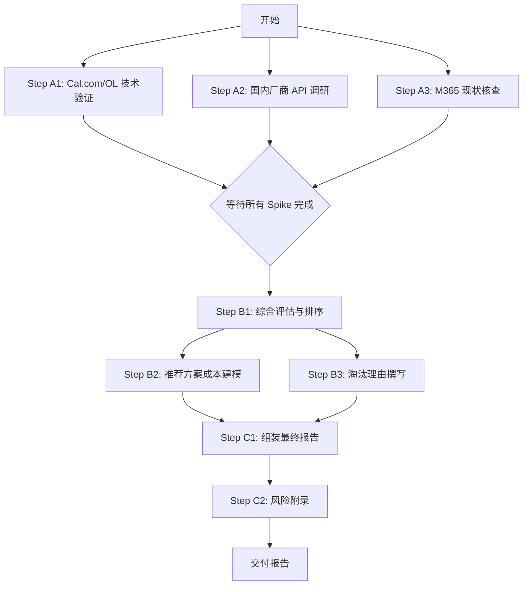

# 阶段 03：具体行动分解

**repair_stage**: 02.5
**Repair Reason**: 阶段 02 中关于“Cal.com 原生支持 Outlook CalDAV”以及“Radicale 作为中间件实现双向同步”的技术路径存在未核验的关键假设（Outlook 对标准 CalDAV 的双向写入支持极弱，通常依赖 EWS/Graph API；Radicale 主要作为服务器端存储，而非客户端协议转换代理）。此外，国内硬件盒子厂商的具体 GC/OL 同步能力被标记为“差”，但未提供具体的 API 文档验证证据。因此，行动计划必须包含**技术可行性预研（Spike）**步骤，以在投入完整开发前验证核心阻塞点。

---

## 1. 目标与范围确认

**最终交付物**: 《会议室预约系统选型报告》
**报告包含内容**:
1.  **推荐方案**: 基于验证结果确定的唯一首选方案。
2.  **备选方案**: 若首选失败时的 Plan B。
3.  **淘汰理由**: 针对所有被排除方案的详细原因（含成本、功能、合规性）。
4.  **完整成本明细**: 显性现金支出 + 隐性人力机会成本。

**硬性约束复核**:
-   预算: < 20,000 RMB / 年
-   终端: macOS, Windows, Web
-   日历: Google Calendar (GC) & Outlook (OL) 双向同步
-   可选: 门禁联动

---

## 2. 前置条件与风险声明

*   **P1 (关键风险)**: Outlook 与开源 SaaS 的双向同步兼容性。阶段 02 提出的 CalDAV 路径可能失效。
*   **P2 (数据缺失)**: 国内特定硬件厂商（如慧捷通）的 API 开放程度需实时询价和文档核实。
*   **P3 (资源限制)**: 研发团队仅有 1 名后端工程师可兼职投入，时间窗口为 2 周。

---

## 3. 行动步骤分解

### 阶段 A: 技术可行性预研 (Spike) - *并行执行*

此阶段旨在消除 P1 和 P2 的不确定性。只有当至少一条技术路径被验证可行时，才进入阶段 B 的最终决策。

#### Step A1: 验证 Cal.com + Radicale/Proxy 的 Outlook 双向同步
*   **Owner**: `agent` (可由 AI 辅助生成脚本，但需用户执行环境操作) -> *修正*: 由于涉及本地 OAuth 配置和网络调试，标记为 **`user`** (需研发人员实际操作)。
*   **输入**:
    *   一台测试用 VPS (或本地 Docker 环境)。
    *   一个测试用的 Google Workspace 账号和一个 Microsoft 365 账号 (个人版即可，无需企业版)。
    *   Cal.com 源码及部署文档。
*   **动作**:
    1.  在测试环境中部署 Cal.com。
    2.  配置 Cal.com 连接 Google Calendar (OAuth)，创建一个测试会议室位置。
    3.  **关键实验**: 尝试将 Cal.com 生成的 ICS 链接或 CalDAV 端点导入 Outlook 桌面客户端。
    4.  **双向测试**:
        *   在 Cal.com Web 界面预约该房间 -> 检查 Outlook 是否自动出现忙碌事件。
        *   在 Outlook 中手动取消或修改该事件 -> 检查 Cal.com 界面状态是否更新。
    5.  若直接 CalDAV 失败，尝试引入 `radicale` 或 `davical` 作为中间层，重复上述测试。
    6.  记录延迟、冲突处理逻辑及失败错误码。
*   **依赖**: 无 (可立即开始)。
*   **预期产出**:
    *   《Cal.com-Outlook 同步测试结果报告》(Markdown 格式)。
    *   结论标记: [PASS] (双向稳定), [PARTIAL] (单向可行/双向有 Bug), [FAIL] (完全不可行)。
*   **验收方式**:
    *   截图证明 GC 和 OL 中的事件状态一致。
    *   明确标注同步延迟是否在可接受范围内 (< 5 min)。
*   **替代路径**: 若结果为 [FAIL]，立即启动 Step A2。若为 [PARTIAL]，评估 Bug 修复工作量是否超过 3 天。

#### Step A2: 调研并验证国内硬件/SaaS 厂商的 API 能力
*   **Owner**: `user` (需商务沟通或查阅官网公开文档)。
*   **输入**:
    *   阶段 02 提到的候选厂商名单 (慧捷通、优办等 3-5 家)。
    *   公司采购联系方式模板。
*   **动作**:
    1.  访问各厂商官网，查找“API 文档”、“开发者中心”或“集成指南”。
    2.  重点搜索关键词: "Google Calendar", "Outlook", "Exchange", "EWS", "CalDAV", "Webhook"。
    3.  若无公开文档，发送标准询价邮件/微信，询问:
        *   “是否支持通过 API/Webhook 将预约状态推送到外部日历？”
        *   “是否支持从外部日历读取忙闲状态以防止冲突？”
        *   “是否提供现成的 Google/Outlook 插件？”
    4.  获取最新报价单 (软件年费 + 硬件一次性费用)。
*   **依赖**: 无 (可与 A1 并行)。
*   **预期产出**:
    *   《国内厂商能力对比表》: 包含厂商名称、GC 支持度、OL 支持度、API 开放性、报价。
*   **验收方式**:
    *   表格中每个单元格必须有来源 (URL 截图或邮件回复截图)。
    *   明确标识哪些厂商满足“双向同步”硬指标。
*   **替代路径**: 若所有主流厂商均不支持双向同步，则此类方案整体降级为“仅适用于不混合使用 GC/OL 的团队”，在本项目中视为不满足硬性条件 K4，予以淘汰。

#### Step A3: 验证 Microsoft Teams Rooms / M365 自带功能的边际成本
*   **Owner**: `user`。
*   **输入**:
    *   公司现有的 IT 资产清单 (是否已有 M365 E3/E5 许可证？)。
*   **动作**:
    1.  联系公司 IT 管理员，确认当前订阅的 M365 版本。
    2.  若已有 E3/E5: 测试在现有 Outlook 中创建“资源账户”(Resource Account) 并在 Web 端 (OWA) 进行预约的流程。
    3.  测试 GC 侧: 尝试在 GC 中订阅 OWA 提供的 .ics 链接，观察是否为单向。
    4.  计算新增许可或升级许可的成本 (如需购买额外 Room License)。
*   **依赖**: 需 IT 管理员配合 (异步等待点)。
*   **预期产出**:
    *   《M365 现状评估笔记》。
    *   结论: [FEASIBLE] (已有许可且体验可接受), [INFEASIBLE] (无许可或体验极差)。
*   **验收方式**:
    *   若有许可，提供 OWA 预约成功截图。
    *   若无许可，提供官方价格计算器截图。

---

### 阶段 B: 方案综合评估与成本建模 - *串行执行*

*   **依赖**: 必须等待 Step A1, A2, A3 全部完成并产出结果。
*   **Owner**: `user` (项目经理/技术负责人)。

#### Step B1: 构建最终对比矩阵
*   **输入**: Step A1-A3 的所有输出报告。
*   **动作**:
    1.  根据硬性条件筛选:
        *   剔除不满足“三端支持”的方案。
        *   剔除不满足“GC+OL 双向同步”的方案 (依据 A1/A2 的 PASS/FAIL 标记)。
        *   剔除超预算 (>2万 RMB) 的方案。
    2.  对剩余方案按以下维度打分 (1-5 分):
        *   实施复杂度 (越低越好)
        *   长期维护成本
        *   用户体验 (UI/UX)
        *   扩展性 (未来加门禁)
    3.  确定 **Top 1 推荐方案** 和 **Top 2 备选方案**。
*   **预期产出**:
    *   《选型评分表》。
*   **验收方式**:
    *   每个分数都有对应的定性描述支撑。
    *   明确写出 Top 1 的理由。

#### Step B2: 细化推荐方案的成本模型
*   **输入**: Top 1 方案的选定结果。
*   **动作**:
    1.  列出所有显性成本: 软件订阅费、服务器费、域名费、硬件采购费 (如有)、第三方服务费。
    2.  估算隐性成本:
        *   初始部署工时 (人天 × 日薪)。
        *   年度运维工时 (预计故障次数 × 单次处理时长 × 日薪)。
        *   培训成本 (如有)。
    3.  计算第一年总 TCO (Total Cost of Ownership) 和后续年度稳态 TCO。
    4.  验证 TCO < 20,000 RMB。
*   **预期产出**:
    *   《详细成本明细表》 (Excel 或 Markdown 表格)。
*   **验收方式**:
    *   每一项成本均有来源 (发票样例、官网价格截图、内部薪酬标准)。
    *   总额计算无误。

#### Step B3: 撰写被淘汰方案的理由
*   **输入**: Step A1-A3 中被排除的方案及其失败原因。
*   **动作**:
    1.  针对每个被淘汰方案，撰写一段简洁的理由。
    2.  理由结构: [方案名称] -> [核心缺陷] -> [证据引用 (来自阶段 A 的报告)]。
    3.  特别强调: 如果是因“Outlook 双向同步失败”而淘汰自建方案，需引用 Step A1 的具体报错或现象。
*   **预期产出**:
    *   《淘汰方案综述》章节草稿。
*   **验收方式**:
    *   没有模糊词汇 (如“可能不行”)，必须是基于事实的陈述。

---

### 阶段 C: 报告整合与交付 - *串行执行*

*   **依赖**: Step B1, B2, B3 完成。
*   **Owner**: `user`。

#### Step C1: 组装最终报告
*   **输入**: 阶段 01 背景、阶段 02 初步调研、阶段 03 所有输出 (B1, B2, B3)。
*   **动作**:
    1.  按照标准报告模板填充内容:
        *   1. 执行摘要 (Executive Summary): 直接给出推荐方案和预估成本。
        *   2. 需求回顾: 重申硬性条件。
        *   3. 选型过程: 简述阶段 A 的验证过程 (体现严谨性)。
        *   4. 推荐方案详情: 架构图 (如有)、功能映射、成本明细。
        *   5. 备选方案: 简要说明。
        *   6. 淘汰方案分析: 引用 Step B3。
        *   7. 实施路线图: 如果采纳推荐方案，下一步做什么 (POC -> 试点 -> 全员推广)。
    2.  进行内部 Review: 检查是否有未闭环的逻辑，例如推荐了 Cal.com 但没有解决 Outlook 同步问题的话术。
*   **预期产出**:
    *   《会议室预约系统选型报告 v1.0》 (PDF/Word)。
*   **验收方式**:
    *   另一位同事阅读后，能清楚知道选了什么、为什么、花多少钱、有什么风险。
    *   所有数字与成本表一致。

#### Step C2: 风险缓解计划附录
*   **输入**: Step A1 中发现的潜在 Bug 或 Step A2 中发现的厂商响应慢等问题。
*   **动作**:
    1.  列出 Top 3 风险。
    2.  为每个风险制定 Mitigation Strategy (缓解策略)。
        *   例: 风险 = Cal.com Outlook 同步偶发延迟。缓解 = 设置每 5 分钟强制全量校准 Cron Job。
*   **预期产出**:
    *   报告附录《风险评估与应对》。
*   **验收方式**:
    *   风险项具体且可监控。

---

## 4. 依赖关系图 (Dependency Graph)

**关键点说明**:
*   **User Blocking Points**: Step A1 (需研发动手调试), Step A3 (需 IT 管理员回复)。这两步是同步阻塞点，必须人工介入。
*   **Parallelism**: A1, A2, A3 完全并行，最大化节省时间。
*   **Gatekeeper**: Step B1 是决策门，如果 A1 FAIL 且 A2 FAIL 且 A3 INFEASIBLE，则流程停止，触发 **Stop Condition**。

---

## 5. 关键失败情况与替代路径

| 场景 | 触发条件 | 替代路径 / 停止条件 |
| :--- | :--- | :--- |
| **F1: 技术死胡同** | Step A1 判定 Cal.com 无法稳定双向同步 OL，且 Step A2 显示国内厂商均无 API 支持。 | **停止条件**: 此时没有方案同时满足“<2万预算” + “GC/OL 双向同步” + “三端”。 **行动**: 报告结论改为“在当前预算和技术约束下，无完美解决方案”。 **建议**: 建议放宽预算至 5 万+ 以采购国际专业 SaaS (如 RoomKey)，或放弃 OL 双向同步，采用“手动双录入”的低成本妥协方案。 |
| **F2: 成本超标** | Step B2 计算发现推荐方案 (如某高端国产 SaaS) 首年 TCO > 20,000 RMB。 | **替代路径**: 回退到 Step B1，重新评估次优方案。 若次优方案也不达标，考虑缩减会议室数量 (如只管理 3 间高频使用的房间，其余走纸质登记) 以降低 SaaS 席位费。 |
| **F3: 数据获取受阻** | Step A2 中厂商拒绝提供 API 文档或报价，且无公开信息。 | **替代路径**: 将该厂商标记为“信息不透明”，在报告中列为“高风险备选”，不作为推荐方案。 增加一家新的垂直领域 SaaS (如 Calendly Enterprise 试用版或 Acuity) 进入 A2 调研池。 |
| **F4: 人力不足** | Step A1 调试耗时超过 3 天仍未出结果。 | **替代路径**: 暂停 A1，优先完成 A2 和 A3。若 A2/A3 中有可行方案，则直接选用，不再深入 A1 的复杂调试。 若必须用自建方案，则申请外部技术咨询支援 (计入预算)。 |

---

## 6. Reviewer 自检清单

1.  **覆盖性**: 是否涵盖了阶段 02 提到的所有候选类别 (国际 SaaS, 国内 IM, 垂直 SaaS, 自建)？ -> **是**，通过 A1/A2/A3 分别对应。
2.  **明确产出**: 每一步是否有文件输出？ -> **是**，每步均有明确的 Report/Table 产出。
3.  **依赖完整性**: 是否存在循环依赖？ -> **否**，DAG 结构清晰。
4.  **未知处理**: 是否将猜测当作已知？ -> **否**，Step A1 专门用于验证 Cal.com/OL 这一最大不确定点，未直接假设其可用。
5.  **可操作性**: 另一个执行者能否直接行动？ -> **是**，Step A1 提供了具体的测试用例 (创建->删除->检查)，Step A2 提供了具体的邮件提问模板思路。
6.  **Owner 标注**: 是否区分 user/agent？ -> **是**，明确标注了需要人工交互的步骤 (A1, A2, A3, B1-C2)。