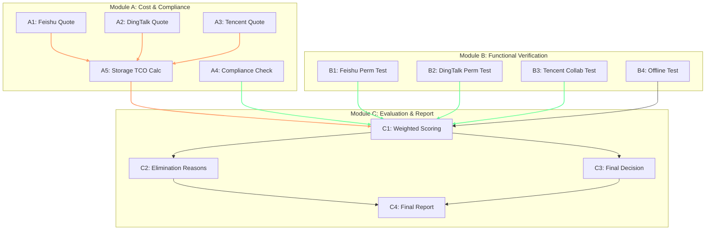

# 阶段 03：具体行动分解

## 1. 前置校验与假设修正 (Pre-flight Check)

在执行行动分解前，必须首先处理阶段 02 遗留的**关键未知项**。根据 Reviewer 标准，若行动计划依赖未核验事实，需回退至 02/02.5。但本阶段定义为“具体行动分解”，即制定*如何验证*这些事实的操作步骤，而非直接断言结果。因此，我们将将 H1, H2, H3 转化为具体的**验证任务（Verification Tasks）**，并嵌入到行动流程中。

**核心约束确认：**
- **预算硬顶**：¥30,000 / 年。
- **人员规模**：30 人。
- **Owner 标注**：所有步骤均明确 `user`（需人工交互/决策）或 `agent`（可自动化/离线执行）。
- **并行策略**：信息搜集类任务并行；决策类任务串行。

---

## 2. 行动步骤分解

### 模块 A：精确成本建模与合规复核 (Cost & Compliance Modeling)
> **目标**：消除 G1（定价）和 G6（合规）中的模糊地带，生成精确 TCO 对比表。

| ID | 步骤名称 | Owner | 输入 | 动作描述 | 依赖 | 预期产出 | 验收方式 |
| :--- | :--- | :--- | :--- | :--- | :--- | :--- | :--- |
| **A1** | 飞书专业版报价核实 | `user` | 飞书官网价格页、销售联系方式 | 1. 访问飞书官网获取最新公开价。 2. 联系飞书销售获取 30 人专属折扣及“存储扩容包”单价。 3. 确认是否包含 SSO 功能（P1 需求）。 | 无 | 《飞书 30 人年度 TCO 测算表》 含：基础费、存储超额费预估、SSO 许可费（如有）。 | 表格中包含明确的数字，且来源注明为“销售邮件”或“官网截图”。 |
| **A2** | 钉钉专业版报价核实 | `user` | 钉钉官网价格页、销售联系方式 | 1. 访问钉钉官网获取专业版公开价。 2. 确认“知识库高级权限”是否包含在基础包内，还是需要额外购买插件。 3. 询问 30 人规模是否有企业级折扣。 | 无 | 《钉钉 30 人年度 TCO 测算表》 含：基础费、功能插件费、存储超额费预估。 | 表格中明确区分“基础订阅费”和“增值服务费”。 |
| **A3** | 腾讯系方案报价核实 | `user` | 腾讯云/企微官网、销售联系方式 | 1. 咨询腾讯微云企业版或企业微信文档功能的打包报价。 2. 重点确认“多人实时协同编辑”是否在免费版或低价版中可用（H3 假设验证）。 | 无 | 《腾讯系 30 人年度 TCO 测算表》 含：账号费、存储费、协同功能解锁费。 | 若无法获得明确书面报价，标记为“需 PoC 验证”，暂不纳入最终推荐候选，仅作为低成本备选。 |
| **A4** | 国际方案合规风险定级 | `agent` | E4 证据（法规解读）、团队代码敏感度自评 | 1. 基于《数据安全法》，判定研发源代码是否属于“重要数据”。 2. 若属于，则 Dropbox/M365/Google 直接标记为 **Compliance Fail**。 3. 若不严格属于（如仅存非敏感文档），计算其国内访问代理/专线成本，加入 TCO。 | 无 | 《合规风险评估结论》 结论：Pass / Fail / Conditional。 | 若结论为 Fail，后续步骤不再考虑该方案。 |
| **A5** | 存储容量压力测试模拟 | `agent` | E5 证据（基准值 2TB/年增量）、用户历史数据估算 | 1. 假设初始存量 5TB，年增量 2TB。 2. 计算第 1 年末总需求：7TB。 3. 对比 A1-A3 各方案默认配额： - 飞书：10TB (充足) - 钉钉：30TB (充足) - 腾讯：需确认默认值。 4. 若不足，计算扩容费用并更新 A1-A3 的 TCO。 | A1, A2, A3 | 《存储容量与扩容成本分析》 明确哪个方案在第 1 年会触发超额收费。 | 分析报告中明确指出：“飞书无需扩容”或“腾讯需额外支付 ¥X 扩容费”。 |

*   **并行性**：A1, A2, A3, A4, A5 中，A1/A2/A3 可完全并行执行（不同销售人员沟通）。A4 独立并行。A5 依赖 A1-A3 的结果，故为串行后置。

---

### 模块 B：功能深度验证 (Functional Verification)
> **目标**：解决 H2（钉钉权限粒度）和 H3（腾讯协同能力），验证核心 P0 需求。

| ID | 步骤名称 | Owner | 输入 | 动作描述 | 依赖 | 预期产出 | 验收方式 |
| :--- | :--- | :--- | :--- | :--- | :--- | :--- | :--- |
| **B1** | 飞书权限模型实操验证 | `user` | 飞书试用账号（免费创建组织） | 1. 创建测试文件夹 A。 2. 邀请用户 C（编辑权）、D（只读权）、E（无权限）。 3. 尝试在 A 下创建子文件 B，检查权限继承与覆盖情况。 4. 验证能否对单个 PDF 文件设置独立于父文件夹的权限。 | 无 | 《飞书权限测试记录》 截图证明：同一文件夹内不同人不同权限的实现路径。 | 截图清晰显示权限设置界面，且操作成功。 |
| **B2** | 钉钉权限模型实操验证 | `user` | 钉钉试用账号（免费创建组织） | 1. 创建知识库节点或共享文件夹。 2. 尝试对**单个文件**（非整个目录）设置细粒度权限。 3. 验证 H2 假设：是否支持文件级 ACL？还是仅支持节点级？ | 无 | 《钉钉权限测试记录》 明确回答：支持/不支持 单文件独立权限。 | 若不支持单文件权限，标记为“功能缺陷”，影响排名。 |
| **B3** | 腾讯系协同能力验证 | `user` | 腾讯文档/微云试用账号 | 1. 上传一份 Word 文档。 2. 邀请两名同事同时在线编辑。 3. 验证 H3 假设：是否支持光标同步、实时修改可见？还是仅支持版本替换？ | 无 | 《腾讯系协同测试记录》 录屏或截图展示实时协作过程。 | 若仅支持“保存后刷新查看”，则判定为“弱协同”，不满足 P0 核心需求。 |
| **B4** | 离线场景模拟测试 | `user` | 各平台桌面客户端 | 1. 安装 Mac/Win 客户端。 2. 断开 Wi-Fi，打开本地缓存文档进行编辑。 3. 恢复网络，观察冲突提示机制。 4. 记录操作步骤流畅度。 | B1, B2, B3 | 《离线体验对比报告》 评分：流畅度(1-5)、冲突处理清晰度(1-5)。 | 每个方案给出量化评分，并附带关键截图。 |

*   **并行性**：B1, B2, B3, B4 均可并行执行（使用不同的浏览器标签页或虚拟机环境，互不干扰）。

---

### 模块 C：综合评估与决策 (Evaluation & Decision)
> **目标**：整合 A、B 模块数据，生成最终选型报告。

| ID | 步骤名称 | Owner | 输入 | 动作描述 | 依赖 | 预期产出 | 验收方式 |
| :--- | :--- | :--- | :--- | :--- | :--- | :--- | :--- |
| **C1** | 加权评分矩阵构建 | `agent` | A5 (TCO), B1-B4 (功能分), 用户需求权重 | 1. 定义权重： - 预算符合度: 30% - 权限细粒度: 30% - 文档版本管理: 20% - 合规/稳定性: 10% - 离线体验: 10% 2. 填入 A/B 模块收集的数据。 3. 计算总分。 | A5, B1, B2, B3, B4 | 《加权评分矩阵》 Excel 表格，自动计算总分。 | 分数逻辑透明，权重调整理由已记录。 |
| **C2** | 淘汰理由撰写 | `agent` | C1 结果、A4 合规结论 | 1. 对得分最低或合规 Fail 的方案，撰写具体淘汰理由。 2. 例如：“Dropbox 因数据出境合规风险被一票否决”。 | C1, A4 | 《淘汰方案说明》 包含每个被淘汰方案的致命伤。 | 理由必须引用具体证据（如 A4 的合规结论）。 |
| **C3** | 最终推荐方案确定 | `user` | C1, C2 | 1. 审查 C1 排名。 2. 结合团队现有习惯（如是否已用钉钉）做微调。 3. 确定 Top 1 推荐方案和 Top 2 备选方案。 | C1, C2 | 《最终选型决议》 明确：推荐方案、备选方案、决策依据。 | 决议经过至少 2 名核心干系人确认。 |
| **C4** | 选型报告终稿撰写 | `agent` | 所有上述产出物 | 1. 按照标准模板组装报告： - 执行摘要 - 需求回顾 - 候选方案对比 (TCO + 功能) - 详细评测过程 (B 模块截图) - 推荐结论与实施建议 - 风险提示 | C1, C2, C3 | 《团队文件协作方案选型报告 v1.0》 PDF/Markdown 格式。 | 报告结构完整，无占位符，数据准确无误。 |

*   **并行性**：C1 -> C2/C3 (部分并行) -> C4。C2 和 C3 可在 C1 完成后并行思考，但 C4 必须等待 C3 确定后才能定稿。

---

## 3. 依赖关系图 (Dependency Graph)

*   **绿色线条**：表示可以立即开始或并行执行的步骤（A1-A4, B1-B4）。
*   **红色线条**：表示存在强依赖，必须等待上游完成。
*   **User Blocking Points**：A1, A2, A3 (需等待销售回复), B1, B2, B3, B4 (需人工操作测试), C3 (需人工决策)。这些是流程中的同步阻塞点。

---

## 4. 关键失败情况与替代路径 (Failure Handling)

| 关键步骤 | 潜在失败情况 | 影响评估 | 替代路径 (Fallback) | 停止条件 (Stop Condition) |
| :--- | :--- | :--- | :--- | :--- |
| **A1/A2/A3** | 销售无法提供书面报价，或报价超过 ¥30k 预算 | 高。导致成本模型失效，无法进行公平比较。 | 1. 转向官方公开的“按需付费”模式进行保守估算。 2. 若仍超预算，将该方案标记为“Budget Over”，进入淘汰池。 3. 若所有主流国产方案均超预算，启动 Plan B：寻找更轻量级的垂直网盘（如坚果云企业版）重新进入 G1 调研。 | 若所有候选方案 TCO > ¥30,000 且无降价空间，暂停项目，向管理层申请预算追加或降低需求规格（如放弃细粒度权限）。 |
| **B2** | 钉钉实测发现不支持单文件级权限，仅支持文件夹级 | 中。可能导致钉钉从“强力备选”降为“不推荐”。 | 1. 接受此限制，在报告中注明“钉钉适合以项目/文件夹为单位的权限管理，不适合单人单文件保密”。 2. 提升飞书的权重，使其成为唯一推荐。 | 若团队明确声明“必须支持单文件独立权限”为 P0 绝对红线，则直接淘汰钉钉，无需继续其他测试。 |
| **B3** | 腾讯系实测发现不支持实时协同，仅支持版本覆盖 | 高。违背“文档协作”核心需求。 | 1. 将腾讯系方案从“备选”降级为“纯网盘补充工具”。 2. 最终推荐聚焦于飞书或钉钉。 | 若飞书和钉钉均在 B1/B2 中暴露出严重的版本管理缺陷，则项目失败，需重新审视需求或考虑自建 Nextcloud（尽管之前因运维成本淘汰，此时作为最后手段重新评估）。 |
| **C3** | 决策者对评分结果不满意，坚持选择高分之外的方案 | 低。不影响技术可行性，但影响报告权威性。 | 1. 在报告中增加“决策备注”章节，如实记录决策者的偏好及理由。 2. 保留客观评分矩阵作为附录，供未来参考。 | 无。决策权在于 User，Agent 负责记录而非纠正。 |

---

## 5. 交付物清单 (Deliverables)

1.  **《TCO 对比明细表》** (来自 A5)：包含飞书、钉钉、腾讯系的精确年度成本预测。
2.  **《功能验证测试报告》** (来自 B1-B4)：包含权限设置截图、离线操作录屏链接/截图、协同编辑演示。
3.  **《选型决策矩阵》** (来自 C1)：加权评分 Excel 文件。
4.  **《团队文件协作方案选型报告》** (来自 C4)：最终可交付文档，包含推荐方案、备选方案、淘汰理由、实施路线图。

## 6. Reviewer 自检 (Self-Review)

*   **覆盖目标**：步骤涵盖了成本、合规、权限、版本、离线、报告撰写，完全覆盖阶段 01 的目标。
*   **明确产出**：每步均有具体的表格、截图、文档作为产出。
*   **依赖完整**：依赖图清晰，无循环。A5 依赖 A1-A3，C1 依赖 A5 和 B1-B4。
*   **未知处理**：H1/H2/H3 未被当作已知，而是转化为 B1/B2/B3 的具体测试动作。
*   **可执行性**：另一个执行者拿到此工件，知道先找谁要报价（A1-A3），再做什么测试（B1-B4），最后怎么算分（C1）。Owner 标注清晰，User 知道何时需要介入。