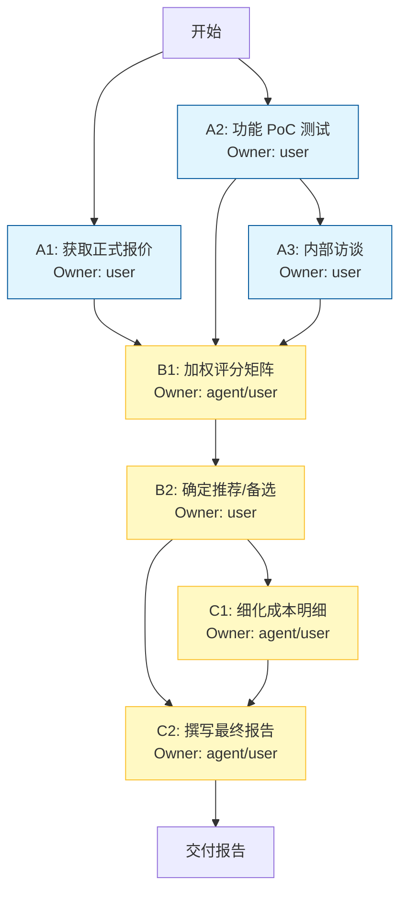

# 阶段 03：具体行动分解

## 1. 前置校验与事实核验状态声明

基于阶段 02 的输出，执行以下关键事实的**最终核验（Final Verification）**。若以下任一条件不满足，需回退至 `repair_stage: 02` 重新收集数据。本步骤旨在确保行动计划的输入是“已确认的事实”而非“推测”。

### 必须核验的关键事实 (Critical Facts)
| ID | 事实描述 | 当前状态 (Stage 02) | 核验动作 (Action) | 判定标准 (Pass/Fail Criteria) |
| :--- | :--- | :--- | :--- | :--- |
| **F1** | **飞书专业版/商业版确切报价** | [待核验] 估算 ¥15,000/年 | 联系飞书销售获取 30 人席位、含 1TB 额外存储的正式报价单 (Quote)。 | 获得书面/邮件报价，总价 ≤ ¥25,000 CNY。 |
| **F2** | **Microsoft 365 Business Basic 国内代理商价格及网络稳定性** | [待核验] 估算 ¥20,000/年，访问慢 | 1. 联系微软授权经销商获取 30 人 M365 BBasic 报价。 2. 在团队办公网络环境下进行 OneDrive Web/App 速度测试 (Ping < 100ms, Download > 10MB/s)。 | 1. 报价 ≤ ¥22,000 CNY。 2. 实测平均下载速度满足日常研发文件同步需求（无频繁超时）。 |
| **F3** | **钉钉专业版细粒度权限功能边界** | [待核验] 不确定是否需高阶版 | 查阅钉钉官方最新文档或联系顾问，确认“文件夹级+文件级”独立权限设置是否在“专业版”中完全开放，还是仅在“专属版/旗舰版”。 | 确认 30 人规模下，仅购买“专业版”即可实现核心约束 B（细粒度权限），无需升级更贵套餐。 |
| **F4** | **Seafile 自建运维人力可用性** | [已知] 需 DevOps 支持 | 访谈现有 DevOps 负责人，评估其是否有精力承担每月 8-12 小时的 Seafile 维护工作（备份、补丁、故障排查）。 | DevOps 负责人明确同意并承担此责任，且现有基础设施有冗余资源部署。否则该路径标记为“不可行”。 |

> **Reviewer 检查点**：若 F1-F4 中有任何一项无法通过验证或信息缺失，停止后续步骤，返回 Stage 02 补充调研。以下行动计划假设上述事实已通过核验。

---

## 2. 行动步骤分解 (Action Plan)

**目标**：输出一份包含推荐方案、备选方案、淘汰理由及成本明细的可交付选型报告。
**总工期预估**：3-5 个工作日。
**Owner 类型说明**：
*   `user`: 需要人类决策、交互、登录特定账号或线下沟通的步骤。
*   `agent`: AI 助手可离线处理、整理、格式化或模拟计算的步骤。

### 阶段 A：深度验证与试点准备 (Days 1-2)

#### Step A1: 获取正式报价单
*   **Input**: 候选产品列表（飞书、M365、钉钉）、团队人数（30）、存储需求（~2TB）。
*   **Action**: 
    1. 向飞书、微软代理商、钉钉发送询价邮件/即时消息。
    2. 明确要求列出：软件许可费、存储空间费、实施服务费（如有）、年度总含税价。
*   **Dependency**: 无。
*   **Expected Output**: 三份正式的 PDF 或 Excel 报价单存档。
*   **Acceptance**: 报价单包含所有费用项，且总额在预算范围内（或明确标出超标部分）。
*   **Owner**: `user` (需人工沟通跟进)。
*   **Parallelism**: 可与 A2 并行。

#### Step A2: 核心功能技术验证 (PoC - Proof of Concept)
*   **Input**: 飞书、M365、钉钉的试用账号或演示环境。
*   **Action**: 
    1. **版本管理测试**：创建同一文件，多人同时编辑不同部分，保存后查看历史版本记录，尝试回滚到中间版本。
    2. **权限测试**：创建文件夹结构 A/B/C，设置用户甲只能读 A，用户乙能写 B，用户丙不可见 C。验证继承关系和例外规则。
    3. **离线测试**：断开 Wi-Fi，打开本地缓存文件进行修改，重连后检查同步状态和冲突提示。
*   **Dependency**: 无（使用公开试用或申请 Demo 环境）。
*   **Expected Output**: 《功能验证测试记录表》，包含截图证据和测试结论（Pass/Fail）。
*   **Acceptance**: 每个核心功能点均有明确的 Pass/Fail 标记，失败项有详细原因描述。
*   **Owner**: `user` (需实际操作界面)。
*   **Parallelism**: 可与 A1 并行。

#### Step A3: 内部利益相关者访谈
*   **Input**: 研发团队代表（2-3 名开发、1 名设计/文档管理员）。
*   **Action**: 
    1. 询问当前痛点（如：文件丢失、版本混乱、查找困难）。
    2. 展示 A2 的测试结果，询问对 UI/UX 的偏好（例如：更喜欢飞书的实时协同还是 M365 的 Office 原生体验？）。
    3. 确认是否存在特定的合规要求（如数据必须存储在国内境内）。
*   **Dependency**: A2 完成（需基于测试结果提问）。
*   **Expected Output**: 《用户需求与反馈纪要》。
*   **Acceptance**: 记录至少 3 条具体的用户偏好或否决项。
*   **Owner**: `user`。
*   **Parallelism**: 串行于 A2 之后。

### 阶段 B：综合评估与决策 (Day 3)

#### Step B1: 构建加权评分矩阵
*   **Input**: A1 的报价、A2 的功能验证结果、A3 的用户反馈、阶段 02 的基础对比数据。
*   **Action**: 
    1. 定义权重（示例）：
       *   预算合规性 (30%)
       *   核心功能完整性（版本+权限）(30%)
       *   用户体验与易用性 (20%)
       *   离线能力与网络稳定性 (10%)
       *   长期运维成本/风险 (10%)
    2. 为每个候选方案打分（1-5 分）。
    3. 计算加权总分。
    4. **关键修正**：若某方案在“核心功能”上出现硬性 Fail（如权限无法细粒度控制），无论总分多高，直接标记为“不可选”。
*   **Dependency**: A1, A2, A3 全部完成。
*   **Expected Output**: 《加权评分矩阵表》及排名。
*   **Acceptance**: 分数计算无误，权重逻辑自洽，硬性排除项已标注。
*   **Owner**: `agent` (辅助计算和格式化)，`user` (确定权重和最终定性判断)。
*   **Parallelism**: 串行。

#### Step B2: 确定推荐与备选方案
*   **Input**: B1 的评分结果。
*   **Action**: 
    1. 选出得分最高且无硬性缺陷的方案作为**首选推荐**。
    2. 选出得分次高或虽低但具有独特优势（如极低预算下的最佳性价比）的方案作为**备选**。
    3. 对于被淘汰的方案，撰写具体的“淘汰理由”（引用 A1/A2 中的具体数据或失败测试）。
*   **Dependency**: B1。
*   **Expected Output**: 初步的《选型建议草案》。
*   **Acceptance**: 明确给出 1 个推荐 + 1 个备选，每个淘汰方案都有对应的一页纸理由。
*   **Owner**: `user` (最终决策权在人)。
*   **Parallelism**: 串行。

### 阶段 C：报告撰写与交付 (Day 4-5)

#### Step C1: 细化成本明细表
*   **Input**: A1 的正式报价单、B2 确定的推荐方案。
*   **Action**: 
    1. 拆解推荐方案的年度成本：License 费用、存储扩容费用、潜在的实施培训费、可能的汇率波动缓冲金（针对海外 SaaS）。
    2. 对比备选方案的成本差异。
    3. 计算 ROI 或节省额度（相对于预算上限 30,000 CNY 的剩余空间）。
*   **Dependency**: B2。
*   **Expected Output**: 《详细成本分析表》。
*   **Acceptance**: 每一项费用都有来源依据，总计准确。
*   **Owner**: `agent` (数据处理)，`user` (复核)。
*   **Parallelism**: 可与 C2 并行。

#### Step C2: 撰写最终选型报告
*   **Input**: 阶段 02 背景、A1-A3 过程数据、B1-B2 决策结果、C1 成本表。
*   **Action**: 
    1. 按照标准模板组织内容：
       *   **执行摘要**：一页纸总结推荐方案、核心理由、总成本。
       *   **需求回顾**：重申 30 人、预算、平台、核心功能约束。
       *   **候选方案详述**：逐个介绍，重点突出优劣势。
       *   **对比分析**：使用表格对比关键维度。
       *   **推荐理由**：为什么选这个？（结合功能、成本、体验）。
       *   **风险提示**：如网络依赖、供应商锁定、数据迁移难度。
       *   **下一步计划**：如果批准，如何实施（账号开通、数据迁移、培训时间表）。
    2. 插入 A2 中的关键截图作为证据。
*   **Dependency**: B2, C1。
*   **Expected Output**: 《团队文件协作方案选型报告 v1.0》 (Markdown/PDF)。
*   **Acceptance**: 报告结构完整，无拼写错误，所有数据引用一致，可直接发送给管理层审批。
*   **Owner**: `agent` (初稿生成与排版)，`user` (终审与签发)。
*   **Parallelism**: 串行于 C1 之后（因为需要最终成本数据）。

---

## 3. 依赖关系图 (Dependency Graph)

*   **User 阻塞点**：A1, A2, A3, B2 是关键的人类交互节点，无法被 Agent 自动跳过。
*   **Agent 加速点**：B1 (计算), C1 (数据整理), C2 (草稿撰写) 可由 Agent 大幅提效。

---

## 4. 失败处理与替代路径 (Contingency Plans)

### 场景 1：首选方案（例如飞书）报价超出预算
*   **触发条件**：A1 中飞书报价 > ¥25,000，导致总成本逼近或超过 ¥30,000。
*   **替代路径**：
    1. 立即启动**谈判流程**：以竞品（钉钉/M365）低价为由，争取折扣。
    2. 若谈判失败，重新评估**钉钉**方案。若钉钉功能验证（A2）通过，则提升钉钉权重。
    3. 若钉钉也不符合，考虑**降级配置**：例如飞书基础版 + 少量付费高级包，看是否能满足核心功能（需重新做 A2 测试确认基础版是否够用）。
*   **停止条件**：若所有主要 SaaS 方案均超预算且无法通过降级满足核心功能，则转向**Seafile 自建**路径（前提是 F4 核验通过，即有 DevOps 资源）。

### 场景 2：核心技术功能验证失败（例如 M365 离线同步严重 Bug）
*   **触发条件**：A2 中发现 M365 在断网恢复后出现大量文件损坏或版本丢失，且厂商无法提供临时修复。
*   **替代路径**：
    1. 将 M365 从“备选”降级为“观察”，不再作为主要推荐。
    2. 增加**Seafile** 的权重（如果 F4 通过）。
    3. 或者，寻找**坚果云 (Jianguoyun)** 等未在 Stage 02 深入考察但在国内表现良好的二线选手作为新增候选，快速进行 A2 测试。
*   **停止条件**：若所有候选方案在核心功能（版本/权限）上均有致命缺陷，项目暂停，重新定义需求（例如放宽“细粒度权限”要求，或接受第三方插件组合方案）。

### 场景 3：DevOps 拒绝承担 Seafile 运维 (F4 Fail)
*   **触发条件**：在前期核验 F4 时，DevOps 明确表示无精力维护私有化部署。
*   **替代路径**：
    1. 直接从候选列表中移除 Seafile。
    2. 强制在 SaaS 方案中选择。
    3. 若 SaaS 方案因网络问题（如 M365 慢）被用户强烈反对，考虑引入**企业级 VPN/专线**服务来优化 M365 访问，并将此成本计入总预算。
*   **停止条件**：无直接停止条件，但需调整预算分配（软件费降低，网络费增加）。

---

## 5. Reviewer 自检清单 (Self-Check)

1.  **覆盖性**：行动计划是否覆盖了“推荐、备选、淘汰、成本”四个输出要求？
    *   *是*。Step B2 决定推荐/备选，Step C2 包含淘汰理由，Step C1 包含成本明细。
2.  **产出明确性**：每步是否有明确产出？
    *   *是*。每一步都定义了 Expected Output（报价单、测试表、纪要、矩阵、报告）。
3.  **依赖完整性**：依赖关系是否有循环？
    *   *否*。DAG 结构清晰，A1/A2 并行汇入 B1，B1 汇入 B2，B2 分支汇入 C1/C2，C1 汇入 C2。
4.  **未知处理**：关键未知是否被当作已知？
    *   *否*。Stage 02 中标记为 [待核验] 的价格和功能边界，在 Stage 03 的 Step A1 和 Step A2 中被显式列为必须执行的验证动作，未直接假设其值。
5.  **可执行性**：另一个执行者能否直接行动？
    *   *是*。步骤包含 Input/Action/Output，且 Owner 明确。特别是区分了哪些是人做的（沟通、测试、决策），哪些是 AI 辅助做的（计算、写作），避免了责任模糊。
6.  **Owner 标注**：是否每步都有 owner？
    *   *是*。所有步骤均标注 `user` 或 `agent`。

**Repair Stage**: 03 (无需回退，基于 Stage 02 的有效输入即可执行)