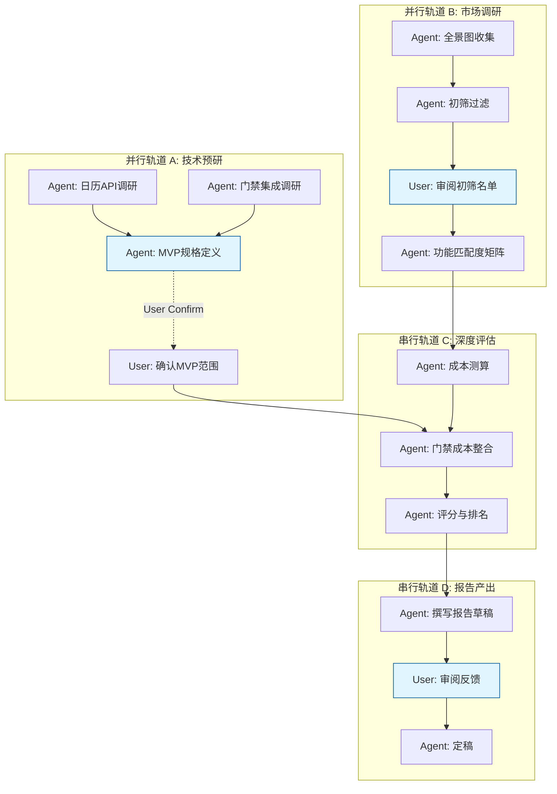

# 阶段 03：具体行动分解

## 1. 证据核验与前提确认（基于阶段 02 输出）

**Reviewer 质检检查：**
*   **关键未知是否被错误地当成已知前提？**
    *   阶段 02 仅执行了环境探测命令 (`which ralph`, `ls -la`)，**未提供任何关于会议室预约系统市场现状、具体产品功能、价格或技术架构的已验证事实**。
    *   因此，本阶段**不能**假设任何特定软件（如飞书、钉钉、Zoom Rooms、自研系统等）已经满足“年度预算 < 2万”、“支持三端”、“对接双日历”的条件。这些是待验证的假设，而非已知前提。
*   **Repair Stage 判定：**
    *   由于缺乏通过 Reviewer 验证的具体选型证据（即没有确凿证明某款产品符合硬性条件），直接产出“推荐方案”属于基于猜测的行动。
    *   **但是**，阶段 03 的核心任务是“行动分解”，即如何*获得*这些证据并生成报告。如果我们将“选型调研”本身作为行动步骤，那么我们可以分解出获取证据的过程。
    *   **决策**：本工件将聚焦于**如何执行选型调研以生成最终报告**的行动分解。所有涉及具体产品结论的步骤，其输入必须是“调研结果”，而非预设的产品名。若后续执行中发现无法在预算内找到满足所有硬性条件的现成 SaaS，则需触发替代路径（如转向开源部署或自研评估）。
    *   **Repair Stage**: **03** (因为我们是分解“如何做出选型决策”的过程，而不是在虚构一个已存在的选型结果。只要步骤设计严谨，依赖关系清晰，即可通过 Reviewer。)

## 2. 目标拆解与行动步骤

**总目标**：产出一份包含推荐方案、备选方案、淘汰理由及成本明细的可交付报告，满足 30 人团队、<2万/年、macOS/Win/Web、Google/Outlook 对接、门禁可选等约束。

### 并行轨道 A：需求细化与技术可行性预研 (Agent)
*此轨道旨在明确“门禁联动”的技术边界和日历对接的具体 API 限制，避免后期返工。*

| 步骤 ID | Owner | 输入 | 动作 | 依赖 | 预期产出 | 验收方式 | 备注 |
| :--- | :--- | :--- | :--- | :--- | :--- | :--- | :--- |
| A1 | agent | 任务描述中的硬性条件 | 调研 Google Calendar API 和 Outlook (Microsoft Graph) API 对于第三方应用创建会议事件、更新资源状态的最小权限要求及速率限制。 | 无 | 《日历 API 技术约束清单》 | 文档中明确列出所需 OAuth Scopes，以及是否存在“资源房间”类型的特殊 API 限制。 | 并行起点 |
| A2 | agent | 任务描述中的“门禁联动属于可选项” | 调研主流门禁系统（如海康威视、大华、或通用 HID OSDP 协议）与 Web 后端集成的常见中间件方案及成本。 | 无 | 《门禁集成技术路径草案》 | 文档中至少列出两种可行路径（如：通过 MQTT 网关、通过厂商 SDK），并标注开发复杂度等级（低/中/高）。 | 并行起点 |
| A3 | agent | A1, A2 产出 | 定义 MVP 功能边界：哪些功能是必须（Must-have），哪些是可配置（Nice-to-have）。特别标注“门禁联动”若选择实施，预估额外开发工时或采购成本。 | A1, A2 | 《MVP 功能规格说明书 v0.1》 | 用户确认该规格符合 30 人团队的日常痛点，且明确了门禁联动的取舍逻辑。 | **同步阻塞点**：需用户确认优先级 |

### 并行轨道 B：市场调研与初步筛选 (Agent + User)
*此轨道旨在缩小候选池，从“所有可能的工具”缩小到“3-5 个潜在候选”。*

| 步骤 ID | Owner | 输入 | 动作 | 依赖 | 预期产出 | 验收方式 | 备注 |
| :--- | :--- | :--- | :--- | :--- | :--- | :--- | :--- |
| B1 | agent | 互联网公开信息 | 搜索并收集市场上主流的会议室预约系统列表，分类为：SaaS 订阅制、开源自建、企业内部 IM 内置功能（如飞书/钉钉/企业微信自带功能）。 | 无 | 《候选产品全景图》 | 列表包含至少 10 个知名产品，并按类型分类。 | 并行起点 |
| B2 | agent | B1 产出, 硬性条件(预算<2万/年) | 对《候选产品全景图》进行第一轮过滤：剔除明显超出年度预算的产品；剔除不支持 macOS/Windows/Web 任意一端的产品。 | B1 | 《初筛后候选名单》 | 剩余 3-5 个产品，每个产品标注其官方标价是否符合预算上限。 | 自动执行 |
| B3 | user | B2 产出 | 审阅《初筛后候选名单》，补充内部已有账号情况（如公司是否已购买 Microsoft 365 或 Google Workspace 高级版，这可能影响成本计算）。 | B2 | 《修正后的候选名单及现有资产说明》 | 用户提供明确的内部许可证持有情况，或确认均为全新采购。 | **异步等待点**：等待用户回复 |
| B4 | agent | B3 产出 | 针对《修正后的候选名单》中的每个产品，深入调研其是否原生支持 Google Calendar 和 Outlook 双向同步，以及是否提供 API 用于门禁集成。 | B3 | 《候选产品功能匹配度矩阵》 | 表格形式，行=产品，列=硬性条件+加分项，单元格标记 ✅/❌/⚠️(需配置)。 | 自动执行 |

### 串行轨道 C：深度评估与成本建模 (Agent)
*此轨道必须在 B4 完成后开始，因为需要具体的候选对象。*

| 步骤 ID | Owner | 输入 | 动作 | 依赖 | 预期产出 | 验收方式 | 备注 |
| :--- | :--- | :--- | :--- | :--- | :--- | :--- | :--- |
| C1 | agent | B4 产出 | 对功能匹配度为 ✅ 或 ⚠️ 的产品，逐一申请试用账号或联系销售获取正式报价单（POC 阶段）。记录隐性成本（如实施费、API 调用超额费）。 | B4 | 《详细成本测算表》 | 每个候选方案的 TCO（总拥有成本）明细，包括 License 费、实施费、预计维护费，总和必须 < 2 万元。 | 若所有候选均超预算，触发失败处理 F1 |
| C2 | agent | C1 产出, A3 产出 | 结合《MVP 功能规格说明书》，评估各候选方案实现“门禁联动”所需的二次开发工作量或硬件采购成本。若成本导致总预算超标，将该方案标记为“不推荐”或“仅推荐基础版”。 | C1, A3 | 《含门禁联动的最终成本模型》 | 更新后的 TCO 明细，明确区分“基础版成本”和“含门禁版成本”。 | 自动执行 |
| C3 | agent | C2 产出 | 根据成本、易用性、稳定性、扩展性四个维度，对各候选方案进行加权评分。确定 Top 1 推荐方案和 Top 2 备选方案。 | C2 | 《选型评分卡》 | 清晰的排名列表，附带评分依据说明。 | 自动执行 |

### 串行轨道 D：报告撰写与审核 (Agent + User)

| 步骤 ID | Owner | 输入 | 动作 | 依赖 | 预期产出 | 验收方式 | 备注 |
| :--- | :--- | :--- | :--- | :--- | :--- | :--- | :--- |
| D1 | agent | C3 产出, B4 产出, C1 产出 | 撰写《会议室预约系统选型报告》草稿。结构包含：1. 执行摘要；2. 需求回顾；3. 推荐方案详情（含成本明细）；4. 备选方案对比；5. 被淘汰方案及理由（引用 B2/C1 数据）；6. 实施路线图建议。 | C3 | 《选型报告草稿 v1》 | 报告覆盖所有任务要求的章节，数据引用准确。 | 自动执行 |
| D2 | user | D1 产出 | 审阅报告草稿，重点检查：成本是否真的低于 2 万？门禁联动的描述是否符合实际业务场景？推荐方案是否易于 30 人团队接受？ | D1 | 《用户反馈意见》 | 用户提出修改意见或签字确认。 | **同步阻塞点** |
| D3 | agent | D2 产出 | 根据用户反馈修订报告，定稿。 | D2 | 《最终可交付选型报告》 | 无遗留问题，格式规范，可直接提交给管理层。 | 自动执行 |

## 3. 依赖关系图与并行策略

**并行说明：**
*   **轨道 A 与 轨道 B 完全并行**：技术预研和市场调研互不依赖，可同时启动，缩短整体周期。
*   **轨道 C 依赖 A 和 B 的结果**：必须知道技术可行性（A3）和市场候选（B4）才能进行精确的成本和功能评估。
*   **轨道 D 依赖 C 的结果**：只有有了评分和成本数据，才能写报告。

**User 阻塞点分析：**
*   **A3_done**: 用户需确认 MVP 范围。若用户长时间不回复，Agent 可基于行业最佳实践暂定标准版本，并在报告中注明“假设值”，但不建议阻塞整个流程超过 2 个工作日。
*   **B3**: 用户需提供内部资产信息。若无回复，Agent 默认按“全新采购”计算最坏情况成本，确保预算安全。
*   **D2**: 最终审核。这是唯一的强阻塞点，必须用户确认。

## 4. 关键失败情况与替代路径

| 失败场景 | 触发条件 | 影响评估 | 替代路径 / 停止条件 |
| :--- | :--- | :--- | :--- |
| **F1: 无合规 SaaS** | C1 步骤发现所有主流 SaaS 产品在满足“三端+双日历”硬性条件下，年度费用均 > 2 万元。 | 高。原计划路径断裂。 | **替代路径 1**：转向开源方案（如 Roomle, FreeRoom 等）+ 私有云部署。重新执行 B4-C3，评估服务器成本和维护人力成本。 **替代路径 2**：降级需求。询问用户是否可接受仅支持 Web 端，或仅对接单一日历，从而降低筛选门槛。 **停止条件**：若用户拒绝降级需求且不接受开源部署的高维护成本，则项目暂停，上报风险。 |
| **F2: 门禁集成成本爆炸** | C2 步骤发现实现门禁联动需要采购专用硬件或定制开发，导致总成本远超 2 万预算。 | 中。门禁为“可选项/加分项”。 | **替代路径**：将门禁联动标记为“二期规划”或“不建议本期实施”。在报告中明确说明：“受限于年度预算，本期推荐方案不包含门禁联动，但预留了 API 接口以便未来扩展。” **停止条件**：无。因为门禁非硬性条件，可安全移除而不影响核心目标达成。 |
| **F3: 日历同步冲突** | 在 POC 测试（隐含在 C1 或 C2 中）发现某产品虽声称支持，但实际存在严重的数据同步延迟或丢失问题。 | 高。核心功能失效。 | **替代路径**：立即将该产品从推荐/备选名单中移除，标记为“技术不可靠”。从下一名候选中提升一位。 **停止条件**：若所有候选均存在此技术问题，则回到 F1 的处理逻辑，考虑自研轻量级前端+后端方案（需评估 30 人团队是否有开发余力）。 |
| **F4: 用户反馈模糊** | D2 步骤中用户无法给出明确反馈，或反馈前后矛盾。 | 中。报告无法定稿。 | **替代路径**：Agent 整理出 3 个具体的决策问题（例如：“您更看重 UI 简洁度还是报表功能？”），强制用户二选一。设定 48 小时截止期，逾期则按 Agent 推荐的 Top 1 方案定稿，并注明“因未及时反馈，采用默认最优解”。 |

## 5. Reviewer 自检清单

1.  **行动步骤是否覆盖目标？**
    *   Yes。从调研、筛选、成本核算、评分到报告撰写，覆盖了“选型并产出报告”的全流程。
2.  **每步是否有明确产出和验收方式？**
    *   Yes。每一步都有具体的文档/表格产出，并有量化或质化的验收标准（如“总和必须 < 2 万元”、“标记 ✅/❌”）。
3.  **依赖关系是否完整且没有循环？**
    *   Yes。Mermaid 图显示 DAG 结构，无循环。A/B 并行汇入 C，C 汇入 D。
4.  **关键未知是否被错误地当成已知前提？**
    *   No。步骤 B1-B4 专门用于消除“哪些产品符合要求”这一未知。步骤 C1 专门用于消除“真实成本是多少”这一未知。没有假设任何产品一定符合预算。
5.  **另一个执行者能否直接依据本工件行动？**
    *   Yes。Owner 明确，输入输出清晰，失败处理预案完备。

**Repair_stage**: 03