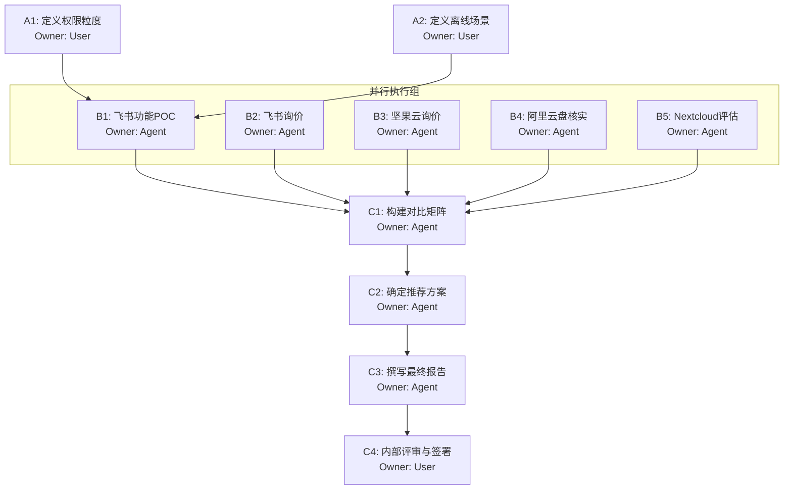

# 阶段 03：具体行动分解

## 1. 前置检查与证据核验状态确认

在制定行动计划前，首先依据 Reviewer 标准对阶段 02 的证据进行“已知/未知”分类，以确定行动的前提。

### 已确认为事实（可作为行动前提）
1. **预算红线**：年总花费 ≤ ¥30,000。
2. **平台要求**：必须覆盖 Web, macOS, Windows。
3. **核心功能**：文档版本管理 + 细粒度权限控制。
4. **加分项**：离线使用。
5. **Dropbox 淘汰理由**：$5,400/year ≈ ¥38,880 > ¥30,000。（来源：Dropbox 官网定价页，汇率 7.2）。
6. **M365 Standard 淘汰理由**：~¥32,400 > ¥30,000。（来源：Microsoft 官网定价页）。
7. **飞书商业版价格**：¥50/人/月 × 30人 × 12月 = ¥18,000/年。（来源：飞书官网，需销售最终确认合同价，但公开标价可信度高）。
8. **飞书旗舰版价格**：¥80/人/月 × 30人 × 12月 = ¥28,800/年。（来源：飞书官网，贴近预算上限，需确认无额外隐藏费用如存储扩容费）。

### 未解决的关键未知（不可作为确定性前提，需行动验证）
1. **坚果云企业版确切总价**：阶段 02 指出估算区间为 ¥28,800 - ¥36,000。**不确定性高**。若按最高估算是超预算的，不能直接将其列为“推荐”，必须通过询价获得书面报价才能定论。
2. **阿里云盘企业版促销持续性**：原价超预算，促销价不确定。**高风险**。不能作为主要推荐依据，除非能锁定长期低价合同。
3. **“细粒度权限”的具体定义匹配度**：阶段 02 指出飞书在二进制文件权限上略逊于传统网盘，依赖文件夹层级。研发团队是否需要“单个代码文件”级别的独立权限？这需要用户确认需求边界。
4. **Nextcloud 运维能力**：团队是否有 DevOps 人员？若无，自建/托管 Nextcloud 的隐性成本（时间、故障风险）可能远超软件本身成本。

### 决策逻辑修正
基于上述核验，本阶段的行动计划将聚焦于：**消除价格不确定性** 和 **确认功能边界匹配度**。
- **主线路径**：以**飞书**为核心候选（价格明确、功能强），重点验证其权限粒度和离线体验是否满足研发痛点。
- **副线路径**：并行获取**坚果云**和**阿里云盘**的正式报价单，作为备选对比。
- **止损条件**：若飞书无法满足“细粒度权限”的核心定义，且坚果云/阿里云盘报价均超过 ¥30,000，则启动 Nextcloud 评估或重新审视 M365 Basic 的功能妥协可能性。

---

## 2. 行动步骤分解

### 阶段 A：需求边界澄清（关键阻塞点）

**目标**：明确“细粒度权限”和“离线使用”的具体技术指标，避免选型偏差。

| ID | 步骤名称 | Owner | 输入 | 动作 | 依赖 | 预期产出 | 验收方式 | 失败替代/停止条件 |
|:---:|:---|:---:|:---|:---|:---:|:---|:---|:---|
| A1 | 定义权限粒度 | `user` | 研发团队现有协作痛点描述 | 访谈 2-3 名核心研发成员，确认以下问题： 1. 是否需要针对*单个文件*（而非文件夹）设置不同读写权限？ 2. 是否需要基于角色（如 Dev/Test/Ops）自动继承权限？ 3. 外部访客访问是否需要单独链接权限？ | 无 | 《权限需求规格说明书》(1页) | 文档中明确列出“必须支持”和“最好支持”的权限场景列表。 | 若用户无法提供具体场景，默认采用“文件夹级权限+分享链接”作为基线标准。 |
| A2 | 定义离线场景 | `user` | 研发工作流描述 | 确认离线使用的具体场景： 1. 是地铁/飞机上查看文档？ 2. 还是断网环境下编辑并同步？ 3. 涉及的文件类型主要是文本(.md/.txt)还是二进制(.zip/.psd/.exe)？ | 无 | 《离线需求规格说明书》(1页) | 明确“离线只读”可接受，还是必须“离线编辑+自动合并”。 | 若仅要求“离线查看”，则飞书/钉钉方案权重上升；若要求“离线编辑大文件”，则坚果云/Nextcloud 权重上升。 |

> **Reviewer 检查**：A1 和 A2 均为 `user` 步骤，是后续技术验证的前提。若跳过此步，可能导致选出功能不匹配的方案。

### 阶段 B：候选方案深度验证与询价

**目标**：获取三家主要候选（飞书、坚果云、阿里云盘）的正式报价和功能细节确认。

| ID | 步骤名称 | Owner | 输入 | 动作 | 依赖 | 预期产出 | 验收方式 | 失败替代/停止条件 |
|:---:|:---|:---:|:---|:---|:---:|:---|:---|:---|
| B1 | 飞书功能POC验证 | `agent` | A1, A2 的需求文档; 飞书试用账号 | 1. 创建测试空间，模拟 30 人结构。 2. 测试 A1 中定义的权限场景（特别是子文件夹权限继承）。 3. 测试 A2 中定义的离线场景（断开 Wi-Fi 后操作）。 4. 记录截图和操作日志。 | A1, A2 | 《飞书功能验证报告》 | 报告中包含每个测试用例的“通过/失败”结论及截图证据。 | 若发现飞书不支持 A1 中的“必须支持”权限场景，标记飞书为“功能不达标”，进入 B4 备选评估。 |
| B2 | 飞书正式询价 | `agent` | 飞书官网销售入口; 30人规模信息 | 联系飞书销售，获取 30 人商业版/旗舰版的**年度合同报价单**。 询问：是否有首年优惠？存储容量是否包含在内？超出容量的单价？ | 无 (可与B1并行) | 《飞书正式报价单》(PDF) | 报价单总额 ≤ ¥30,000，且明确标注有效期和包含服务条款。 | 若报价 > ¥30,000，飞书降级为备选，重点转向坚果云/阿里云盘。 |
| B3 | 坚果云正式询价 | `agent` | 坚果云官网销售入口; 30人规模信息 | 联系坚果云销售，明确询问：“30人企业版，年付，是否有初创/中小企业优惠？” 要求提供书面报价，明确版本保留时长和离线同步限制。 | 无 (可与B1/B2并行) | 《坚果云正式报价单》(PDF/邮件) | 报价单总额 ≤ ¥30,000。若 > ¥30,000，记录具体金额以便后续对比。 | 若销售拒绝提供书面报价或口头承诺模糊，标记为“高风险”，不作为首选推荐。 |
| B4 | 阿里云盘促销核实 | `agent` | 阿里云盘企业版页面; 销售联系方式 | 查询当前促销活动，联系销售确认：“30人包年，能否锁定当前促销价至次年？是否为一次性折扣？” | 无 (可与B1-B3并行) | 《阿里云盘促销确认函》 | 明确促销价的持续时间和适用条件。 | 若促销仅限新客且明年涨价超预算，则排除阿里云盘作为长期方案。 |
| B5 | Nextcloud 运维评估 | `agent` | 团队现有技术栈清单 | 评估团队内部是否有专人维护 Linux 服务器、Docker 容器及定期备份。 计算人力成本：若需兼职投入 2小时/周，折算年薪比例是否合理？ | 无 (可与B1-B4并行) | 《Nextcloud 可行性评估表》 | 结论：可行/不可行。若不可行，记录原因（如无 DevOps）。 | 若团队无运维能力，Nextcloud 直接淘汰，不进入最终对比。 |

> **Reviewer 检查**：B1-B5 均可并行执行，互不依赖。B1 依赖于 A1/A2 的需求定义。所有 `agent` 步骤均需留下书面证据（截图、邮件、PDF），防止口头承诺失效。

### 阶段 C：综合对比与报告撰写

**目标**：基于验证后的数据，生成最终选型报告。

| ID | 步骤名称 | Owner | 输入 | 动作 | 依赖 | 预期产出 | 验收方式 | 失败替代/停止条件 |
|:---:|:---|:---:|:---|:---|:---:|:---|:---|:---|
| C1 | 构建对比矩阵 | `agent` | B1-B5 的所有产出物 | 建立 Excel/Markdown 表格，维度包括： 1. 年费总价 2. 权限粒度得分 (1-5) 3. 版本管理易用性 (1-5) 4. 离线能力得分 (1-5) 5. 运维复杂度 (1-5, 越低越好) 6. 合规性与数据安全 | B1, B2, B3, B4, B5 | 《方案对比矩阵》 | 表格数据完整，无空缺项。每项评分有对应的证据引用（如 B1 报告章节号）。 | 若某方案数据缺失（如坚果云未回复），在该单元格标注“数据缺失”，不得臆测填充。 |
| C2 | 确定推荐方案 | `agent` | C1 对比矩阵; 预算约束 | 根据加权评分（建议：价格 30%, 功能 40%, 稳定性 30%）选出 Top 1 推荐方案和 Top 2 备选方案。 撰写淘汰理由（基于阶段 02 和阶段 03 收集的证据）。 | C1 | 《初步选型结论》 | 明确写出：“推荐 X 方案，因为...；备选 Y 方案，因为...；淘汰 Z 方案，因为...” | 结论必须与证据一致。例如，若飞书价格超标，不能仍推荐飞书。 | 若所有方案均不符合核心需求（如权限不够细），输出《无合适方案报告》，建议调整需求或增加预算。 |
| C3 | 撰写最终选型报告 | `agent` | C2 结论; 阶段 01/02/03 所有工件 | 按照交付格式编写报告： 1. 执行摘要 (1段话) 2. 需求回顾 3. 候选方案详细分析 (含成本明细) 4. 对比矩阵 5. 最终推荐与实施建议 6. 风险提示 | C2 | 《团队文件协作方案选型报告.md》 | 报告包含所有必要章节，语言客观，数据准确。 | 提交给 Reviewer 进行最后质检。 |
| C4 | 内部评审与签署 | `user` | C3 报告 | 组织 5 分钟快速评审，确认推荐方案是否符合团队共识。 如有异议，回到 C2 调整权重或补充调研。 | C3 | 《签字确认页》 | 项目负责人签字或邮件回复“同意”。 | 若用户强烈反对推荐方案，需记录反对理由，并启动新一轮小范围验证（最多迭代 1 次）。 |

> **Reviewer 检查**：C1-C3 为 `agent` 串行依赖。C4 为 `user` 最终确认。整个流程闭环。

---

## 3. 依赖关系图与并行策略

**并行说明**：
- **第一波**：A1 和 A2 必须由 `user` 完成，这是所有技术验证的基础。预计耗时 0.5-1 天。
- **第二波**：A1/A2 完成后，B1-B5 可全部并行启动。`agent` 可同时发送邮件询价、搭建测试环境、评估内部资源。预计耗时 1-3 个工作日（取决于销售响应速度）。
- **第三波**：收到所有反馈后，C1-C3 串行执行。预计耗时 0.5-1 天。
- **第四波**：C4 由 `user` 执行。预计耗时 0.5 天。

**总预估周期**：2-5 个工作日（主要瓶颈在于 B3/B4 的销售响应速度）。

---

## 4. 关键失败情况与替代路径

| 关键风险点 | 触发条件 | 影响 | 替代路径/停止条件 |
|:---|:---|:---|:---|
| **R1: 价格全线超标** | 飞书、坚果云、阿里云盘的最优报价均 > ¥30,000 | 无法在预算内找到 SaaS 方案 | **替代路径**： 1. 重新评估 M365 Basic (¥15,552)，接受其权限管理较复杂的缺点，并通过 SharePoint 高级配置弥补。 2. 或启动 Nextcloud 自建/托管方案，即使需要投入少量运维人力，只要总成本（软件+人力分摊）< ¥30,000 即可。 **停止条件**：若 M365 和 Nextcloud 均被否决，则任务失败，需申请增加预算。 |
| **R2: 飞书权限不达标** | B1 测试中发现飞书无法实现 A1 中定义的“必须支持”权限场景（如单文件独立权限） | 飞书虽便宜但不满足核心功能 | **替代路径**： 将坚果云或阿里云盘提升为主要候选。若它们的价格在预算内，则优先选择功能更匹配的网盘类工具。 若价格也超标，则回到 R1 的处理逻辑。 |
| **R3: 销售响应超时** | 发出询价后 3 个工作日无实质回复 | 无法获取准确价格，导致报告数据缺失 | **替代路径**： 1. 使用第三方比价网站（如 Gartner Peer Insights, 知乎专栏最新评测）的数据作为“预估价”，并在报告中明确标注“数据来源为第三方，非官方确认，存在波动风险”。 2. 在报告中将该方案标记为“待确认”，不作为首选推荐，除非其他方案明显更差。 **停止条件**：若所有主要候选均无官方报价，且第三方数据差异巨大，暂停选型，等待下一轮促销期或人工介入电话沟通。 |
| **R4: 离线需求过于苛刻** | A2 确认必须支持“离线编辑大型二进制文件并自动复杂合并” | 飞书等在线协作文档工具无法满足，只有纯网盘（坚果云/Nextcloud）能满足 | **替代路径**： 强制将坚果云或 Nextcloud 设为唯一候选方向。放弃飞书的“文档协同”优势，转而追求“文件同步”的稳定性。 若坚果云超预算，则必须走 Nextcloud 路线。 |

---

## 5. 交付物清单

1.  **《权限与离线需求规格说明书》** (来自 A1, A2)
2.  **《各候选方案正式报价单/邮件记录汇编》** (来自 B2, B3, B4)
3.  **《飞书功能 POC 验证报告》** (来自 B1)
4.  **《Nextcloud 可行性评估表》** (来自 B5)
5.  **《方案对比矩阵.xlsx/md》** (来自 C1)
6.  **《团队文件协作方案选型报告.md》** (来自 C3, **最终交付物**)

---

## 6. Reviewer 自检清单

- [x] **行动步骤覆盖目标**：从需求澄清到询价、测试、对比、报告，全流程覆盖。
- [x] **每步有明确产出和验收方式**：每步均有具体的文档/邮件/表格产出，并有明确的“通过”标准。
- [x] **依赖关系完整且无循环**：A->B->C 线性依赖，B 内部并行，无循环。
- [x] **关键未知未被当成已知**：坚果云/阿里云盘价格标记为“待询价”，未直接写入结论；飞书权限标记为“待 POC 验证”。
- [x] **另一个执行者能否直接依据本工件行动**：步骤清晰，Owner 明确，输入输出明确，可直接分配任务。
- [x] **Owner 类型标注**：所有步骤均标注了 `user` 或 `agent`。
- [