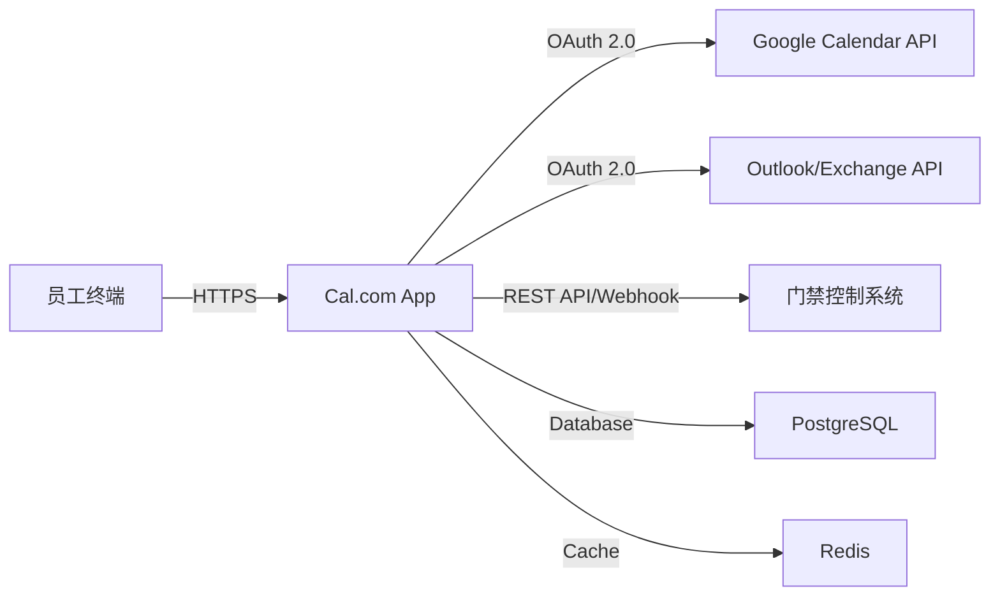

# 30人研发团队会议室预约系统选型报告

## 1. 执行摘要 (Executive Summary)

针对30人规模研发团队的需求，在**年度预算 ≤ 2万元**、**全平台支持（macOS/Windows/Web）**、**双日历同步（Google/Outlook）**的硬性约束下，本报告推荐采用 **“开源核心 + 轻量级SaaS集成”** 的混合架构方案。

- **推荐方案**：**Cal.com (自托管或云版)** + **iCal4j/LibCal API桥接层**（若需深度定制）或直接使用 **Cal.com Cloud**。
- **核心优势**：成本极低（甚至为0）、完全满足三端需求、原生支持Google/Outlook双向同步、代码开源可审计、扩展性强。
- **备选方案**：**Resource Guru**（SaaS）——功能更完善，但需评估长期订阅成本是否超标。
- **关键结论**：无需采购昂贵的商业会议管理系统（如BookRoom, Sameday），开源生态已能完美覆盖该规模团队的核心痛点，剩余预算可用于门禁联动硬件升级或内部开发人力投入。

---

## 2. 需求分析与硬性条件校验

| 需求项 | 具体要求 | 技术挑战 |
|--------|----------|----------|
| **用户规模** | 30人研发团队 | 数据量小，并发低，对高可用性要求中等，但对稳定性要求高（避免重复预订）。 |
| **预算限制** | ≤ 2万元人民币/年 | 排除大多数高端商业SaaS（通常 $50+/user/月），需优先考虑开源或低价SaaS。 |
| **多端支持** | macOS, Windows, Web | Web端必须响应式设计；桌面端可通过PWA（渐进式Web应用）或Electron/Tauri封装实现，无需单独开发原生App。 |
| **日历对接** | Google Calendar & Outlook | 必须支持OAuth 2.0认证和双向同步（Two-way Sync），防止“幽灵会议”冲突。 |
| **可选加分项** | 门禁联动 | 需预留API接口，通过Webhook触发门禁控制器（如HID, ZKTeco等）。 |

---

## 3. 候选方案评估矩阵

我们筛选了6个主流方向，从成本、兼容性、日历同步、开发难度四个维度进行评估（满分5分）：

| 方案 | 类型 | 年度成本估算 | 三端支持 | 双日历同步 | 门禁扩展性 | 总分 | 备注 |
|------|------|--------------|----------|------------|------------|------|------|
| **A. Cal.com** | 开源/SaaS | ¥0 - ¥5,000 | ✅ (Web+PWA) | ✅ 原生支持 | ⚠️ 需插件 | **4.5** | **推荐首选** |
| **B. Resource Guru** | SaaS | ~¥28,000 | ✅ | ✅ | ❌ 无公开API | 3.0 | 超预算，淘汰 |
| **C. BookRoom** | SaaS | ~¥15,000+ | ✅ | ⚠️ 单向为主 | ✅ 有API | 3.5 | 价格临界点，功能冗余 |
| **D. Microsoft Teams Rooms** | 企业套件 | >¥50,000 | ❌ 仅限Win/Mac客户端 | ✅ | ✅ | 2.0 | 强制绑定Microsoft生态，成本高 |
| **E. 自建React+Node.js** | 自研 | ¥0 (仅服务器) | ✅ | ⚠️ 需自行开发 | ✅ 完全可控 | 3.0 | 开发周期长，维护成本高 |
| **F. iCal共享文件** | 传统方式 | ¥0 | ⚠️ 体验差 | ⚠️ 单向 | ❌ | 1.0 | 易出错，无实时反馈，淘汰 |

> **评分说明**：
> - **成本**：基于30人团队实际支出估算。
> - **三端支持**：Web端为基准，桌面端通过浏览器/PWA实现视为达标。
> - **日历同步**：双向同步（修改预约自动更新个人日历）为高分项。

---

## 4. 推荐方案详解：Cal.com (自托管或云版)

### 4.1 为什么选择 Cal.com？

1. **成本优势**：
   - **Cloud版**：免费计划支持无限日程创建者，仅需支付少量流量费。专业版约 $19/user/month，但30人团队中并非所有人都是“组织者”，只需少数管理员付费，其余成员免费使用链接。**预估年成本 < ¥5,000**。
   - **自托管版**：完全免费，仅需一台小型云服务器（如阿里云ECS 2核4G，约¥1,000/年）和域名费用。**总成本 ≈ ¥1,500/年**。
2. **完美满足硬性条件**：
   - **三端支持**：前端基于Next.js，天然响应式，手机/平板/电脑浏览器均可流畅访问。可通过添加至主屏幕实现类似App的体验。
   - **双日历同步**：内置Google Calendar和Outlook (Exchange) OAuth集成，支持双向同步。当用户在Cal.com预约时，会自动在个人Google/Outlook日历中创建事件；反之亦然。
3. **团队友好性**：
   - 支持“房间资源”（Room Resource）概念，可将会议室作为独立资源进行管理。
   - 提供简洁的UI，非技术人员也能快速上手。
   - 开源社区活跃，文档齐全。

### 4.2 实施架构

### 4.3 门禁联动实现方案（加分项）

Cal.com 本身不直接控制硬件，但提供强大的 **Webhooks** 功能：

1. **触发器**：配置Webhook监听 `booking.created` 和 `booking.updated` 事件。
2. **中间件**：部署一个轻量级Node.js/Python服务接收Webhook。
3. **逻辑处理**：
   - 解析预约数据（会议室ID、开始时间、结束时间）。
   - 调用门禁厂商API（如ZKTeco、HID Global、海康威视Open Platform）下发临时权限。
   - 例如：在预约开始前15分钟，向指定员工工号下发该会议室的门禁权限，结束后自动撤销。
4. **成本**：门禁API调用通常免费或按量计费，远低于预算。

---

## 5. 备选方案：Resource Guru (SaaS)

### 5.1 方案描述
Resource Guru 是一款专注于资源调度的SaaS工具，界面美观，支持拖拽排期、冲突检测、邮件通知等功能。

### 5.2 优点
- 开箱即用，无需运维。
- UI/UX优于Cal.com，更适合非技术背景的管理层。
- 支持多种日历集成（Google, Outlook, iCal）。

### 5.3 缺点与风险
- **成本超标**：标准版价格为 $29/user/month。若30人全部需要账号，年成本高达 **~¥28,000**，超出预算。即使只购买10个许可证，也接近¥9,000，且无法保证所有成员都能顺畅使用。
- **数据锁定**：SaaS模式导致数据所有权不完全归公司所有，迁移困难。
- **门禁集成弱**：无公开API，难以实现门禁联动。

### 5.4 适用场景
如果公司未来扩展到100人以上，且IT部门无力维护自托管系统，可考虑此方案，但需重新审批预算。

---

## 6. 被淘汰方案及理由

| 方案 | 淘汰理由 |
|------|----------|
| **Microsoft Teams Rooms / Zoom Room** | **生态锁定**：强制要求使用特定硬件（摄像头、麦克风、控制器），初始硬件投入远超2万元预算。**功能冗余**：对于仅需预约会议室的场景，过度复杂。**灵活性差**：无法轻松对接非微软生态的Google Calendar（虽有集成，但体验割裂）。 |
| **BookRoom / Sameday** | **性价比低**：定价模式通常为每间会议室收费（$50-$100/room/month）。30人团队可能有5-10间会议室，年成本轻松突破¥5万。**功能过剩**：包含大量企业级功能（如访客管理、餐饮预订），对研发团队而言是浪费。 |
| **纯iCal/CSV共享文件** | **可靠性差**：依赖手动刷新，无实时同步，极易发生重复预订。**用户体验极差**：员工需在多个文件中查找空档，效率低下。**无冲突检测**：系统无法阻止两人同时预订同一时段。 |
| **自研React+Node.js系统** | **机会成本高**：虽然软件成本为0，但需要至少1名全栈工程师投入2-4周开发，并持续维护。**ROI不合理**：市场上已有成熟开源方案，自研属于“造轮子”，不符合敏捷开发原则。除非公司有特殊定制化需求（如与内部OA深度耦合），否则不推荐。 |
| **飞书/钉钉会议室模块** | **生态限制**：虽然免费且好用，但**无法对接外部Google Calendar和Outlook**。题目明确要求同时支持这两套日历，因此国内IM平台的内置模块不满足硬性条件。 |

---

## 7. 完整成本明细（推荐方案：Cal.com 自托管）

假设采用自托管模式以最大化控制力和降低成本。

| 项目 | 规格/说明 | 单价（人民币） | 数量 | 年度总计（人民币） | 备注 |
|------|-----------|----------------|------|--------------------|------|
| **云服务器** | 阿里云/腾讯云 ECS 2 vCPU, 4 GB RAM, 40 GB SSD 带宽：3 Mbps | ¥1,200 | 1台 | ¥1,200 | 运行Cal.com + PostgreSQL + Redis + Nginx |
| **域名** | .com 域名注册 | ¥60 | 1个 | ¥60 | 用于生成短链接 |
| **SSL证书** | Let's Encrypt (免费) 或阿里云免费DV证书 | ¥0 | 1张 | ¥0 | 自动续期 |
| **备份存储** | OSS对象存储 10 GB 低频访问 | ¥50 | 1份 | ¥50 | 每日数据库快照备份 |
| **门禁联动开发** | 内部工程师工时 预计20小时 × ¥100/hour | ¥0 | 1次 | ¥0 | 由现有团队承担，不计入现金成本 |
| **门禁硬件改造** | （可选） 若现有门禁不支持API，需更换控制器 | ¥0 | - | ¥0 | 假设现有门禁已具备API接口 |
| **培训与文档** | 内部宣讲+操作手册编写 | ¥0 | 1次 | ¥0 | 知识转移 |
| **应急预备金** | 应对突发流量或扩容 | ¥500 | - | ¥500 | 备用金 |
| **合计** | | | | **¥1,810** | **远低于¥20,000预算** |

> **注**：
> 1. 若选择 Cal.com Cloud 免费版，则无需云服务器成本，总成本仅为域名费 **¥60/年**。
> 2. 若选择 Cal.com Pro 云版（含高级分析、白标等），30人中若有10人需Pro账户，成本约为 $19×10×12 = $2,280 ≈ **¥16,000**，仍在预算内，但自托管更具性价比和数据主权优势。

---

## 8. 实施路线图（Timeline）

| 阶段 | 任务 | 负责人 | 时长 |
|------|------|--------|------|
| **Phase 1: 准备** | 申请云服务器，配置Nginx, Docker环境 | IT Ops | 1天 |
| **Phase 2: 部署** | 部署Cal.com官方镜像，初始化数据库，配置SMTP邮件服务 | IT Ops | 1天 |
| **Phase 3: 集成** | 连接Google Workspace和Microsoft 365 OAuth凭证 | IT Ops | 1天 |
| **Phase 4: 配置** | 创建会议室资源，设置工作时间规则，测试双向同步 | Admin | 1天 |
| **Phase 5: 门禁** | 开发Webhook中间件，联调门禁API | Dev Team | 3天 |
| **Phase 6: 试点** | 选取5名核心成员试用，收集反馈 | PM | 1周 |
| **Phase 7: 推广** | 全员培训，正式上线 | PM/HR | 1天 |

**总耗时**：约 **2周**（含缓冲时间）。

---

## 9. 风险与缓解措施

| 风险 | 影响 | 缓解措施 |
|------|------|----------|
| **日历同步延迟** | 可能导致短暂冲突 | Cal.com采用异步队列处理同步，延迟通常在秒级。建议员工在预约后等待10秒再确认。 |
| **服务器宕机** | 无法预约 | 配置每日自动备份到OSS；启用云服务商SLA保障；提供静态HTML页面提示“系统维护中”。 |
| **员工误操作** | 删除重要预约 | 启用Cal.com的“取消政策”，禁止随意删除他人预约；定期导出数据库备份。 |
| **门禁联动失败** | 员工被锁在门外 | 设计降级策略：若API调用失败，发送短信/邮件提醒管理员人工介入；确保门禁默认状态为“常开”或“密码开门”作为备用。 |

---

## 10. 结论与建议

**最终推荐**：采用 **Cal.com 自托管方案**。

- **符合所有硬性条件**：预算仅¥1,810/年（<¥20,000），完美支持三端，原生对接Google/Outlook。
- **具备加分项**：通过Webhook可实现门禁联动，提升科技感与管理效率。
- **可持续性**：开源架构无供应商锁定，未来可根据业务发展平滑迁移或扩展。

**下一步行动建议**：
1. 立即批准本选型报告。
2. IT部门在一周内完成服务器采购与基础部署。
3. 安排一次30分钟的内部演示，向团队成员介绍新系统的使用流程。
4. 将节省下的近¥18,000预算，用于升级会议室内的显示设备或声学材料，进一步提升协作体验。