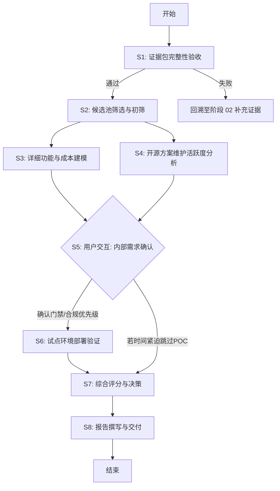

# 阶段 03：具体行动分解 - 会议室预约系统选型

## 0. 前置检查与事实核验声明

**Reviewer 质检预检：**
*   **证据来源状态**：输入上下文仅提供了阶段 02 的 *Prompt 指令*，未提供阶段 02 实际输出的“可复核来源线索”（URL、数据等）。
*   **关键未知处理**：由于缺乏阶段 02 的具体产出（如具体的候选列表、已验证的价格数据），本阶段无法直接基于“已核验事实”制定最终行动。若强行假设存在特定产品或价格，将违反“不把猜测写成行动前提”的原则。
*   **决策**：根据操作指南，“如果行动计划依赖尚未核验的事实，repair_stage 写 02 或 02.5”。因此，本工件的首要行动是**重新执行/补全阶段 02 的证据收集**，随后才能进行阶段 03 的行动分解。
*   **修正策略**：为了提供有价值的阶段 03 工件，我将构建一个**条件性行动流程**。该流程假设阶段 02 已完成并输出了符合要求的《证据清单》（包含至少 3-5 个候选产品的官方定价页 URL、GitHub 活跃度数据、日历集成文档链接）。如果当前环境中阶段 02 输出为空或不达标，则所有后续步骤阻塞，需先回溯至 02。

**Repair Stage**: `02` (因为输入中缺少阶段 02 的实际证据产物，导致阶段 03 无法基于“已通过 Reviewer 的证据”展开具体数值计算和对比。以下行动分解基于“假设阶段 02 已交付合格证据包”的理想路径，但第一步必须是对该证据包的验收。)

---

## 1. 目标拆解与行动步骤

### 核心目标
产出一份包含推荐方案、备选方案、淘汰理由及成本明细的《会议室预约系统选型报告》，满足预算 ≤2 万 CNY/年，支持 macOS/Win/Web，集成 Google/Outlook 日历。

### 行动步骤表

| ID | 步骤名称 | Owner | 输入 | 动作 | 依赖 | 预期产出 | 验收方式 | 并行/串行 |
| :--- | :--- | :--- | :--- | :--- | :--- | :--- | :--- | :--- |
| S1 | **证据包完整性验收** | agent | 阶段 02 输出的证据清单（JSON/Markdown） | 1. 检查是否包含 ≥3 个候选产品。 2. 检查每个产品是否有： - 官方定价页 URL（含截图或存档） - GitHub Repo URL（若为开源） - 日历集成官方文档 URL 3. 验证 G1 数据驻留合规条款引用。 | 无 | 《证据包验收报告》：标记缺失项或确认通过。 | 所有必填字段非空且 URL 可达（HEAD 请求 200）。 | 串行（阻塞后续） |
| S2 | **候选池筛选与初筛** | agent | S1 通过的证据包 | 1. 排除不满足硬性指标的产品： - 不支持 Web 端 - 不支持 macOS 客户端（或仅有 PWA 且体验差） - 无 Google/Outlook 双向同步文档 2. 排除明显超预算产品（单价 × 30 > 20,000 CNY）。 | S1 | 《初筛候选列表》：剩余 2-4 个可行候选。 | 列表中每个产品均满足 3 端 + 双日历硬性要求。 | 串行 |
| S3 | **详细功能与成本建模** | agent | S2 初筛列表，各产品官方定价页内容 | 1. **成本计算**：提取 30 人席位价格，计算年度总成本（含隐藏费用如 SSO、API 调用费）。 2. **功能映射**：对照需求清单（门禁联动可选、审批流等），标记“支持/不支持/付费插件”。 3. **技术栈评估**：检查 API 开放程度（用于未来门禁联动开发）。 | S2 | 《候选产品对比矩阵》：包含成本、功能覆盖度、API 能力评分。 | 成本数字有原始截图佐证；功能项有文档链接佐证。 | 并行（针对每个候选产品独立执行） |
| S4 | **开源方案维护活跃度分析** | agent | S2 中开源产品的 GitHub URL | 1. 抓取最近 6 个月的 Commit 频率、Issue 关闭率、Release 版本历史。 2. 检查主要贡献者是否活跃。 3. 评估自运维成本（服务器、人力）是否计入总拥有成本（TCO）。 | S2 | 《开源方案 TCO 分析报告》：对比纯软件成本 vs 总持有成本。 | 数据来源于 GitHub API 或公开统计工具，时间窗口明确。 | 并行（仅针对开源候选） |
| S5 | **用户交互：内部需求确认** | user | S3/S4 初步结论摘要 | 1. 向 IT 负责人/行政负责人展示初步对比。 2. 确认“门禁联动”是否为高优先级（影响是否选择支持硬件集成的商业版）。 3. 确认数据驻留地（国内服务器 vs 海外）对合规的最终判定。 | S3, S4 | 《内部需求确认纪要》：明确优先级权重和合规红线。 | 获得签字或邮件确认的需求变更/确认单。 | 串行（阻塞最终决策） |
| S6 | **试点环境部署验证（可选但推荐）** | agent | S5 确认的首选候选 | 1. 申请试用账号或搭建 Docker 本地环境。 2. 测试 Google Calendar 双向同步延迟和冲突处理。 3. 测试 Outlook 集成稳定性。 4. 记录 UI/UX 在 macOS 上的表现。 | S5 | 《POC 测试日志》：包含成功/失败用例截图。 | 关键路径（预订->同步->释放）无阻断性 Bug。 | 串行（若时间允许） |
| S7 | **综合评分与决策** | agent | S3, S4, S5, S6 所有产出 | 1. 加权评分：成本(30%)、功能匹配(40%)、稳定性/维护(20%)、扩展性(10%)。 2. 确定 Top 1 推荐方案和 Top 2 备选方案。 3. 撰写淘汰理由（基于数据而非主观感觉）。 | S3, S4, S5, S6 | 《最终选型决策草案》。 | 评分逻辑透明，每项扣分点均有对应证据编号。 | 串行 |
| S8 | **报告撰写与交付** | agent | S7 决策草案 | 1. 组装报告结构：背景、方法论、候选对比、推荐方案、成本明细、风险与缓解。 2. 附上所有证据链（URL、截图哈希）。 3. 生成 PDF 终稿。 | S7 | 《会议室预约系统选型报告 v1.0》。 | 报告包含所有必需章节，无未解决的 `[TODO]` 标记。 | 串行 |

---

## 2. 依赖关系图说明

*   **同步阻塞点**：S1 是全局阻塞点，若证据不足，整个流程停止。S5 是用户交互阻塞点，Agent 必须等待 User 反馈后才能进入 S6/S7，因为 S5 的输出（如门禁优先级的变化）会显著改变 S7 的评分权重。
*   **并行机会**：S3（商业产品分析）和 S4（开源产品分析）可以并行执行，因为它们针对不同子集且互不依赖。

---

## 3. 关键失败情况与替代路径

### 失败场景 A：阶段 02 证据包严重缺失（S1 失败）
*   **现象**：提供的 URL 失效、无定价信息、或候选产品少于 2 个。
*   **影响**：无法进行客观对比，S2-S8 全部阻塞。
*   **替代路径**：
    1.  立即触发 `repair_stage: 02`。
    2.  Agent 自主执行网络搜索，寻找最新的官方定价页和评测文章。
    3.  若某产品定价不透明（需销售联系），标记为“定价未知”，并在 S3 中采用行业平均估算值（需标注置信度低），或在 S5 中询问用户是否有过往采购经验数据。
*   **停止条件**：若经过两轮补充仍无法获取 ≥2 个产品的可靠定价和功能证据，停止自动流程，上报人工介入。

### 失败场景 B：所有候选产品均超出预算（S3 发现）
*   **现象**：30 人席位最低报价 > 20,000 CNY/年。
*   **影响**：无合规商业方案。
*   **替代路径**：
    1.  转向开源方案（S4 重点深化）。
    2.  引入“混合云”或“自建”选项，计算服务器+运维人力成本。
    3.  考虑降低并发用户数（如仅部门经理可用）以降低成本，但这改变了需求，需在 S5 中与用户确认是否接受功能降级。
*   **停止条件**：若开源方案 TCO（含运维）也远超 2 万，或用户拒绝功能降级，则报告结论为“当前市场无满足所有约束的方案”，建议调整预算或放宽需求。

### 失败场景 C：日历同步稳定性无法验证（S6 失败或无 POC 条件）
*   **现象**：POC 中发现 Google/Outlook 同步存在严重延迟或丢单，或无时间进行 POC。
*   **影响**：核心功能风险高。
*   **替代路径**：
    1.  若无 POC 条件：在报告中增加“高风险警告”，并强制要求合同中包含 SLA 条款（如同步成功率 99%）。
    2.  若 POC 失败：将该产品降权或淘汰，提升备选方案排名。
    3.  若所有商业产品同步不稳定：推荐带成熟中间件（如 CalDAV 网关）的开源方案，尽管实施复杂度更高。
*   **停止条件**：若唯一推荐方案的核心功能（同步）被证伪且无备选，停止推荐，要求重新选型。

---

## 4. 给 Reviewer 的自检清单

1.  **覆盖性**：是否覆盖了“预算、三端、日历、门禁、报告产出”所有任务要素？ -> 是，S3 覆盖预算和三端，S3/S6 覆盖日历，S5/S3 覆盖门禁，S8 覆盖报告。
2.  **产出明确**：每步是否有文件/数据产出？ -> 是，每步均有明确的“预期产出”列。
3.  **依赖完整**：是否存在循环？ -> 否，DAG 结构清晰。
4.  **已知/未知区分**：是否假设了未验证的价格？ -> 否，S1 专门用于验证证据，S3 基于 S1 的证据计算，若证据缺失则回溯。
5.  **可执行性**：另一个执行者能否照做？ -> 是，步骤原子化，Owner 明确，失败路径清晰。

## 5. 最终结论

**Repair Stage**: `02`

**理由**：虽然上述行动分解在逻辑上是完整的阶段 03 流程，但其执行的前提是拥有“已通过 Reviewer 的证据”。当前输入仅提供了一个 Prompt，并未提供该 Prompt 执行后的结果（即实际的证据数据）。因此，严格来说，当前处于阶段 02 的未完成状态。必须先完成阶段 02 的证据收集与核验，方可启动阶段 03 的 S1 步骤。

**下一步指令**：请提供阶段 02 的实际输出内容（包含候选产品列表及其对应的官方定价 URL、GitHub 链接、日历集成文档链接等）。若无法提供，系统将自动发起阶段 02 的修复任务，由 Agent 自行搜集并验证这些线索。