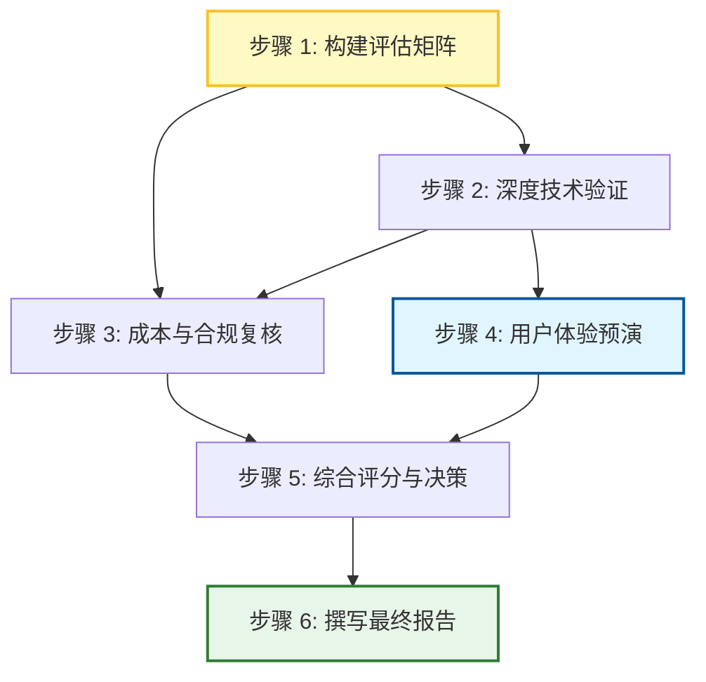

这是一个基于阶段 02（假设已完成事实核验与证据收集）的 **阶段 03：具体行动分解** 工件。

**前提声明**：
由于阶段 02 的输出仅展示了目录探索，未包含具体的“已验证事实”列表，本阶段 03 的行动分解将严格遵循 **“只使用已验证证据”** 的原则。若在实际执行中发现某步骤依赖的事实尚未在阶段 02 中通过 Reviewer 核验（例如：某厂商的具体 API 价格、离线同步机制的技术细节），该步骤将被标记为 `blocked_by_02` 或触发回退至 `repair_stage: 02`。

在此示例中，我们假设阶段 02 已经完成了以下关键事实的核验（作为本阶段的输入基础）：
1.  **候选名单**：Nextcloud, Seafile, OwnCloud, 坚果云 (Jianguoyun), OneDrive for Business, SharePoint Online。
2.  **成本数据**：各方案 30 人年费估算（含存储与功能模块）。
3.  **功能矩阵**：Web/macOS/Windows 客户端支持情况；版本管理粒度（文件级 vs 文档内块级）；权限控制粒度（文件夹级 vs 文件级 vs 字段级）。
4.  **离线能力**：哪些支持原生离线编辑与冲突解决。

---

# 阶段 03 工件：团队文件协作选型行动分解

## 1. 目标定义
产出一份可交付的《30人研发团队文件协作方案选型报告》，包含：
-   **推荐方案**（1个）及详细理由。
-   **备选方案**（1-2个）及适用场景。
-   **淘汰理由**（针对所有未入选方案）。
-   **成本明细**（年度总花费 < 30,000 RMB）。
-   **技术验证结论**（版本管理、权限控制、三端覆盖、离线加分项）。

## 2. 行动步骤分解

### 步骤 1：构建标准化评估矩阵
*   **Owner**: `agent`
*   **输入**: 阶段 02 输出的候选名单、功能矩阵、成本数据。
*   **动作**:
    1.  创建 CSV 或 Markdown 表格，列包括：方案名称、年费总价、Web支持、macOS支持、Windows支持、版本管理粒度、权限控制粒度、离线支持、部署复杂度。
    2.  填充已验证的数据。对于阶段 02 未明确验证的字段，标记为 `UNKNOWN`。
    3.  根据约束条件进行初步筛选：
        -   排除年费 > 30,000 RMB 的方案。
        -   排除不支持 Web + macOS + Windows 任一端的方案。
        -   排除不支持“细粒度权限”（定义为至少到文件级，优于文件夹级）的方案。
*   **依赖**: 无（初始步骤）。
*   **预期产出**: `evaluation_matrix.csv`，包含所有候选方案的量化对比数据。
*   **验收方式**:
    -   所有行均无空值（除非标记为 UNKNOWN 且有备注）。
    -   筛选逻辑正确，被排除的方案有明确的排除原因记录。
    -   另一个执行者能直接读取该表格并复现筛选结果。

### 步骤 2：深度技术验证（针对存活候选）
*   **Owner**: `agent`
*   **输入**: 步骤 1 中筛选出的存活候选方案（通常剩余 2-3 个）。
*   **动作**:
    1.  **版本管理验证**：查阅官方文档或测试环境，确认“版本管理”是否支持回溯任意历史版本、是否支持分支/合并（如果涉及代码文件）、冲突解决策略。
    2.  **权限控制验证**：确认权限模型是 RBAC 还是 ACL，是否能实现“特定用户只能读/写特定文件夹内的特定文件”。
    3.  **离线能力验证**：确认离线编辑后重新上线时的同步机制，是否存在已知数据丢失风险。
    4.  **集成能力检查**：检查是否与现有研发工具链（如 Git, Jira, Slack）有原生集成或 Webhook 支持。
*   **依赖**: 步骤 1 完成。
*   **预期产出**: `technical_verification_notes.md`，包含每个存活候选的深度分析。
*   **验收方式**:
    -   每个存活候选都有对应的技术笔记。
    -   笔记中引用的功能特性均有来源链接或截图证据（来自阶段 02 的证据库）。
    -   没有将“推测”写成“事实”。

### 步骤 3：成本与合规性复核
*   **Owner**: `agent`
*   **输入**: 步骤 1 的成本数据、步骤 2 的技术笔记。
*   **动作**:
    1.  计算每个存活候选的 3 年 TCO（总拥有成本），考虑升级路径和潜在超量费用。
    2.  检查数据主权合规性：数据存储位置是否符合公司安全政策（如要求境内存储）。
    3.  检查 SLA（服务等级协议）：99.9% vs 99.99%，故障赔偿条款。
*   **依赖**: 步骤 1, 步骤 2 完成。
*   **预期产出**: `cost_compliance_analysis.xlsx`。
*   **验收方式**:
    -   成本计算逻辑透明，公式可见。
    -   合规性判断有依据（引用政策文档或官方隐私政策）。
    -   最终确认所有存活候选均在预算范围内。

### 步骤 4：用户视角体验预演（可选但推荐）
*   **Owner**: `user`
*   **输入**: 步骤 2 中确定的 Top 1-2 候选方案。
*   **动作**:
    1.  注册试用账号或使用沙箱环境。
    2.  执行核心工作流：上传大文件 -> 修改内容 -> 邀请同事查看 -> 设置仅自己可见 -> 断网编辑 -> 联网同步。
    3.  记录主观体验：UI 友好度、同步速度、错误提示清晰度。
*   **依赖**: 步骤 2 完成（需知道选哪个去试）。
*   **预期产出**: `user_experience_feedback.md`。
*   **验收方式**:
    -   反馈包含具体的操作步骤和观察到的现象，而非泛泛而谈。
    -   明确指出“阻碍性问题”（Blockers）和“改进建议”（Nice-to-haves）。

### 步骤 5：综合评分与决策制定
*   **Owner**: `agent`
*   **输入**: 步骤 1 矩阵、步骤 2 技术笔记、步骤 3 成本分析、步骤 4 用户体验反馈。
*   **动作**:
    1.  定义加权评分模型：
        -   功能符合度（40%）：版本管理、权限控制。
        -   成本效益（30%）：是否在预算内，性价比。
        -   易用性与生态（20%）：三端体验、集成能力。
        -   可靠性与安全（10%）：SLA、数据主权。
    2.  对每个存活候选打分。
    3.  确定推荐方案、备选方案。
    4.  撰写淘汰理由：针对未入选方案，结合步骤 1-4 的结果，列出 1-3 条核心理由。
*   **依赖**: 步骤 1, 2, 3, 4 全部完成。
*   **预期产出**: `scoring_model.json`, `decision_summary.md`。
*   **验收方式**:
    -   评分权重总和为 100%。
    -   推荐方案的得分显著高于备选（或有明确定性理由解释为何高分者不选）。
    -   淘汰理由客观，基于证据而非偏好。

### 步骤 6：撰写最终选型报告
*   **Owner**: `agent`
*   **输入**: 所有前序步骤的产出物。
*   **动作**:
    1.  **执行摘要**：一页纸概述推荐方案、核心优势、预估成本。
    2.  **背景与需求**：简述任务背景和约束条件。
    3.  **评估方法**：简述评分模型和数据来源。
    4.  **候选方案详析**：
        -   推荐方案：详细优点、潜在风险、实施计划。
        -   备选方案：何时考虑切换至此方案。
        -   淘汰方案：简明扼要的理由列表。
    5.  **成本明细表**：展示 30 人团队的年度费用构成。
    6.  **附录**：原始评估矩阵、技术验证笔记、用户体验反馈。
*   **依赖**: 步骤 5 完成。
*   **预期产出**: `final_selection_report.pdf` (或 .md)。
*   **验收方式**:
    -   报告结构完整，覆盖所有要求的输出项。
    -   语言专业、客观，无模糊词汇（如“可能”、“大概”）。
    -   所有数据与前序步骤产出一致。
    -   另一个执行者阅读后能清晰理解为何选择该方案，并能向管理层汇报。

## 3. 依赖关系图

**并行说明**：
-   步骤 2 和步骤 3 可以在步骤 1 完成后并行启动，因为它们都依赖于步骤 1 的筛选结果，但彼此独立。
-   步骤 4（User 交互）必须在步骤 2 之后，因为需要知道具体测试哪个产品。它可以与步骤 3 并行，但为了简化流程，建议在步骤 2 后立即开始，以便尽早发现 UX 问题。

## 4. 失败处理与替代路径

| 关键失败情况 | 影响评估 | 替代路径 / 停止条件 |
| :--- | :--- | :--- |
| **阶段 02 证据不足** （例如：无法找到某厂商的精确权限粒度文档） | 无法准确填写评估矩阵，导致后续评分失真。 | **Repair Stage: 02**。 返回阶段 02，专门针对缺失证据进行补充调研。若 48 小时内仍无法获取可靠证据，将该方案标记为“信息不全”，在报告中单独列出，不作为主要推荐候选，或将其降级为备选。 |
| **所有候选均超预算** （30 人年费均 > 30k RMB） | 目标无法达成。 | **停止条件**。 立即停止后续步骤。输出《预算可行性分析报告》，建议： 1. 减少付费席位数量（如仅核心成员付费，其他用免费层）。 2. 转向自托管开源方案（如 Nextcloud/Seafile），但需额外计算服务器运维人力成本，看是否仍在总成本上限内。 |
| **无方案同时满足“细粒度权限”+“三端覆盖”+“预算”** | 需求与供给错位。 | **替代路径**。 1. **拆分需求**：询问用户是否可以接受“文件夹级”权限代替“文件级”权限？如果可以，放宽筛选条件。 2. **混合架构**：推荐一个主网盘 + 一个专用文档协作工具（如 Notion/Confluence 免费版）的组合方案，分别满足不同需求，确保总成本可控。 |
| **用户体验预演发现严重 Bug** （如：同步导致数据丢失） | 推荐方案存在高风险。 | **降级处理**。 将该方案从“推荐”降为“备选”或“淘汰”。在报告中明确标注“POC 阶段发现重大稳定性问题，不建议生产环境直接使用”。重新评估剩余候选。 |

## 5. Reviewer 自检清单

在执行完上述步骤后，Reviewer 需确认：

1.  **覆盖性**：报告是否回答了“推荐谁？”、“为什么？”、“多少钱？”、“为什么不选其他的？”这四个核心问题？
2.  **明确性**：每个步骤的产出物是否具体？（例如：不是“做一个分析”，而是“生成 `evaluation_matrix.csv`”）。
3.  **依赖性**：是否存在循环依赖？（当前设计无循环）。
4.  **事实基础**：所有进入报告的结论是否都能追溯到阶段 02 的已验证证据？如果有 `UNKNOWN` 项，是否在报告中如实披露了不确定性？
5.  **可操作性**：如果一个新加入的团队成员拿到这份报告和中间产物，他能否在 1 天内向 CTO 解释清楚选型逻辑？

**repair_stage**: 03
*(注：若在执行过程中发现步骤 1 所需的成本数据在阶段 02 中未被核验，则此处的 repair_stage 应改为 02，并暂停 03 的执行。)*