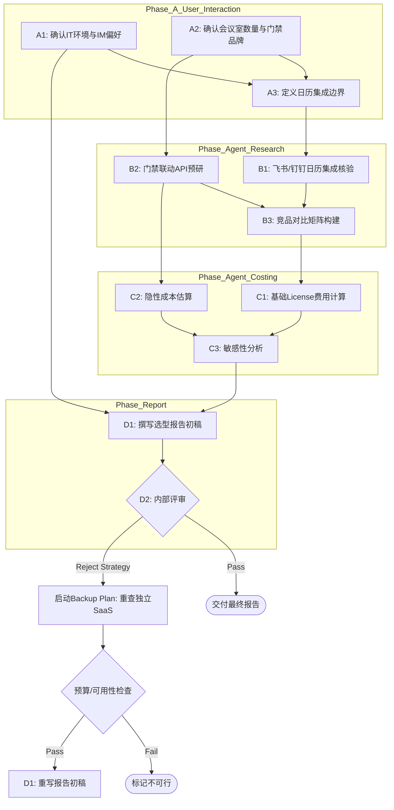

# 阶段 03：具体行动分解 — 会议室预约系统选型

## 1. 执行摘要与前提确认

本阶段基于阶段 01 的目标分解和阶段 02 的证据搜集，将“产出可交付的选型报告”拆解为可执行的原子步骤。

**核心结论预判（基于阶段 02 证据）：**
*   **首选推荐**：飞书 (Feishu) 或 钉钉 (DingTalk)。理由：成本极低（<5k CNY/年），完美覆盖三端及国内网络环境，门禁生态成熟。**关键风险点**：对 Google Calendar (GC) 和 Outlook 的双向同步支持较弱，需通过“统一日历源策略”或“API 二次开发”解决。
*   **备选方案**：腾讯企业微信 + 第三方垂直会议室 SaaS（如简道云/明道云）。适用于团队已深度绑定微信生态的场景。
*   **淘汰方案**：Zoom Rooms、Calendly Team（超预算且定位偏差）、开源自建（隐性人力成本过高且集成难度大）。

**关键假设声明（若以下假设不成立，需触发 Repair Stage 02）：**
1.  团队目前至少在使用其中一种主流 IM（飞书、钉钉或企微），或者愿意迁移至其中之一。若团队强制要求保留独立的 Outlook/GC 作为唯一真源且拒绝使用新 IM 日历，则上述 SaaS 方案均需降级为“高风险”，需重新评估具备原生双向 GC+Outlook 集成的独立工具（如 RoomGuru Cloud, Acuity 等，但需重新验证价格与中国区可用性）。
2.  “门禁联动”为非阻塞项，允许通过 Webhook/API 实现异步对接，不要求毫秒级实时硬件握手。

---

## 2. 详细行动步骤分解

### 阶段 A：内部需求对齐与信息补全 (Owner: User)
*目标：消除 G7, G8 等内部信息空缺，锁定技术约束。*

| ID | 步骤名称 | 输入 | 动作 | 依赖 | 预期产出 | 验收方式 | Owner |
| :--- | :--- | :--- | :--- | :--- | :--- | :--- | :--- |
| **A1** | 确认现有 IT 环境与 IM 偏好 | 阶段 01 中的 G7 空缺 | 询问决策者： 1. 团队目前主要使用的 IM 是哪个？(飞书/钉钉/企微/其他) 2. 是否已有 Azure AD/LDAP 身份源？ 3. 是否有强制的数据不出境合规要求？ | 无 | 《内部环境确认单》 | 明确写出当前 IM 类型；明确是否接受引入新 IM 平台。 | `user` |
| **A2** | 确认会议室数量与门禁品牌 | 阶段 01 中的 G8 空缺 | 询问 IT 管理员： 1. 物理会议室确切数量？ 2. 现有门禁系统品牌及型号？是否开放 API/Webhook？ | 无 | 《硬件资产清单》 | 列出 N 间会议室；列出门禁品牌及接口文档链接（若有）。 | `user` |
| **A3** | 定义“日历集成”的可接受边界 | 阶段 02 中 G2 的核心矛盾 | 与业务负责人确认： 1. 能否接受“以飞书/钉钉日历为主，GC/Outlook 仅单向订阅忙闲”的方案？ 2. 若必须双向同步，是否允许 IT 投入 1-2 人天进行简单的 API 脚本开发？ | A1, A2 | 《集成策略决议》 | 二选一： Path X: 接受单向同步 + 人工协调。 Path Y: 必须双向，接受少量开发成本。 | `user` |

> **并行说明**：A1 和 A2 可以并行执行，A3 依赖于 A1 的结果（因为 IM 选择影响集成策略）。

---

### 阶段 B：候选方案最终验证与 POC 准备 (Owner: Agent)
*目标：针对 A3 确定的路径，对 Top 2 候选进行最后的技术核验。*

| ID | 步骤名称 | 输入 | 动作 | 依赖 | 预期产出 | 验收方式 | Owner |
| :--- | :--- | :--- | :--- | :--- | :--- | :--- | :--- |
| **B1** | 飞书/钉钉 日历集成深度核验 | A3 决议, 阶段 02 证据 C2/D2 | 查阅最新官方文档，确认： 1. 是否支持 ICS 文件导入/导出？ 2. OpenAPI 中是否有 `calendar.events.create` 权限可供外部推送？ 3. 查找社区案例：是否有用户通过 Zapier/n8n 实现过 GC->飞书 的双向同步？ | A3 | 《技术可行性备忘录》 | 明确回答：原生支持程度；若不支持原生双向，提供可行的中间件方案（如 n8n 工作流示例）。 | `agent` |
| **B2** | 门禁联动 API 连通性预研 | A2 硬件清单, 阶段 02 证据 C3/D3 | 根据 A2 提供的门禁品牌： 1. 搜索该品牌是否提供标准 HTTP API。 2. 模拟编写一个伪代码：接收飞书 Webhook -> 解析时间 -> 调用门禁 API 开门。 3. 评估开发难度（低/中/高）。 | A2 | 《门禁对接技术方案》 | 输出伪代码或流程图；标注所需的具体 API Endpoint 和鉴权方式。 | `agent` |
| **B3** | 竞品对比矩阵构建 | 阶段 02 全部证据 | 构建 Excel/Markdown 表格，维度包括： 1. 年度总成本 (TCO) 2. 三端支持度 3. GC/Outlook 集成深度 (原生/插件/无) 4. 门禁扩展性 5. 中国区稳定性 6. 运维复杂度 | B1, B2 | 《选型对比矩阵 v1》 | 包含飞书、钉钉、企微+插件、Zoom(参照) 四列数据。 | `agent` |

> **并行说明**：B1 和 B2 可以并行执行，因为它们分别关注软件层和硬件层。B3 依赖 B1 和 B2 的输出。

---

### 阶段 C：成本建模与敏感性分析 (Owner: Agent)
*目标：生成精确的成本明细，验证预算合规性。*

| ID | 步骤名称 | 输入 | 动作 | 依赖 | 预期产出 | 验收方式 | Owner |
| :--- | :--- | :--- | :--- | :--- | :--- | :--- | :--- |
| **C1** | 基础 License 费用计算 | 阶段 02 证据 C4/D4 | 计算 30 人在不同套餐下的年费： 1. 飞书标准版/专业版 2. 钉钉专业版 3. 企微认证费 + 第三方插件费 | B3 | 《License 成本表》 | 列出每种方案的精确金额区间。 | `agent` |
| **C2** | 隐性成本估算 | B2 门禁方案, 阶段 02 证据 F4 | 计算实施与维护成本： 1. 门禁开发工时 x 时薪 (假设 200 CNY/h) 2. 日历同步中间件维护工时 3. 潜在硬件成本 (iPad for Room Display, 若需要) | B2 | 《TCO 明细表》 | 区分“一次性投入”和“年度经常性支出”。确保总额 ≤ 20,000 CNY。 | `agent` |
| **C3** | 敏感性分析 | C1, C2 | 场景测试： 1. 若会议室增加到 10 间，Per-room 计费方案是否超标？ 2. 若需购买高级安全包，是否超标？ | C1, C2 | 《风险预警注记》 | 在报告中注明：“若房间数 > X 或启用功能 Y，可能超出预算。” | `agent` |

> **依赖关系**：C1-C3 串行执行，C1 是基础，C2 叠加隐性成本，C3 做压力测试。

---

### 阶段 D：报告撰写与评审 (Owner: Agent + User)
*目标：整合所有产出，形成最终交付物。*

| ID | 步骤名称 | 输入 | 动作 | 依赖 | 预期产出 | 验收方式 | Owner |
| :--- | :--- | :--- | :--- | :--- | :--- | :--- | :--- |
| **D1** | 撰写选型报告初稿 | B3, C1-C3, A1-A3 | 按照阶段 01 定义的交付物结构撰写： 1. 执行摘要 2. 推荐方案详情 (含架构图) 3. 备选方案对比 4. 淘汰理由 5. 成本明细表 6. 实施路线图 (含门禁开发步骤) 7. 风险提示 (特别是日历同步风险) | A3, B3, C3 | 《会议室系统选型报告_v1.docx/pdf》 | 文档完整，逻辑自洽，无未决变量。 | `agent` |
| **D2** | 内部评审与修订 | D1 报告, A1-A3 背景 | 提交给决策者和 IT 主管审阅： 1. 确认“统一日历源”策略是否被接受。 2. 确认门禁开发工作量是否在 IT 承受范围内。 3. 根据反馈修改报告。 | D1 | 《会议室系统选型报告_Final.pdf》 | 获得签字或邮件确认批准。 | `user` |

> **关键失败处理**：
> *   **若 D2 中用户拒绝“统一日历源”策略**：
>     *   **替代路径**：启动 Backup Plan。重新调研具备原生 GC+Outlook 双向集成的独立 SaaS（如 RoomGuru, Acuity, 或国内的“智慧空间”类垂直产品）。
>     *   **停止条件**：若重新调研发现所有满足双向集成的产品均超过 2 万预算或无法在中国大陆稳定访问，则标记任务为“不可行”，并建议调整预算或降低集成要求。

---

## 3. 依赖关系图 (Dependency Graph)

**图例说明：**
*   **User 节点 (A1, A2, A3, D2)**：同步阻塞点。Agent 必须等待 User 提供输入才能继续后续依赖步骤。
*   **Agent 节点 (B1-D1)**：离线执行。
*   **Fallback 路径**：仅在 D2 评审失败时触发，属于异常分支。

---

## 4. 关键失败情况与替代路径

| 失败场景 | 触发条件 | 影响范围 | 替代路径 / 停止条件 |
| :--- | :--- | :--- | :--- |
| **F1: 日历集成策略被否决** | 用户在 A3 或 D2 阶段坚持必须原生双向同步 GC+Outlook，且拒绝任何中间件开发。 | 导致飞书/钉钉方案失效。 | **替代路径**：立即转向调研 C1 类别中未被完全排除的独立工具（如 RoomGuru, Acuity Scheduling, 或国内的“易企秀/智慧办公”垂直厂商）。 **停止条件**：若新调研的所有候选项 TCO > 20,000 CNY 或无中国区节点，则任务终止，输出《不可行分析报告》，建议增加预算或妥协集成需求。 |
| **F2: 门禁接口封闭** | A2 发现现有门禁为老旧私有协议，无 HTTP API，且厂商不再提供支持。 | B2 方案失效，门禁联动功能无法实现。 | **替代路径**：将“门禁联动”从需求列表中移除，降级为“未来升级项”。在报告中注明：当前方案不包含自动开门，需人工刷卡。这不影响核心预约功能，因此**不停止任务**。 |
| **F3: 隐性成本超支** | C2/C3 计算发现，加上门禁开发和 iPad 显示终端后，首年 TCO 接近 20,000 CNY 上限，且第二年可能因人员变动或功能升级而超支。 | 预算风险高。 | **替代路径**： 1. 砍掉 iPad 显示终端，改用员工手机 App 查看状态（牺牲部分 UX）。 2. 门禁联动推迟到第二年实施。 3. 选择更低价的钉钉免费版+手动管理（牺牲自动化）。 **停止条件**：若即使砍掉所有可选功能仍超预算，则需用户批准追加预算或更换更低成本的开源方案（但开源方案已被阶段 02 判定为高风险，需重新评估）。 |
| **F4: 团队 IM 迁移阻力大** | A1 发现团队强烈抵触更换 IM（例如全员重度使用微信个人号沟通，不愿安装飞书/钉钉）。 | 飞书/钉钉采纳率极低，系统闲置。 | **替代路径**：转向 C2 类别中的 **企业微信 + 第三方插件** 方案。虽然集成度稍弱，但符合用户习惯。需重新执行 B1-B3 步骤，针对企微生态下的第三方会议室 SaaS 进行调研。 |

---

## 5. 交付物检查清单 (Definition of Done)

在执行完上述步骤后，最终工件应包含以下部分，方可视为完成：

1.  **《选型报告》正文**：
    *   [ ] 明确的推荐方案（单一）。
    *   [ ] 至少 1 个备选方案及其优劣对比。
    *   [ ] 至少 2 个被淘汰的主流方案及其具体淘汰理由（引用阶段 02 证据编号）。
2.  **《成本明细表》**：
    *   [ ] 分项列出 License 费、实施费、硬件费（如有）。
    *   [ ] 明确标注第一年 vs 第二年的成本差异。
    *   [ ] 总结论：Total Cost of Ownership (Year 1) <= 20,000 CNY。
3.  **《实施路线图》**：
    *   [ ] 账号开通流程。
    *   [ ] 日历配置步骤（含 GC/Outlook 订阅指令）。
    *   [ ] 门禁对接开发计划（若适用，含预估工时）。
4.  **《风险评估与缓解措施》**：
    *   [ ] 明确列出日历同步可能的冲突风险及人工介入机制。
    *   [ ] 明确列出数据合规性说明。

**Reviewer 质检重点提示：**
*   检查 A3 步骤是否真的由 User 确认了“单向 vs 双向”的策略，这是整个方案成立的关键逻辑支点。
*   检查 B2 步骤的门禁 API 预研是否基于 A2 提供的真实硬件信息，而非泛泛而谈。
*   检查 C2 步骤的隐性成本估算是否包含了“开发人员的时间成本”，而不仅仅是软件许可费。