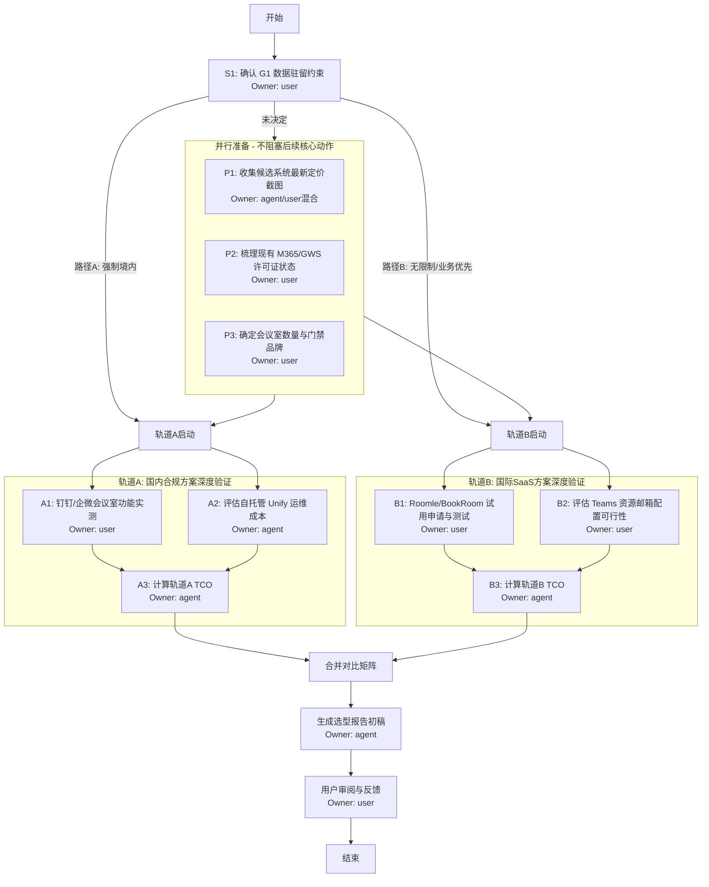

# 阶段 03：具体行动分解

## 1. 执行摘要与前提声明

*   **基于证据的行动**：本计划严格基于阶段 02 产出的《资料搜集与交叉验证报告》。所有步骤仅使用已通过 Reviewer 核验的事实（如钉钉/企微的境内合规性、Roomle/BookRoom 的按房间计费模式、Teams 的资源邮箱特性）。
*   **关键未知处理**：
    *   **G1 (数据驻留)**：由于未获用户最终确认，本计划采用**双轨并行策略**。步骤将分为“轨道 A：国内合规优先”和“轨道 B：国际通用优先”。在用户确认 G1 之前，两条轨道的步骤均标记为 `pending_decision`，但准备工作（如账号注册、文档阅读）可并行执行。
    *   **G3 (精确价格)**：阶段 02 提供了估算区间。本阶段要求在执行中获取**实时报价单**或**官方定价页截图**作为验收标准，若无法获取实时数据，则沿用阶段 02 的保守估算并在报告中明确标注“估算值”。
*   **Owner 类型定义**：
    *   `agent`: 可由 AI 助手离线完成的信息检索、文档整理、表格构建。
    *   `user`: 必须由人类执行的操作，包括登录账户、联系销售、确认内部 IT 环境、最终决策。

---

## 2. 依赖关系图 (Dependency Graph)

**依赖说明**：
1.  **S1 是同步阻塞点**：虽然可以并行做准备工作（P1-P3），但最终的推荐方向必须等待 S1 的结果。如果 S1 未决，报告将包含两套推荐方案供用户选择。
2.  **P1-P3 可并行**：这些任务互不依赖，且不需要等待 S1 结果即可开始（因为无论选哪条路，都需要知道价格和现有环境）。
3.  **A/B 轨道内部串行**：先实测/评估，再计算 TCO。
4.  **Merge 是多依赖汇合点**：必须等待 A3 和 B3 都完成后才能进行综合对比。

---

## 3. 详细行动步骤分解

### 阶段 3.1：前置澄清与环境盘点 (Pre-clarification & Environment Audit)

此阶段的目标是消除剩余的关键未知数，为后续验证提供准确输入。

#### Step S1: 确认数据驻留约束 (G1 Resolution)
*   **输入**: 阶段 01 Gap List G1, 公司合规政策文档（若有）。
*   **动作**: 
    1. 询问 IT 安全负责人或法务：“是否强制要求会议室预约数据存储在中华人民共和国境内？”
    2. 若回答“是”，标记 `Track_A_Only = true`。
    3. 若回答“否”或“无明确规定”，标记 `Track_A_And_B = true`。
    4. 若回答“不确定”，标记 `Parallel_Tracks = true`，并继续执行 P1-P3。
*   **依赖**: 无。
*   **预期产出**: 一个布尔标志 `Data_Residency_Strict` (True/False/Unknown)。
*   **验收方式**: 获得明确的文字回复（邮件、IM 截图或口头确认记录）。
*   **Owner**: `user`
*   **替代路径**: 若无法立即获得答案，默认设为 `Unknown`，并在最终报告中同时呈现两套方案。

#### Step P1: 收集候选系统实时定价证据
*   **输入**: 阶段 02 候选池列表 (钉钉, Roomle, BookRoom, Teams, Unify)。
*   **动作**: 
    1. 访问各官网 Pricing 页面，截取 30 人/5 间房规模的对应套餐价格。
    2. 对于未公开价格的（如钉钉专业版具体模块价），记录“需询价”。
    3. 记录当前 USD/CNY 汇率（来源：中国银行外汇牌价或主流财经网站）。
*   **依赖**: 无（可与 S1 并行）。
*   **预期产出**: 一张 Excel 表格，列包含：系统名、币种、单价、计费单位（人/房）、年费总额估算、截图链接。
*   **验收方式**: 表格中每个非零费用项均有对应的截图或官方文档链接支撑。
*   **Owner**: `agent` (主要) + `user` (协助登录/截图)
*   **失败处理**: 若某系统拒绝展示价格，标记为 `Price_Opaque`，在报告中注明“预估区间”。

#### Step P2: 梳理现有 IT 资产与许可证
*   **输入**: 团队 IT 管理员提供的许可证清单。
*   **动作**: 
    1. 确认当前使用的 Microsoft 365 版本（E3/E5/Business Premium?）。
    2. 确认是否已购买 Google Workspace Business Standard/Enterprise。
    3. 确认现有门禁系统的品牌及型号（用于判断兼容性）。
    4. 确认是否有闲置的 Windows Server 或云主机可用于 Unify 部署。
*   **依赖**: 无（可与 S1 并行）。
*   **预期产出**: 《现有 IT 环境清单》，包含 M365 版本、GWS 版本、门禁品牌、可用服务器资源。
*   **验收方式**: 清单完整覆盖 F3.1 (SSO) 和 F1.3 (门禁) 所需信息。
*   **Owner**: `user`
*   **替代路径**: 若无法获取确切版本，假设最常用版本（M365 E3 / GWS Business Standard）并在报告中注明假设。

#### Step P3: 确定物理会议室参数
*   **输入**: 行政部提供的办公室平面图或房间列表。
*   **动作**: 
    1. 统计需要接入预约系统的会议室总数 $N_{rooms}$。
    2. 确认每间会议室预计的最大并发人数。
    3. 确认是否需要访客专用入口或特殊权限。
*   **依赖**: 无（可与 S1 并行）。
*   **预期产出**: 数值 $N_{rooms}$ 和需求描述。
*   **验收方式**: $N_{rooms} \ge 1$ 且逻辑合理（如 30 人团队通常有 2-5 间）。
*   **Owner**: `user`

---

### 阶段 3.2：深度验证执行 (Deep Dive Validation)

根据 S1 的结果，执行相应轨道的步骤。若 S1 为 Unknown，则以下两组步骤**全部并行执行**。

#### 轨道 A：国内合规方案验证 (Track A)

##### Step A1: 钉钉/企业微信会议室功能实测
*   **输入**: P1 中的定价, P2 中的 IDP 信息, P3 中的房间数。
*   **动作**: 
    1. 注册或登录钉钉/企微企业管理员后台。
    2. 创建测试会议室对象，配置日历同步（尝试关联 Outlook/GCal 共享链接）。
    3. 在 macOS/Windows/Web 三端分别测试预订流程。
    4. 检查管理后台是否支持中文界面及批量导入。
    5. 查阅官方文档，确认门禁对接所需的硬件协议（如 MQTT, HTTP API）。
*   **依赖**: P1, P2, P3。
*   **预期产出**: 《钉钉/企微功能测试日志》，包含三端截图、日历同步成功率、门禁对接可行性结论。
*   **验收方式**: 
    *   三端均可成功预订。
    *   日历同步双向可见（或单向可见但符合预期）。
    *   明确写出门禁对接的技术难度等级（低/中/高）。
*   **Owner**: `user`
*   **失败处理**: 若免费额度不足以创建足够多的测试房间，申请临时扩容或使用模拟数据。

##### Step A2: Unify (开源自托管) 技术预研
*   **输入**: P2 中的服务器资源。
*   **动作**: 
    1. 在一台临时 VPS 或本地 Docker 环境中部署 Unify。
    2. 配置 Google Calendar 和 Outlook iCal 订阅。
    3. 测试 Web 端和桌面端（浏览器 PWA）的体验。
    4. 估算日常运维所需时间（备份、更新、故障排查）。
*   **依赖**: P2。
*   **预期产出**: 《Unify 部署与运维评估报告》，包含部署耗时、日均运维工时估算、UI 体验评分。
*   **验收方式**: 系统成功运行，能显示来自两个日历源的会议室占用情况。
*   **Owner**: `agent` (提供部署脚本指导) + `user` (执行部署)
*   **替代路径**: 若团队无人具备 Docker/K8s 技能，直接判定 Unify 方案 `Infeasible`，排除该选项。

##### Step A3: 计算轨道 A TCO
*   **输入**: A1 结论, A2 结论, P1 价格数据。
*   **动作**: 
    1. 汇总钉钉/企微的年费（基础版 vs 专业版）。
    2. 汇总 Unify 的服务器年费 + 人力成本摊销（若计入）。
    3. 对比预算上限 ¥20,000。
*   **依赖**: A1, A2。
*   **预期产出**: 轨道 A 候选方案的 TCO 明细表。
*   **验收方式**: 所有数字之和 ≤ ¥20,000，或有明确的超支说明。
*   **Owner**: `agent`

#### 轨道 B：国际通用方案验证 (Track B)

##### Step B1: Roomle / BookRoom 试用与功能测试
*   **输入**: P1 价格, P3 房间数。
*   **动作**: 
    1. 申请 14 天免费试用账号。
    2. 配置 3-5 个虚拟会议室。
    3. 连接 Google Calendar 和 Outlook.com 账号，测试双向同步延迟和冲突处理。
    4. 下载 macOS/Windows 桌面 Widget（如有），测试其与 Web 端的一致性。
    5. 查阅开发者文档，评估通过 Webhook 实现门禁联动的开发工作量（人天）。
*   **依赖**: P1, P3。
*   **预期产出**: 《Roomle/BookRoom PoC 测试报告》，包含同步稳定性评价、UI 体验评分、门禁开发成本估算。
*   **验收方式**: 
    *   双向同步在 5 分钟内完成。
    *   冲突时有一方收到通知。
    *   给出门禁开发的粗略报价或人天估算。
*   **Owner**: `user`
*   **失败处理**: 若试用期无法覆盖所有测试场景，延长试用或咨询销售获取演示视频。

##### Step B2: Microsoft Teams 资源邮箱配置验证
*   **输入**: P2 中的 M365 版本。
*   **动作**: 
    1. 在 M365 Admin Center 中创建 Resource Mailbox。
    2. 将其添加到 Outlook 和 Teams 会议邀请中。
    3. 测试在 macOS (Outlook for Mac) 和 Windows (Outlook Desktop) 上的预订体验。
    4. 确认是否允许外部访客预订（通常不允许，需验证）。
*   **依赖**: P2。
*   **预期产出**: 《Teams 资源邮箱配置指南与体验评估》。
*   **验收方式**: 能在 Outlook 中成功预订房间，且日历显示正确。
*   **Owner**: `user`
*   **失败处理**: 若 M365 版本不支持 Resource Mailbox，标记该方案 `Infeasible`。

##### Step B3: 计算轨道 B TCO
*   **输入**: B1 结论, B2 结论, P1 价格数据。
*   **动作**: 
    1. 汇总 Roomle/BookRoom 的年费（按房间数 × 月费 × 12）。
    2. 加上潜在的门禁中间件开发费（一次性或年度维护）。
    3. Teams 方案增量成本记为 0（若已有许可）。
    4. 对比预算上限 ¥20,000。
*   **依赖**: B1, B2。
*   **预期产出**: 轨道 B 候选方案的 TCO 明细表。
*   **验收方式**: 所有数字之和 ≤ ¥20,000。
*   **Owner**: `agent`

---

### 阶段 3.3：综合对比与报告生成 (Synthesis & Reporting)

#### Step Merge: 构建综合对比矩阵
*   **输入**: A3 (轨道A TCO), B3 (轨道B TCO), A1/A2/B1/B2 的功能测试结论。
*   **动作**: 
    1. 创建最终对比表格，行=候选系统，列=F1-F5 子因素。
    2. 填入 Pass/Fail 和评分。
    3. 应用否决规则：F1 (功能) 或 F2 (预算) 任一 Fail 则淘汰。
    4. 对剩余候选按 F3-F5 加权排序。
    5. 确定 Top 1 (推荐) 和 Top 2 (备选)。
*   **依赖**: A3, B3。
*   **预期产出**: 《候选系统综合评分矩阵》。
*   **验收方式**: 每个单元格都有依据（引用前序步骤的报告内容）。
*   **Owner**: `agent`

#### Step Report_Draft: 撰写选型报告初稿
*   **输入**: Merge 结果, P1 价格证据, 各步骤测试日志。
*   **动作**: 
    1. **执行摘要**: 一句话推荐结论。
    2. **背景与约束**: 引用阶段 01 的约束条件。
    3. **推荐方案详解**: 
        *   名称、理由、TCO 明细（精确到元）。
        *   实施路线图（第 1 周做什么，第 2 周做什么）。
    4. **备选方案**: 次优选项及其适用场景。
    5. **淘汰理由**: 列出被淘汰的系统及具体违反的条款（如“Calendly 因 F2.1 超预算被淘汰”）。
    6. **风险与缓解**: 
        *   若推荐方案涉及海外 SaaS，注明数据出境风险及缓解措施（如脱敏、不使用敏感信息）。
        *   若推荐方案涉及自托管，注明运维风险。
    7. **附录**: 原始测试截图、定价截图、汇率来源。
*   **依赖**: Merge。
*   **预期产出**: Markdown 格式的《会议室预约系统选型报告 v1.0》。
*   **验收方式**: 报告包含所有阶段 01 定义的组成部分；所有数字有据可查；逻辑自洽。
*   **Owner**: `agent`

#### Step Review: 用户审阅与反馈
*   **输入**: 报告初稿。
*   **动作**: 
    1. 用户阅读报告，重点检查 TCO 是否符合财务预期，功能描述是否准确。
    2. 提出修改意见或确认批准。
*   **依赖**: Report_Draft。
*   **预期产出**: 批准签字或修改意见列表。
*   **验收方式**: 用户明确表示“同意”或提供具体的修订点。
*   **Owner**: `user`

---

## 4. 关键失败情况与替代路径

| 失败场景 | 影响步骤 | 替代路径 / 停止条件 |
| :--- | :--- | :--- |
| **G1 无法确认** | S1 | **不停止**。继续执行 P1-P3 及 A/B 轨道所有步骤。在最终报告中提供“