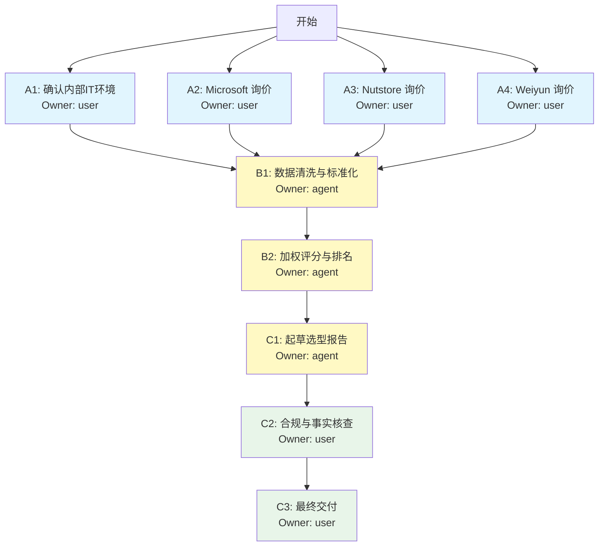

# 阶段 03：具体行动分解

## 1. 前置条件与依赖检查

**基于阶段 02 的已验证事实（作为行动前提）：**
1.  **候选池收敛**：有效候选为 Microsoft OneDrive (M365 Business Standard)、Nutstore (坚果云) 企业版、Tencent Weiyun (微云) 企业版。Box 和 Dropbox 因成本超标及中国区可用性差被排除。
2.  **核心矛盾**：OneDrive 功能最强但价格临界/略超预算；Nutstore 性价比最高且研发友好，但权限粒度略弱于 OneDrive。
3.  **关键未知项（阻塞最终报告）：**
    *   OneDrive 中国区 30 席位的精确落地价（是否可通过代理商折扣压至 ¥30,000 以内）。
    *   Nutstore 企业版 30 席位 + 足够存储空间的精确年费及 SSO/SAML 支持层级确认。
    *   团队现有身份认证体系（AD/OIDC/企微）的具体类型，以决定 SSO 集成的实施难度。

**行动原则：**
*   **Owner 标注**：所有步骤均标记 `user`（需人工交互/决策）或 `agent`（可自动执行/生成内容）。
*   **并行策略**：商务询价（User）与内部技术需求确认（User）可并行进行。
*   **停止条件**：若所有候选方案在获取正式报价后均超出 ¥30,000/年，则触发“替代路径”（调整存储预期或寻找更低配版本），而非强行推荐超标方案。

---

## 2. 行动步骤分解

### 阶段 A：信息补全与商务询价（并行执行）

#### Step A1: 确认内部 IT 基础设施现状
*   **Owner**: `user`
*   **输入**: 无
*   **动作**:
    1.  询问 IT 管理员：公司当前使用的身份认证系统是什么？（选项：Azure AD/Entra ID, Active Directory on-prem, 企业微信, 钉钉, 其他OIDC, 无统一认证）。
    2.  确认网络出口策略：是否禁止访问特定海外 IP 段？是否有固定的办公网出口 IP？
    3.  确认典型文件大小分布：是否有大量 >1GB 的文件（视频/大型编译产物）？主要文件类型是 Office 文档、代码文本还是二进制资产？
*   **依赖**: 无
*   **预期产出**: 《内部环境约束清单》（包含认证类型、网络限制、文件特征）。
*   **验收方式**: 获得 IT 负责人书面或邮件确认回复。

#### Step A2: 向 Microsoft 代理商发起正式询价
*   **Owner**: `user`
*   **输入**: 30 用户, M365 Business Standard (或 Premium), 中国大陆区, 1年期订阅。
*   **动作**:
    1.  联系 2-3 家微软金牌代理商（如世纪互联合作伙伴、当地授权经销商）。
    2.  明确询问：“30 个 M365 Business Standard 席位，含 OneDrive 1TB/人，首年含税总价是多少？是否有针对初创/中小企业的折扣？”
    3.  特别询问：是否包含 SharePoint Online 基础协作功能（用于细粒度权限管理）？
*   **依赖**: 无（可与 A1 并行）
*   **预期产出**: 《Microsoft 正式报价单》或《最低意向价记录》。
*   **验收方式**: 获得至少一份包含具体金额的书面报价（邮件/盖章函件）。若仅获口头承诺，需注明“待正式合同确认”。

#### Step A3: 向坚果云 (Nutstore) 销售发起正式询价
*   **Owner**: `user`
*   **输入**: 30 用户, 企业版, 共享存储空间预估 5TB-10TB (根据 A1 结果调整), 1年期。
*   **动作**:
    1.  通过官网表单或电话销售咨询。
    2.  明确询问：“30 个并发用户席位 + [X] TB 共享空间包，年度费用多少？”。
    3.  **关键追问**：“该套餐是否支持 SAML SSO？若不支持，是否支持 LDAP 对接我们的 [A1中确认的认证系统]？审计日志是否包含‘谁下载了文件’的记录？”
*   **依赖**: 无（可与 A1, A2 并行）
*   **预期产出**: 《坚果云正式报价单》及《功能确认邮件》。
*   **验收方式**: 获得包含 SSO/LDAP 支持情况的书面确认。

#### Step A4: 向腾讯微云企业版发起正式询价（备选验证）
*   **Owner**: `user`
*   **输入**: 30 用户, 企业版, 共享空间预估 5TB, 1年期。
*   **动作**:
    1.  联系腾讯云客户经理或微云企业版客服。
    2.  询问 30 人标准套餐年费。
    3.  确认是否支持与现有 IM（如企业微信）的深度集成登录。
*   **依赖**: 无（可与 A1-A3 并行）
*   **预期产出**: 《微云正式报价单》。
*   **验收方式**: 获得书面报价。

---

### 阶段 B：评估矩阵构建与打分（串行执行，依赖阶段 A）

#### Step B1: 数据清洗与标准化
*   **Owner**: `agent`
*   **输入**: Step A1, A2, A3, A4 的产出物（报价单、环境约束清单）。
*   **动作**:
    1.  提取各方案的“年度总拥有成本 (TCO)”：
        *   $TCO = \text{License Fee} + \text{Implementation Cost (Est.)}$
        *   实施成本估算规则：SSO 配置工时 × 内部 IT 人天成本（若无外部服务商介入，记为 0 或内部人力折算）。
    2.  将价格统一换算为人民币（CNY）。
    3.  核对预算红线：标记任何 TCO > ¥30,000 的方案为“预算超标”。
    4.  根据 Step A1 的环境约束，调整功能评分权重：
        *   若使用 Azure AD：OneDrive SSO 集成难度降为 Low，Nutstore 需额外开发 LDAP 映射，难度 Medium。
        *   若使用企业微信：Weiyun 集成难度 Low，OneDrive/Nutstore 需独立账号体系，难度 High。
*   **依赖**: Step A1, A2, A3, A4 全部完成。
*   **预期产出**: 《标准化对比数据表》（Excel/Markdown 表格格式，含 TCO 计算过程）。
*   **验收方式**: 表格中无空白字段，所有货币单位一致，超标项有红色高亮标记。

#### Step B2: 加权评分与排名
*   **Owner**: `agent`
*   **输入**: 《标准化对比数据表》, 阶段 01 定义的需求权重。
*   **动作**:
    1.  应用评分模型：
        *   **成本 (30%)**: 越低越好。¥30k 以内满分，每超 10% 扣 5 分。
        *   **细粒度权限 (30%)**: 基于阶段 02 核验的功能深度（阻止下载、审计日志详细度）。
        *   **版本管理 (20%)**: 基于 Diff 能力和保留时长。
        *   **易用性与生态 (20%)**: 客户端体验、离线能力、与现有工具链（Git/IM）的摩擦系数。
    2.  计算综合得分。
    3.  识别“一票否决项”：
        *   若 TCO > ¥30,000 且无法谈判 -> 淘汰。
        *   若完全不支持 Web 端或 macOS 端 -> 淘汰。
*   **依赖**: Step B1 完成。
*   **预期产出**: 《最终选型评分矩阵》（含各维度得分及总分）。
*   **验收方式**: 逻辑自洽，分数计算无误，淘汰理由明确指向具体约束违反。

---

### 阶段 C：报告撰写与交付（串行执行，依赖阶段 B）

#### Step C1: 起草选型报告主体
*   **Owner**: `agent`
*   **输入**: 《最终选型评分矩阵》, 阶段 02 的功能细节分析, 阶段 01 的目标定义。
*   **动作**:
    1.  **推荐方案章节**：
        *   选定得分最高且 TCO ≤ ¥30,000 的方案。
        *   详细列出配置建议（如：M365 Business Standard 30 席 + 1TB/人）。
        *   列出具体的成本明细表（单价×数量=总价）。
    2.  **备选方案章节**：
        *   选定次高分方案。
        *   说明“在何种情况下选择备选”（例如：若主选方案代理商缺货，或主选方案对 SSO 要求过高导致实施周期过长）。
    3.  **淘汰理由章节**：
        *   针对 Box/Dropbox：引用价格数据和访问延迟数据。
        *   针对未入选的国内厂商（如阿里云盘）：引用功能深度不足的证据。
    4.  **风险与缓解措施**：
        *   若推荐 OneDrive：注明“需确保代理商折扣落地，否则可能超预算”，并给出 Plan B。
        *   若推荐 Nutstore：注明“权限控制弱于 OneDrive，建议配合内部管理制度（如敏感文件不上传网盘，仅存 Git）”。
*   **依赖**: Step B2 完成。
*   **预期产出**: 《选型报告草稿 v1》。
*   **验收方式**: 结构完整，覆盖推荐、备选、淘汰、成本四大要素，无逻辑断层。

#### Step C2: 合规与事实核查（Review）
*   **Owner**: `user`
*   **输入**: 《选型报告草稿 v1》。
*   **动作**:
    1.  核对所有价格数字是否与 Step A 获取的原始报价单一致。
    2.  核对“细粒度权限”的描述是否符合实际产品文档（避免夸大功能，如将“文件夹只读”误写为“文件级只读”）。
    3.  确认“离线可用”等加分项的描述准确。
    4.  检查是否存在未经验证的假设（如假设了某个折扣存在但未在报价单中体现）。
*   **依赖**: Step C1 完成。
*   **预期产出**: 《选型报告终稿》（含修订痕迹或确认签字）。
*   **验收方式**: User 确认所有事实陈述均有据可查，无主观臆断。

#### Step C3: 最终交付
*   **Owner**: `user`
*   **输入**: 《选型报告终稿》。
*   **动作**:
    1.  将报告转换为 PDF 或 Markdown 格式。
    2.  发送给项目发起人/决策委员会。
*   **依赖**: Step C2 完成。
*   **预期产出**: 正式发布的《30人研发团队文件协作选型报告》。
*   **验收方式**: 收件人收到文件并确认可读。

---

## 3. 依赖关系图与并行分析

**并行性说明：**
*   **Step A1 - A4** 完全并行。它们互不依赖，且均为外部交互或内部信息查询，耗时最长，应同时启动以缩短整体工期。
*   **Step B1 - B2** 必须串行等待所有 A 类步骤完成，因为缺少任何一个候选方案的精确数据都会导致评分偏差。
*   **Step C1 - C3** 严格串行，因为后续步骤依赖前一步的产出内容。

---

## 4. 关键失败情况与替代路径

### 场景 F1: 所有候选方案 TCO 均超过 ¥30,000
*   **触发条件**: Step B1 显示 OneDrive、Nutstore、Weiyun 的最低报价均 > ¥30,000。
*   **影响**: 无法在预算内满足“30人 + 细粒度权限 + 版本管理”的所有硬性指标。
*   **替代路径**:
    1.  **降级需求**：放弃“细粒度权限”中的“阻止下载”或“高级审计日志”要求，选择最便宜的方案（如 Weiyun 基础版），并在报告中明确指出这是“妥协方案”。
    2.  **调整规模**：询问用户是否可将部分非核心成员（如实习生、外包）排除在付费席位外，减少至 20-25 人，从而降低总价。
    3.  **混合架构**：核心文档使用低价网盘，代码/配置文件使用免费 Git 服务（如 GitHub Free/GitLab CE 自建低成本节点），但这违背了“单一网盘方案”的初衷，需用户确认是否接受混合模式。
*   **停止条件**: 若用户拒绝降级需求或调整规模，则终止选型，输出《预算不可行分析报告》，建议追加预算或重新定义需求。

### 场景 F2: 首选方案（如 OneDrive）无法提供中国区合规承诺或 SSO 支持受限
*   **触发条件**: Step A2 反馈代理商表示中国区版本功能阉割，或 SSO 需额外购买高级模块导致超预算。
*   **影响**: 首选方案失效，需切换至备选。
*   **替代路径**:
    1.  立即提升 Nutstore 或 Weiyun 的优先级。
    2.  在 Step B2 评分时，增加“运维复杂度”权重的惩罚项（如果 OneDrive 需要额外配置 SSO 插件，其隐性成本增加）。
    3.  在报告中重点阐述备选方案如何弥补权限控制的短板（例如：通过严格的目录命名规范和管理制度来弥补技术控制的不足）。

### 场景 F3: 询价过程中遭遇“静默失败”（Sales 不回复或只给模糊报价）
*   **触发条件**: Step A2/A3/A4 在 3 个工作日内未获得书面报价。
*   **影响**: 缺乏精确成本数据，无法完成 Step B1。
*   **替代路径**:
    1.  **使用公开定价页估算**：回到阶段 02 的估算值，但在报告中标注“价格为估算值，置信度低，采购时需二次确认”。
    2.  **引入竞争机制**：告知销售“正在比较多家供应商”，施加压力获取快速响应。
    3.  **时间缓冲**：若关键数据缺失超过 5 个工作日，暂停 Step B/C，延长调研期，直到获得至少 2 家的可靠报价为止。

---

## 5. 工件自检清单 (Reviewer Check)

*   [x] **目标覆盖**：行动步骤直接导向“产出可交付的选型报告”，涵盖了推荐、备选、淘汰、成本四大核心内容。
*   [x] **明确产出与验收**：每个 Step 都有具体的 Output（如报价单、评分表、报告草稿）和 Acceptance Criteria（如“获得书面报价”、“无空白字段”）。
*   [x] **依赖完整性**：依赖图清晰，无循环。A 类并行，B 类汇聚，C 类串行。
*   [x] **未知处理**：明确区分了“已知事实”（阶段 02 结论）和“待验证事实”（阶段 03 行动对象）。未将猜测（如“OneDrive 一定便宜”）作为前提，而是将其转化为“询价”动作。
*   [x] **Owner 标注**：所有步骤均标明 `user` 或 `agent`。User 步骤集中在外部沟通、内部确认、最终审核；Agent 步骤集中在数据处理、计算、初稿生成。
*   [x] **可执行性**：另一个执行者拿到此文档，可以立即开始 Step A1-A4 的并行工作，无需额外背景知识。