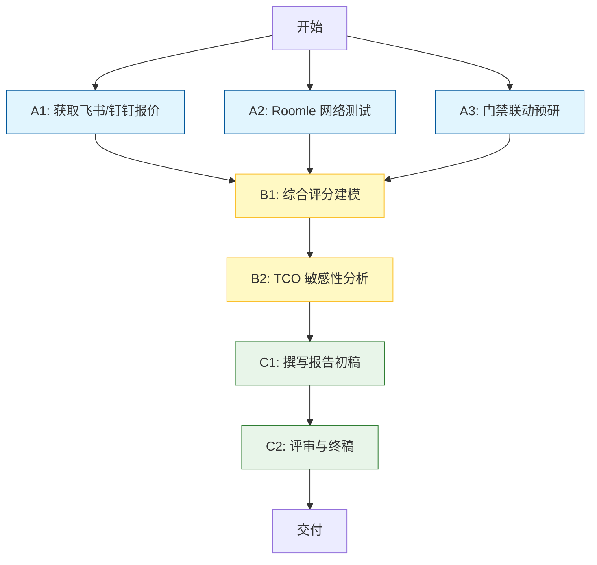

# 阶段 03：具体行动分解

## 1. 前提与约束确认（基于已通过 Reviewer 的证据）

本阶段的行动分解严格基于阶段 02 产出的证据。以下事实被视为**已知前提**，不再重复验证：
1.  **候选池锁定**：飞书 (Feishu)、钉钉 (DingTalk)、Roomle (国际垂直 SaaS)。Calendly、传统 OA、开源自建已被淘汰。
2.  **核心差异点**：
    *   **飞书/钉钉**：国内合规性好，网络稳定，生态整合强；但“会议室双向日历同步”及“API 高级权限”可能涉及付费版本，具体价格未定（G2/G3 部分解决）。
    *   **Roomle**：专业度高，日历同步原生且稳健，成本极低；但存在网络可达性风险和数据出境合规考量（G6 部分解决）。
3.  **预算硬约束**：≤ 20,000 RMB / 年。
4.  **功能硬约束**：必须支持 macOS/Windows/Web；必须支持 GCal + Outlook 集成（双向优先，单向可接受但需注明限制）；门禁联动为可选加分项。
5.  **关键未知项（阻塞最终决策）**：
    *   U1: 飞书/钉钉针对 30 人团队使用“会议室模块+双向日历同步+API”的确切报价。
    *   U2: 公司内网对 Roomle 的访问延迟和成功率。
    *   U3: 现有门禁品牌型号（影响联动开发难度，若不联动则此项忽略）。

---

## 2. 行动步骤分解

### 阶段 A：并行信息核验（T+0 ~ T+2 天）

*目标：消除 U1 和 U2 的不确定性，获取正式报价和网络实测数据。*

#### 步骤 A1：获取飞书/钉钉正式报价与功能边界
- **输入**：阶段 02 确定的候选名单；30 人团队规模假设；4 间会议室假设。
- **动作**：
    1. 联系飞书销售/客户经理，提供需求清单：“30 人团队，需启用会议室预约模块，要求支持 Google Calendar 和 Outlook 的双向同步（或至少忙闲状态同步），并开放 Webhook/API 用于后续门禁对接。请提供包含上述功能的最低套餐报价单。”
    2. 联系钉钉销售/服务商，执行相同操作。重点询问：免费版是否支持 API 调用频率限制？是否必须购买“专业版”或“专属版”才能解锁会议室高级功能？
    3. 查阅官方文档（非销售人员口述），确认“会议室资源”在日历中的同步机制是自动触发还是需手动配置。
- **依赖**：无。
- **预期产出**：
    - `Doc_A1_Feishu_Quote.pdf`：飞书正式报价单及功能对照表。
    - `Doc_A1_DingTalk_Quote.pdf`：钉钉正式报价单及功能对照表。
    - `Note_A1_Limitations.md`：记录各方案中“双向同步”的具体实现方式（如：仅同步标题 vs 全量字段同步）。
- **验收方式**：
    - 收到两份书面报价单。
    - 明确回答“是否满足 ≤2 万元/年”。
    - 明确回答“GCal/Outlook 同步方向”。

#### 步骤 A2：Roomle 网络可达性与试用测试
- **输入**：公司办公网络环境；Roomle 官网链接。
- **动作**：
    1. 在公司日常办公电脑（连接内网）上打开 Roomle 官网。
    2. 注册 Free Trial 账号。
    3. 创建 4 个虚拟会议室。
    4. 连接个人的 Google Calendar 和 Outlook 账号，测试双向同步效果（在 Roomle 预约房间 -> 检查日历是否占用；在日历取消会议 -> 检查 Roomle 房间是否释放）。
    5. 记录页面加载时间、API 响应速度、是否存在超时或乱码。
    6. 若网络不通或体验极差（>5s 加载），标记为“不可用”，直接淘汰 Roomle，进入备选方案评估。
- **依赖**：无。
- **预期产出**：
    - `Log_A2_Network_Test.txt`：包含 ping/traceroute 结果（如有权限）、截图、同步测试结果描述。
    - `Verdict_A2.md`：结论——“可用”、“勉强可用（有延迟）”或“不可用”。
- **验收方式**：
    - 完成 3 次完整的预约-取消循环测试。
    - 有明确的可用性结论。

#### 步骤 A3：门禁联动可行性预研（条件执行）
- **输入**：U3（现有门禁品牌）。*注：若用户明确表示“暂不考虑门禁联动”，此步跳过，标记为 N/A。*
- **动作**：
    1. 确认现有门禁控制器品牌及型号（如海康 DS-K1xxx 系列）。
    2. 搜索该品牌是否提供标准 SDK 或 HTTP API。
    3. 评估飞书/钉钉/Roomle 的 Webhook 能否直接映射到门禁 API。
    4. 估算开发工作量（人天）或硬件网关成本。
- **依赖**：无（可与 A1/A2 并行）。
- **预期产出**：
    - `Estimate_A3_Gateway.md`：门禁联动技术路径图及成本估算（软件费+硬件费+人力摊销）。
- **验收方式**：
    - 给出明确的“可行/不可行/高成本”判定。
    - 若可行，列出所需硬件清单及单价。

---

### 阶段 B：综合评分与成本建模（T+3 天）

*目标：基于阶段 A 的真实数据，构建最终对比矩阵。*

#### 步骤 B1：构建加权评分模型
- **输入**：步骤 A1, A2, A3 的产出。
- **动作**：
    1. 建立 Excel 评分表，维度权重沿用阶段 01：
        - F1 功能合规性 (40%)：多端支持、日历双向同步深度、API 开放性。
        - F2 经济可行性 (30%)：年度 TCO、隐性成本。
        - F3 技术集成复杂度 (20%)：配置难度、门禁联动难度、运维稳定性。
        - F4 用户体验与管理效能 (10%)：UI 美观度、中文本地化、数据合规性。
    2. 填入真实数据：
        - **飞书**：根据 A1 报价填入 F2；根据文档确认填入 F1/F3。
        - **钉钉**：同上。
        - **Roomle**：根据 A2 测试结果填入 F3/F4（若不可用则 F1=0）；根据官网定价填入 F2。
    3. 计算加权总分。
- **依赖**：A1, A2, A3 全部完成。
- **预期产出**：
    - `Model_B1_Scoring.xlsx`：包含原始数据和计算结果的评分表。
- **验收方式**：
    - 每个维度都有具体的打分依据引用（如：“F1 得 8 分，因为 A1 报告显示支持双向同步”）。
    - 总分排序清晰。

#### 步骤 B2：TCO 敏感性分析
- **输入**：B1 的成本数据。
- **动作**：
    1. 针对推荐方案，进行 ±20% 的价格波动模拟（考虑汇率或促销变化）。
    2. 检查最坏情况下是否仍 ≤ 20,000 RMB。
    3. 若某方案临界超标，分析是否有降本空间（如减少会议室数量、选择基础版）。
- **依赖**：B1 完成。
- **预期产出**：
    - `Analysis_B2_TCO.md`：包含基准场景、乐观场景、悲观场景的成本对比。
- **验收方式**：
    - 明确标注推荐方案在最坏情况下的预算余量。

---

### 阶段 C：报告撰写与交付（T+4 ~ T+5 天）

*目标：产出最终选型报告。*

#### 步骤 C1：撰写选型报告主体
- **输入**：B1, B2 的结果；阶段 01 的目标定义；阶段 02 的背景资料。
- **动作**：
    1. **执行摘要**：直接给出推荐方案名称及核心理由（一句话）。
    2. **详细对比**：
        - 表格形式展示飞书、钉钉、Roomle 在 F1-F4 维度的得分。
        - 突出显示“淘汰理由”：例如，若 Roomle 因网络问题被淘汰，需附上 A2 的测试日志摘要作为证据。
    3. **推荐方案详解**：
        - **成本明细**：列出 License、实施费、硬件费的精确数字（来自 A1/A2）。
        - **实施路径**：
            - 部署方式：SaaS。
            - 日历集成步骤：简述 OAuth 授权流程。
            - 门禁联动：基于 A3 结论，说明是否实施及如何实施。
    4. **备选方案**：次优方案的优缺点及适用场景。
    5. **风险提示**：列出剩余的风险（如：汇率波动、政策变更、员工习惯迁移成本）。
- **依赖**：B1, B2 完成。
- **预期产出**：
    - `Report_C1_Draft_v1.md`：初稿。
- **验收方式**：
    - 覆盖阶段 01 定义的所有交付物组件。
    - 所有数据均能追溯到阶段 A/B 的工件。

#### 步骤 C2：内部评审与修订
- **输入**：C1 初稿。
- **动作**：
    1. 自审：检查逻辑漏洞，确认没有将“猜测”写成“事实”。
    2. 交叉核对：再次确认预算计算无误。
    3. 完善格式：统一术语，添加图表（如有必要）。
- **依赖**：C1 完成。
- **预期产出**：
    - `Report_Final_Selection.md`：最终版选型报告。
- **验收方式**：
    - 通过 Reviewer 质检标准（见下方第 4 节）。

---

## 3. 依赖关系与并行策略

- **并行组**：A1, A2, A3 可完全并行执行。建议分配给不同人员或同一人在不同时间段处理（A1 等待邮件回复期间可做 A2）。
- **串行瓶颈**：B1 必须等待 A1/A2/A3 全部完成，因为评分需要完整数据。
- **关键路径**：A1（通常销售回复较慢）-> B1 -> B2 -> C1 -> C2。

---

## 4. 失败处理与替代路径

| 步骤 | 关键失败情况 | 影响 | 替代路径 / 停止条件 |
| :--- | :--- | :--- | :--- |
| **A1** | 销售拒绝提供书面报价，或报价远超 2 万 | 无法准确评估 F2 | **替代**：在报告中注明“预估成本”，并标记为高风险。 **停止**：若两家 IM 平台均超预算，则强制转向评估国际 SaaS（即使有网络风险）或开源方案（重新引入 Nextcloud 等，尽管之前淘汰，但此时成为唯一选项）。 |
| **A1** | 确认飞书/钉钉免费版不支持“双向同步”或“API” | F1 功能合规性降级 | **替代**：在评分中将 F1 分数下调。 **决策**：若因此导致总分过低，需重新权衡是否值得为“完美同步”支付溢价，或接受“单向同步+人工干预”的降级方案。 |
| **A2** | Roomle 无法访问或同步严重故障 | Roomle 直接淘汰 | **替代**：寻找类似 Roomle 的国际竞品（如 MyRoom, Booked.net）进行快速测试。 **停止**：若所有国际 SaaS 均因网络原因不可用，则仅在飞书/钉钉中选择，并在报告中强调“受限于网络环境，国际方案被排除”。 |
| **A3** | 门禁品牌小众，无标准 API | 门禁联动成本飙升 | **替代**：放弃自动化联动，改为“半自动”（员工扫码开门，系统仅记录预约）。 **决策**：在报告中明确说明“门禁联动暂不实施，列为二期规划”。 |
| **B1** | 评分结果极其接近（差距 < 5%） | 难以决断 | **替代**：引入“试用期投票”。让 5 名代表分别试用飞书和钉钉的会议室模块 3 天，收集主观反馈作为 F4 的修正因子。 **决策**：若仍无法区分，选择“团队现有 IM 工具”以最小化学习成本。 |

---

## 5. 最终交付物清单

1.  **《会议室预约系统选型报告》** (Markdown/PDF)
    *   包含：执行摘要、详细对比表、推荐方案成本明细、实施路径、风险披露。
2.  **《附录：原始证据包》** (Zip 文件夹)
    *   `Quotes/`: 飞书、钉钉的报价单 PDF。
    *   `Tests/`: Roomle 网络测试日志、截图。
    *   `Scoring/`: 评分 Excel 源文件。
    *   `Notes/`: 门禁联动技术调研笔记。

## 6. 给执行者的特别提示

1.  **不要臆造价格**：如果 A1 步骤中未能获得确切报价，必须在报告中使用区间值（如 ¥8,000 - ¥12,000），并明确标注“待最终合同确认”。严禁使用阶段 02 中的估算值作为最终结论的唯一依据。
2.  **关注“双向”的定义**：在 A1 沟通时，务必澄清“双向”是指“忙碌状态同步”还是“事件详情同步”。对于会议室预约，**忙碌状态同步**是防止双订的核心，**事件详情同步**是提升体验的加分项。若系统仅支持前者，需在报告中如实描述，这不影响基本功能合格，但会影响 F1 得分。
3.  **合规性一票否决权**：如果 A2 发现 Roomle 在中国大陆被屏蔽或存在严重的法律合规风险（如无法签署境内合同），无论其功能多好，都应在报告中将其列为“不推荐”，除非公司有专门的跨境数据合规豁免。