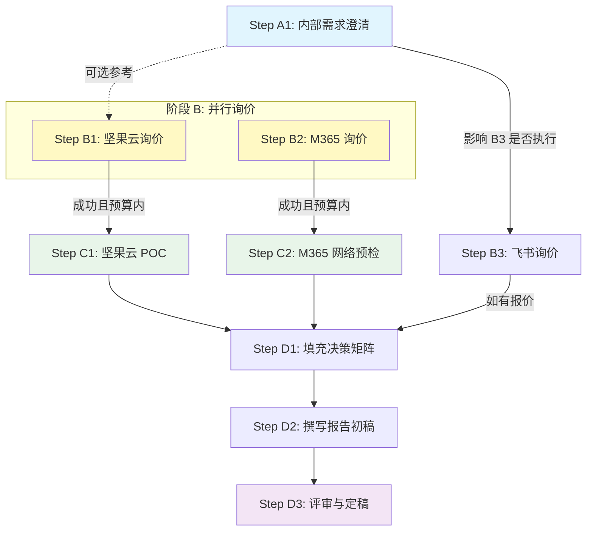

# 阶段 03：具体行动分解

## 1. 执行前提与证据边界声明

**基于已核验证据（来自阶段 02）：**
1.  **预算硬约束**：总年度成本 ≤ ¥30,000。人均上限 ≈ ¥1,000/人/年。
2.  **核心需求**：文档版本管理（P0）、细粒度权限控制（P0）。
3.  **平台要求**：Web + macOS + Windows 客户端必须稳定可用。
4.  **加分项**：离线可用性。
5.  **候选池状态**：
    *   **坚果云企业版**：预估成本 ¥5,400-9,000/年，功能匹配度高，国内网络优。**状态：高置信度候选**。
    *   **Microsoft 365 Business Standard**：预估成本 ~¥32,400/年（可能微超），功能最强，但国内网络存在高风险。**状态：需POC验证的备选**。
    *   **飞书商业版**：预估成本 >¥36,000/年（大概率超预算），定位为OA套件而非纯网盘。**状态：需询价确认是否可砍价至预算内，否则淘汰**。
    *   **Dropbox/Box**：严重超标，直接淘汰。
    *   **阿里云盘/百度网盘**：功能深度不足或体验较差，列为低优先级观察对象。

**关键未知（必须在行动中解决）：**
*   **U1**: 坚果云企业版针对30人团队的确切刊例价及是否有折扣（G1残留）。
*   **U2**: Microsoft 365 中国区代理商针对30人的实际成交价能否压至 ¥30,000以内（G1残留）。
*   **U3**: 坚果云低价套餐中“版本保留时长”的具体数值（是7天、30天还是更长？影响研发追溯需求）（G3残留）。
*   **U4**: 团队当前主要协作载体是“在线文档”还是“本地二进制文件同步”？这决定最终选型偏向（飞书 vs 坚果云/M365）。

---

## 2. 行动步骤分解

### 阶段 A：内部需求澄清与基线确立 (并行)

#### Step A1: 确认团队工作流偏好
*   **输入**：研发团队访谈记录、现有文件类型统计。
*   **动作**：
    1.  发起简短问卷或会议，询问3名核心成员：日常工作中，80%的文件交互是通过“在线编辑文档（Word/Excel/Markdown）”还是“下载-修改-上传二进制文件（PSD/PDF/Code Archive）”？
    2.  确认是否存在大量 >2GB 的文件传输需求。
*   **依赖**：无。
*   **预期产出**：《工作流特征画像》。明确“文档主导”还是“文件同步主导”。
*   **验收方式**：得到明确的比例判断（如：70%在线文档 / 30%文件同步）。
*   **失败处理**：若无法确定，默认按“混合场景”处理，权重向“通用性强”的方案倾斜（即坚果云或M365，排除纯文档导向的飞书）。

#### Step A2: 获取内部审批流程与时限
*   **输入**：公司IT采购政策。
*   **动作**：确认软件采购是否需要走招投标流程，以及决策截止日期的硬性时间窗口。
*   **依赖**：无。
*   **预期产出**：《采购时间表与合规要求》。
*   **验收方式**：明确最晚签约日期。

### 阶段 B：供应商精准询价与条款锁定 (串行/部分并行)

#### Step B1: 坚果云企业版深度询价与SKU确认
*   **输入**：Step A1 的结果（确定所需容量和功能等级）、阶段02识别的缺口 U1, U3。
*   **动作**：
    1.  联系坚果云官方销售或授权代理商。
    2.  **关键提问清单**：
        *   “30人企业版标准套餐的年费是多少？是否有首年优惠？”
        *   “该套餐下，文件历史版本保留多久？是固定30天还是随套餐升级延长？”（解决 U3）
        *   “是否支持对单个文件设置‘仅查看’权限，而父文件夹为‘可编辑’？”（复核 G2）
        *   “macOS 和 Windows 客户端是否支持完全离线的编辑与自动冲突合并？”（复核 G5）
    3.  要求提供书面报价单（Quotation）。
*   **依赖**：A1（可选，用于调整容量需求）。
*   **预期产出**：《坚果云正式报价单》+ 《功能承诺确认函》。
*   **验收方式**：拿到包含确切金额、版本保留天数、权限细节的书面文档。
*   **替代路径**：若官网自助下单价格高于销售报价，以销售报价为准；若销售拒绝明确版本保留天数，标记为“风险项”，在报告中标注“需试用验证”。

#### Step B2: Microsoft 365 中国区代理商询价与网络测试准备
*   **输入**：阶段02识别的缺口 U2。
*   **动作**：
    1.  联系2-3家微软中国区金牌合作伙伴（如神州数码、京东企业购等）。
    2.  **关键提问清单**：
        *   “30席 Microsoft 365 Business Standard 的年付总价是多少？能否控制在 ¥30,000 以内？”
        *   “OneDrive 在中国大陆的访问速度如何？是否有针对企业的加速线路？”
        *   “是否支持自定义 OneDrive 的版本保留策略（例如设置为保留1年）？”
    3.  获取含税发票样例和合同模板。
*   **依赖**：无（可与 B1 并行）。
*   **预期产出**：《M365 代理商报价对比表》。
*   **验收方式**：至少获得一份低于或等于 ¥30,000 的有效报价，或明确得知最低起售价。
*   **停止条件**：若所有代理商报价均 > ¥32,000 且无折扣空间，直接将 M365 从“强力备选”降级为“因预算超标淘汰”，不再进行后续 POC。

#### Step B3: 飞书商业版询价（条件执行）
*   **输入**：Step A1 结果。
*   **动作**：
    *   *条件*：仅当 Step A1 显示团队 >60% 的工作流为“在线文档协作”时执行此步。
    *   *动作*：联系飞书销售，询问30人商业版是否有针对初创/中小团队的特价包，目标价 ≤ ¥30,000/年。
*   **依赖**：A1。
*   **预期产出**：《飞书报价单》或《淘汰理由：价格超标》。
*   **验收方式**：获得确切数字。

### 阶段 C：技术验证与 POC (Proof of Concept) (串行，依赖 B)

#### Step C1: 坚果云小规模 POC (如果 B1 成功且在预算内)
*   **输入**：坚果云测试账号（通常可申请14天免费企业试用）。
*   **动作**：
    1.  邀请5名不同角色的员工（Admin, Editor, Viewer, External Guest）加入测试团队。
    2.  **测试用例执行**：
        *   **权限测试**：创建文件夹A，内部文件B。给User1设A为编辑，B为只读。验证User1能否修改B。（验证细粒度）
        *   **版本测试**：连续修改文件C 5次，检查版本历史列表，尝试恢复到第2版，并查看Diff（如果是文本文件）。（验证版本管理）
        *   **离线测试**：断开网络，在Mac上修改文件D，保存；重新联网，观察同步过程及冲突提示。（验证离线能力）
        *   **性能测试**：上传一个 500MB 的视频文件，记录耗时。
    3.  收集参与者反馈。
*   **依赖**：B1 完成。
*   **预期产出**：《坚果云 POC 测试报告》（含截图证据）。
*   **验收方式**：所有测试用例通过，且用户主观评分 ≥ 4/5。
*   **失败处理**：若权限或版本功能不达标，立即终止推荐，转向备选方案。

#### Step C2: M365 网络连通性预检 (如果 B2 价格在预算内)
*   **输入**：M365 测试租户（代理商通常可提供短期试用或演示环境）。
*   **动作**：
    1.  在公司办公网络环境下，安装 OneDrive 桌面客户端。
    2.  执行“大文件同步压力测试”：上传/下载 1GB 文件，记录平均速度和成功率。
    3.  执行“断网重连测试”：模拟网络波动，观察客户端是否频繁报错或卡死。
*   **依赖**：B2 完成。
*   **预期产出**：《M365 国内网络适应性评估》。
*   **验收方式**：平均上传/下载速度满足团队基本需求（如 > 5MB/s），且无频繁崩溃。
*   **停止条件**：若速度极慢（< 1MB/s）或频繁超时，标记为“国内使用高风险”，在报告中建议“仅作为海外备份节点”或“淘汰”。

### 阶段 D：综合评估与报告撰写 (串行)

#### Step D1: 填充决策矩阵
*   **输入**：Step B/C 的所有产出数据。
*   **动作**：
    1.  将实测价格填入“预算符合度”。
    2.  将 POC 测试结果填入“版本管理”、“权限细粒度”、“多端体验”、“离线能力”。
    3.  计算加权总分。
*   **依赖**：B1, B2, C1, C2。
*   **预期产出**：《最终决策矩阵表》。
*   **验收方式**：所有单元格均有数据或明确的“N/A”及理由，无空白项。

#### Step D2: 撰写选型报告初稿
*   **输入**：决策矩阵、POC 报告、报价单。
*   **动作**：
    1.  **推荐方案**：基于最高分且无重大风险的方案撰写推荐理由。
    2.  **备选方案**：列出第二高分方案，说明其适用场景（如：若未来团队扩大或网络改善，可切换至 M365）。
    3.  **淘汰理由**：
        *   Dropbox/Box：引用 B2/B1 中的价格数据，说明超出预算 X%。
        *   飞书/钉钉：引用 B3 询价结果，说明要么超预算，要么功能定位不符（非专业网盘）。
        *   自托管：引用阶段01推导，说明运维隐性成本不可控。
    4.  **成本明细**：列出推荐方案的单价、人数、总额、税费，证明 ≤ ¥30,000。
*   **依赖**：D1。
*   **预期产出**：《选型报告草稿》。
*   **验收方式**：覆盖阶段01定义的所有交付物字段。

#### Step D3: 内部评审与定稿
*   **输入**：《选型报告草稿》。
*   **动作**：
    1.  提交给 IT 负责人和项目经理评审。
    2.  重点审查：风险评估是否充分？成本计算是否准确？
    3.  根据反馈修改，形成终稿。
*   **依赖**：D2。
*   **预期产出**：《30人研发团队文件协作/网盘选型报告（终稿）》。
*   **验收方式**：获得关键干系人签字或邮件确认。

---

## 3. 依赖关系图与并行策略

**并行说明**：
*   **A1 与 A2** 可并行。
*   **B1 与 B2** 可并行（联系不同供应商互不影响）。
*   **C1 与 C2** 可并行（如果两个方案都进入 POC 阶段，可同时安排测试人员分别测试）。

---

## 4. 关键失败情况与替代路径

| 关键步骤 | 潜在失败情况 | 影响评估 | 替代路径 / 停止条件 |
| :--- | :--- | :--- | :--- |
| **Step B1** | 坚果云报价超过 ¥30,000，或拒绝承诺版本保留时长 | 首选方案失效 | **替代路径**：提升 M365 优先级，启动 Step C2 强化验证。 **停止条件**：若无其他备选，考虑降低需求（如放弃审计日志）以换取更低档位套餐。 |
| **Step B2** | M365 所有渠道报价均 > ¥30,000 | 备选方案因预算失效 | **替代路径**：检查 Microsoft 365 Business Basic 是否满足最低功能需求（通常不满足原生客户端要求，故大概率直接淘汰 M365）。 **结果**：M365 从备选变为“因预算淘汰”。 |
| **Step C1** | POC 中发现坚果云权限粒度不够（如无法单独控制子文件权限） | 核心需求 P0 未满足 | **替代路径**： 1. 若飞书在预算内（Step B3 成功），转为推荐飞书。 2. 若飞书也不符，考虑组合方案：使用 Git 管理代码/文本，使用阿里云盘管理素材（虽非最佳，但满足基础存储）。 **停止条件**：若所有 SaaS 均无法满足“细粒度权限”，需重新评估是否引入私有化部署（尽管阶段01已排除，但若业务强制要求则重启评估）。 |
| **Step C2** | M365 在国内网络环境中频繁掉线，无法正常使用 | 备选方案体验不可用 | **替代路径**：在报告中明确标注 M365 为“高风险备选，仅限有专线/科学上网设施的场景”，不作为常规推荐。 **结果**：M365 降级或淘汰。 |
| **Step D1** | 所有候选方案得分过低，无一达到推荐标准 | 无法给出明确推荐 | **替代路径**： 1. 扩大候选池：考察 Nextcloud 自托管（尽管成本高，但功能可控）或 Synology Drive 私有化。 2. 输出“无单一最优解”报告，列出各方案的短板，交由管理层决策取舍。 |

---

## 5. 交付物检查清单 (Definition of Done)

在执行完上述步骤后，确保最终报告包含以下具体内容，方可视为任务完成：

1.  **明确的首选推荐**：例如，“推荐采用坚果云企业版标准套餐”。
2.  **精确的成本核算表**：
    *   单价：¥XX/人/月
    *   人数：30
    *   年费总计：¥XXXXX
    *   备注：包含/不含税，支付方式。
    *   结论：≤ ¥30,000。
3.  **功能匹配证据**：
    *   引用 POC 测试截图或官方文档链接，证明“版本管理”和“细粒度权限”已验证通过。
4.  **清晰的淘汰逻辑**：
    *   对于每个被淘汰的主流竞品，写出一句话理由（基于预算、功能缺失或网络风险）。
5.  **风险提示**：
    *   明确指出所选方案的主要风险（如：坚果云的版本保留期限制、M365的网络波动风险等）及缓解措施。

**repair_stage**: 03